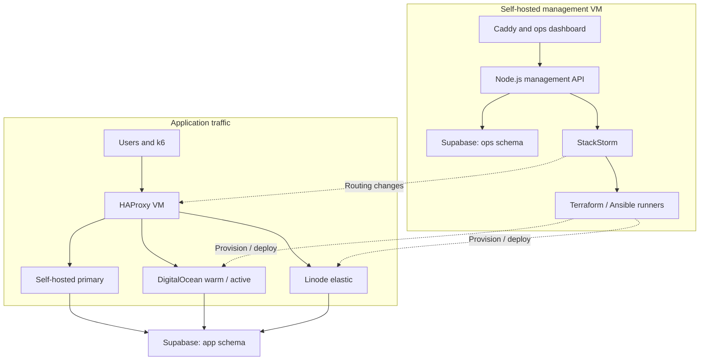

# Complete project documentation and conversation handoff

Design baseline: 22 October 2026. Documentation only; no implementation/deployment has occurred.

Read source headings for individual-file boundaries. The docs folder remains the canonical editable bundle.


---


---


---

# Source: README.md

# collageDRproject — architecture and Claude Code handoff

Cloud-Based Disaster Relief Resource Allocation and Coordination System  
Design baseline: 22 October 2026. Status: architecture documentation; implementation has not started.

## Purpose

Demonstrate cloud compute allocation and digital disaster recovery using a small relief-request application. The system routes traffic to healthy servers, activates existing standby capacity, provisions replacement/overflow VMs, coordinates incidents, and backs up/restores application data.

This is a college demonstration. Infrastructure resources mean compute capacity. Food, water, medicine, and shelter are request categories in the sample app; physical inventory optimization is outside the baseline.

## Project layout

collageDRproject/ is the project root (working directory for the project). This documentation bundle lives in collageDRproject/docs/ and is one part of the project. Path convention: every file path in this README, CLAUDE.md and WORK_PROJECT_START.md is relative to the bundle root collageDRproject/docs/ (so docs/01-requirements-and-decisions.md is collageDRproject/docs/docs/01-requirements-and-decisions.md on disk, and config/ and spec/ sit beside it). Sibling repositories are referred to by name, relative to collageDRproject/. The bundle is the documentation and contract set. Implementation components (relief app, operations dashboard/API, infra with Terraform/Ansible, StackStorm pack) may live in separate repositories as sibling folders alongside it, each with its own build and test commands. Do not assume a single monorepo.

## Start here

1. Read CLAUDE.md for implementation constraints and build order.
2. Read docs/01-requirements-and-decisions.md for confirmed scope.
3. Read docs/02-architecture.md and docs/04-workflows.md.
4. Use config/policy-defaults.json as the initial policy specification.
5. Follow docs/11-build-and-demo-plan.md and its acceptance gates.

## Portable handoff files

- WORK_PROJECT_START.md: prompt and context for a new ChatGPT Work project.
- CLAUDE.md: implementation instructions for Claude Code.
- PROJECT_HANDOFF.md: combined copy of all documentation and contracts.
- docs/14-conversation-record.md: detailed chronological project conversation digest.
- docs/15-runbooks.md: operator runbooks for manual recovery.

The user explicitly requested local workspace output. The collageDRproject folder on the Mac now holds this bundle as `drproj-docs/` next to the `drproj-app/` and `drproj-mgmt/` repositories (docs/11, GitHub repositories).

## Documentation index

| Document | Contents |
|---|---|
| docs/01-requirements-and-decisions.md | Confirmed decisions and resolved alternatives |
| docs/02-architecture.md | Topology, services, traffic paths, ownership |
| docs/03-policies.md | Editable defaults and activation rules |
| docs/04-workflows.md | Scaling, failover, failback, failures, reconciliation |
| docs/05-data-model.md | Schemas, tables, invariants, idempotency |
| docs/06-api-and-events.md | Public APIs, internal events, command contracts |
| docs/07-automation.md | StackStorm, Terraform, Ansible, locking and state |
| docs/08-containers-networking-tls.md | Compose roles, ports, DNS, TLS, persistent storage |
| docs/09-backup-and-restore.md | Daily pg_dump, retention, staged recovery |
| docs/10-monitoring-and-tests.md | Metrics, k6 scenarios, acceptance matrix |
| docs/11-build-and-demo-plan.md | Repository layout, build dependencies, demo script |
| docs/12-boundaries-and-deployment-inputs.md | Accepted limitations and actual deployment inputs |
| docs/13-reference-sources.md | Official technical references |
| docs/14-conversation-record.md | Chronological conversation digest and decisions |
| docs/15-runbooks.md | Operator runbooks: HAProxy VM recovery, orphan adoption, restore |
| config/policy-defaults.json | Initial editable policy values |
| config/deployment-inputs.example.json | Non-secret deployment input template |
| spec/openapi.yaml | API design contract |
| spec/events.schema.json | Internal alert envelope contract |

## Intended location on the developer's Mac

/Users/obedsayyad/Documents/collageDRproject

This bundle was prepared in a remote workspace that cannot access that Mac path. This is a plain folder, not a ZIP: copy the whole collageDRproject directory to /Users/obedsayyad/Documents, so the docs bundle is at /Users/obedsayyad/Documents/collageDRproject/docs and sibling repositories can sit next to it. Do not create a similarly named /Users directory on a Linux host and claim it is the developer's Mac.

## Claude Code starting prompt

Open the project root collageDRproject/ (the folder that contains docs/) in Claude Code and use:

"Read README.md, CLAUDE.md, and the architecture documents. Build this project incrementally according to the accepted design and policy defaults. Start with the application, database migrations, policy model, and local container setup. Keep real infrastructure integrations distinguishable from test adapters. Use reasonable defaults for routine details and ask only for genuinely missing deployment inputs. Do not add login systems, AWS, Kubernetes, VPN setup, or firewall automation. Validate each build phase before continuing. Do not deploy cloud resources until deployment is part of my request."

## Not implemented

This bundle itself contains no application sources (they are in `drproj-app` and `drproj-mgmt`), working Terraform modules, Ansible playbooks, StackStorm packs, live DNS records, credentials, or deployed containers in this bundle. The JSON and OpenAPI files are design specifications, not operational configuration. Planning decisions do not constitute evidence that deployment or tests passed.


---

# Source: WORK_PROJECT_START.md

# Start the next ChatGPT Work project

## Place these files

Working directory: the project root is collageDRproject/ and the documentation bundle is in collageDRproject/docs/. This is a plain folder, not a ZIP. Copy the entire collageDRproject directory (docs/ plus any sibling implementation repositories placed next to it) to:
/Users/obedsayyad/Documents/collageDRproject

Path convention: file paths in this document, README.md and CLAUDE.md are relative to the docs bundle root (collageDRproject/docs/); numbered documents are written as docs/NN-name.md within that bundle.

Create/open the next ChatGPT Work project with that directory and its documentation attached/available. This document does not itself create a ChatGPT project.

## Paste this starting prompt

Read README.md, CLAUDE.md, all docs, config/policy-defaults.json, and the API/event specifications in this folder. These documents capture the completed architecture discussion for my college disaster-recovery demonstration. docs/14-conversation-record.md preserves the detailed project decisions and corrections.

We are using Node.js, Supabase Free, Docker Compose on separate public-IP VMs, StackStorm, Terraform, Ansible, HAProxy, Prometheus/Grafana, and k6. The fixed primary/management/LB/testing VMs are self-hosted. There is one warm application standby, on DigitalOcean by default (or Linode). Elastic cloud application VMs are added one per step, alternating DigitalOcean and Linode. The cloud cap is up to 5 DigitalOcean and up to 5 Linode VMs, counting the standby and provisioning/cleanup-pending resources.

The relief application has no login; dashboard views are public, and mutating ops operations require the shared operator password (Caddy Basic Auth). Do not add Supabase Auth, custom RBAC, firewall setup, VPNs, AWS, Kubernetes, Pulumi, AWX, managed PITR, or Restic. HAProxy handles app traffic only. DNS is Vercel, with app.cproj.obed.one on the LB and management subdomains directly on the management host.

Use the documented editable defaults. Back up application data through daily pg_dump at 00:00 UTC and retain it 30 days (unencrypted, dir 0700 / files 0600 on the management VM). Restore only the app schema, preserving ops records and maintenance controls.

I want to build this with Claude Code. Help me implement it phase by phase from the accepted design. Use reasonable engineering defaults and ask only for genuinely missing deployment facts or meaningful unresolved requirements. Keep your chat responses short. Clearly distinguish documentation, implemented behavior, test adapters, real integrations, and executed validation. Start by inspecting this folder and checking that you understand the documented constraints.

## For Claude Code

CLAUDE.md is the direct implementation handoff. Start with the phase gates in docs/11-build-and-demo-plan.md. Actual deployment inputs remain unset in config/deployment-inputs.example.json. No app code or cloud resources were created during planning.

## First environment information to gather when deployment is requested

Existing VM public IPs and SSH access; cloud account credentials/available regions; Supabase project connections; GitHub repository/registry namespace; storage capacity; ACME contact. Do not request secrets pasted into public documentation or source.

## Current completion status

The architectural plan, decisions, policy defaults, contracts, acceptance criteria, and handoff context are documented. Runtime compatibility, software pins, resource headroom, actual infrastructure creation, DNS edits, certificates, app implementation, migrations and acceptance tests remain to be performed.


---

# Source: CLAUDE.md

# CLAUDE.md

This file provides guidance to Claude Code (claude.ai/code) when working with code in this repository.

# Claude Code implementation brief

## Repository state

`collageDRproject/` is the project folder; it holds `drproj-docs/` (this bundle), `drproj-app/` and `drproj-mgmt/` side by side, and each code repo sees this bundle at `docs/`. This bundle is the documentation and contract set; implementation lives in two code repositories, `obedsayyad/drproj-app` and `obedsayyad/drproj-mgmt`, and this bundle is `obedsayyad/drproj-docs`, included in both as a git submodule at `docs/` (see docs/11-build-and-demo-plan.md, GitHub repositories). All three are public; never commit secrets. The bundle is documentation and contracts only: `docs/` (numbered design docs), `config/` (`policy-defaults.json`, `deployment-inputs.example.json`), `spec/` (`openapi.yaml`, `events.schema.json`), and `PROJECT_HANDOFF.md` (combined copy of all docs; regenerate or edit consistently if source docs change). There is no source code, package manifest, build, lint, or test command in this bundle. Add the real commands (including how to run a single test) here or in each component repository's own CLAUDE.md once it exists. The bundle's `SHA256SUMS` will go stale when files are edited.

## Read order

Read README.md, docs/01-requirements-and-decisions.md, docs/02-architecture.md, docs/03-policies.md, docs/04-workflows.md, and docs/12-boundaries-and-deployment-inputs.md before making architecture changes. Consult the remaining documents for the component being implemented.

The user completed technical planning and intends to implement with Claude Code. This bundle is the agreed starting point. Honor the actual implementation/deployment request in the current session. No implementation has been performed by the planning assistant.

## Non-negotiable user choices

- This is a college demonstration, not a production emergency-response deployment.
- Do not constrain the design to the earlier three-day deadline.
- No AWS.
- Node.js backend; Supabase Free PostgreSQL.
- No custom login, Supabase Auth integration, accounts, or application/dashboard RBAC.
- The relief app has no login. Dashboard views are public; every mutating ops method (POST/PATCH/PUT/DELETE) requires the shared Caddy Basic Auth password and returns 401 without it (T31).
- StackStorm is the automation controller. Node.js provides application/dashboard APIs; it must not become a competing infrastructure controller.
- Terraform provisions and removes elastic cloud VMs. Ansible configures machines and deploys containers.
- Fixed primary, management, load-balancer, and testing VMs are self-hosted and have public IPs.
- Exactly one cloud application VM stays warm, on DigitalOcean (default, `capacity.warm_provider`) or Linode; if the warm provider is unavailable the other provider may host an interim warm standby.
- Cloud APPLICATION VM cap: up to 5 DigitalOcean plus up to 5 Linode (`capacity.max_cloud_vms_per_provider`, each 0..5, immutable ceiling 5), including standby, provisioning, uncertain, and cleanup-pending resources. Supporting self-hosted VMs are excluded.
- Scale out/in one VM per step, alternating providers (`elastic_provider_strategy: alternate`) and skipping a provider at cap or unavailable. One slot per possible VM, each with its own Terraform state keyed by slot.
- Each cloud application VM: 1 vCPU / 1 GB RAM.
- Management VM: 8 vCPU / 16 GB RAM, 62 GB disk (Debian 12).
- HAProxy VM: 1 vCPU / 1 GB RAM.
- k6 testing VM: 4 vCPU / 8 GB RAM (as built, BOOTSTRAP-1).
- Docker/Compose on every VM role; no Kubernetes or cross-cloud cluster.
- No firewall setup or firewall automation. No VPN requirement.
- HAProxy balances only sample-application traffic.
- Management interfaces use the management VM's independent reverse proxy.
- Images: GitHub Container Registry; builds: GitHub Actions.
- DNS: Vercel DNS, under cproj.obed.one.
- app.cproj.obed.one points to the HAProxy VM.
- ops, grafana, stackstorm, and stats subdomains point to the management VM.
- Backups: application-schema pg_dump, daily at 00:00 UTC, retained for 30 days, on persistent management storage; unencrypted at rest (dir 0700, files 0600, management VM only).
- Rate limits: HAProxy per-IP stick-table limits (429) apply to the public; the k6 testing VM's IP is exempt (trusted test-host list), while k6's own caps (200 rps, 600 s) and the app's bounded worker pool still apply. The app applies no per-IP limit to the test host.
- No Restic, managed Supabase backup dependency, or PITR assumption.
- Restores are operator-started; first validate in isolation, then restore app data under maintenance.
- Policies are editable. Initial values are in config/policy-defaults.json.

Internal service/API credentials are still needed for providers, StackStorm, database roles, GHCR, and SSH. No-login means no custom user-authentication feature. Keep machine credentials out of browsers, source, logs, and public API output. Native tools may retain their standard API authentication.

## Implementation style

Use TypeScript (pnpm workspaces in `drproj-app` and `drproj-mgmt`), React/Vite frontends, Node.js/Express APIs, node-postgres with bounded pools, database migrations, and Docker Compose. This is a reasonable implementation default, not a mandate to add unrelated frameworks.

Use one relief API deployment and one management API deployment; separate workers/actions live in the StackStorm execution environment. Use shared validation schemas where useful. Keep business modules separate without creating a microservice per feature.

Start fixed VMs as pre-created machines. Bootstrap using Ansible from the developer workstation. Resolve cloud region, provider size/image IDs, and compatible pinned software versions at deployment time. Do not invent actual IPs, credentials, registry namespaces, or account IDs. Approved exception: the operator records the public IPs of the pre-created fixed VMs in the deployment inputs; credentials are never recorded.

Keep Terraform state persistent and separate by provider/failure boundary and keyed per slot. Do not put a Linode fallback behind a Terraform refresh that requires a failed DigitalOcean API. Never use global terraform destroy for scale-in.

Pin image digests and provider/package versions after compatibility verification. Preserve a previous application image for rollback. Database migrations run once in a controlled job, not on every replica startup.

## Critical invariants

1. Reserve a cloud slot transactionally before provisioning. Keep it occupied until deletion is confirmed.
2. A timeout/unreachable API does not prove a VM does not exist.
3. Reconcile a partial/unknown creation before retrying. Stop and raise an incident if safe fallback cannot preserve the per-provider caps (max 5 DigitalOcean, 5 Linode).
4. Primary failure, overload, retry, reconciliation, standby repair, and failback use the same capacity-control lock (lease 120 s, renewed every 20 s; `assert_lease` before each side-effecting call).
5. Use the ready warm standby for overload before provisioning elastic VMs; add one VM per step, alternating providers.
6. Preserve the single warm standby (either provider) after normal recovery. If necessary, preserve the last healthy cloud serving instance until the standby invariant is restored.
7. Do not scale in during a primary outage just because traffic is low. Never scale in the warm standby; remove one elastic VM per step, newest first.
8. Exclude idle standby/supporting VMs from fleet CPU calculations.
9. Do not restart every application container just because Supabase is unavailable.
10. Missing control state or stale metrics cannot authorize speculative scaling/deletion. Freeze CPU scaling only if a serving member is stale/missing or membership is absent; a member HAProxy confirmed down is removed from membership.
11. Management records, maintenance controls, and restore history are outside the app schema being restored.
12. All application writes, including direct-IP requests and background writes, honor maintenance mode.
13. Only configured project-managed resources are eligible for cleanup.
14. Keep real tests and integrations distinct from simulation. Never present fake metrics or mock provisioning as real provider behavior.

## Concurrency and retries

StackStorm execution history is authoritative for workflow task execution; Supabase stores project-level operation references and projections. Terraform state tracks ownership; provider APIs report actual existence; HAProxy reports applied routing.

Use stable operation IDs, distinct attempt IDs, resource tags, database uniqueness constraints, a capacity-lock lease with fencing generation, and reconciliation. Recheck desired state after waiting for a lock. Jobs delayed by concurrency controls must not execute obsolete intent.

Configure concurrency controls explicitly. StackStorm concurrency policies need supporting coordination configuration; merely installing StackStorm is not an exactly-once or race-free guarantee. A database slot reservation remains required.

Confirmed provisioning defaults: initial checkpoint at 240 s; rechecks at 360 and 480 s; fail at the 480 s deadline if not ready; one retry per provider after confirmed cleanup. Accept early readiness. When both providers exhaust attempts, stop provisioning and raise an incident.

## Policy edits

Validate, persist a pending version, compile affected tool configuration, validate/reload, and verify it before activation. On failure retain/reinstate the previous active version. Alert events carry policy version and timestamp. Running workflows capture a version; capacity reductions are staged until compatible with existing reserved capacity.

Policy edits (like every mutating ops call) require the shared Caddy Basic Auth password, not a user login or accounts. Validate allowed commands and parameters regardless. Do not expose an arbitrary shell or arbitrary Terraform file path in the public API.

## Build gates

Follow docs/11-build-and-demo-plan.md (phases are dependency order):
1. Phase 1: contracts and app data (workspace, app/ops migrations, relief API/UI, idempotency, maintenance admission).
2. Phase 2: management API/dashboard and versioned policy activation.
3. Phase 3: Compose and genuine monitoring on the management VM.
4. Phase 4: StackStorm workflows, leases/slots, local contract tests.
5. Phase 5: real infrastructure (per-slot Terraform states, Ansible roles).
6. Phase 6: HAProxy routing, activation/drain/failover/failback.
7. Phase 7: backups, verification, and staged restore.
8. Phase 8: end-to-end demonstrations and measured evidence.

Run targeted meaningful checks at each gate. Do not write tests that merely mirror constants or repeatedly test unchanged behavior. Ask only for actual missing inputs, substantive unresolved requirements, or authorization outside the current request. The user prefers reasonable defaults over questions about every knob.

## Deliverables expected from implementation

Working source, migrations, validated Compose files, pinned images/tool versions, Terraform modules and persistent state configuration, Ansible roles, StackStorm pack, Prometheus/Alertmanager/Grafana configuration, CI, seeded demo data, k6 tests, runbooks, and actual validation evidence. Keep this documentation updated when implementation resolves an engineering default.

Health checks: `inter 10s fall 3 rise 6` on the primary server line (with `timeout check 4s` in `defaults`/`backend`, never on the server line) (rise 2 on standbys/elastic), `/health/live` only; `/health/ready` never removes a backend. Failback: direct probes of the primary while in maint, weight 0 set before `ready`, then ramp 10% -> 50% -> 100% (observe 60/60/120 s) with gates, reversing on regression. The management VM is assumed always up (accepted risk, docs/12). RTO targets to be measured: HAProxy failover < 40 s, overload relief < 90 s, one elastic VM < 8 min, with one retry < 17 min. Writes during maintenance get 503 + `Retry-After: 60`; restores need a backup verified within 7 days; restore preflight requires `current_db_size + restored_app_size * 1.2 < 450 MB` (Free limit 500 MB), with pg_dump/pg_restore/psql and the restore-test Postgres image pinned to the same major as the Supabase server (`postgres_server_major`).

Do not claim full regional recovery or Supabase-provider failover. Single management/LB VMs and shared Supabase are accepted boundaries described in the docs.


---

# Source: docs/01-requirements-and-decisions.md

# Requirements and accepted decisions

## Project goal

Build a cloud-based disaster relief resource allocation and coordination demonstration. A small emergency-request portal is the protected workload. The platform demonstrates traffic distribution, compute allocation, VM lifecycle automation, recoverable application data, and coordinated recovery.

The demonstrated disaster is a digital infrastructure/application failure. A physical disaster motivates the sample workload; the system does not claim to allocate physical relief inventory optimally.

## Functional requirements

- Create, list, filter, view, and update relief requests.
- Handle food, water, medicine, and shelter categories; positive quantity; location; urgency; Pending/In Progress/Resolved states.
- No user accounts, RBAC or login in the relief application or custom operations dashboard. Dashboard views are public; every mutating ops method (POST/PATCH/PUT/DELETE) requires the shared Caddy Basic Auth password and returns 401 without it (T31).
- Keep app replicas stateless, sharing Supabase.
- Display real instance health, traffic, CPU/memory, provider allocations, workflow steps, backups, incidents, and timestamps.
- Edit policies from the custom dashboard, with validation, version history, and visible activation status.
- Start bounded k6 tests and operator backup/restore operations.
- Use a fixed primary self-hosted VM first.
- Keep exactly one cloud application VM deployed and ready as a warm standby, on DigitalOcean or Linode (default DigitalOcean).
- Activate that standby for overflow and failure.
- Add elastic cloud VMs one per scale step, alternating DigitalOcean and Linode, up to 5 per provider (10 total).
- Provision and deploy using Terraform and Ansible under StackStorm.
- Route only ready app instances through HAProxy.
- Recover failed primary traffic and return it automatically after stable health/capacity verification.
- Create daily application pg_dump files and retain them for 30 days.
- Recover selected application data from a chosen dump through an isolated verification stage.

## Explicit decisions

| Topic | Decision |
|---|---|
| Project time | No time-based design reduction |
| Backend | Node.js |
| Database | Supabase Free PostgreSQL |
| Cloud providers | DigitalOcean and Linode |
| Fixed machines | Primary, management, HAProxy, testing: all self-hosted |
| Public addressing | All VMs have public IPs |
| Infrastructure controller | StackStorm |
| VM provisioning | Terraform |
| VM configuration/deployment | Ansible |
| Containers | Docker/Compose, including management and load-balancer services |
| Public traffic routing | Dedicated single HAProxy VM, application traffic only |
| Monitoring | Prometheus, Alertmanager, Grafana |
| Load generation | Dedicated k6 VM |
| Custom authentication | None, on both custom interfaces |
| Firewall automation | Excluded |
| VPN | Not needed in the selected public-IP design |
| CI/registry | GitHub Actions and GHCR |
| Domain | app.cproj.obed.one and management subdomains |
| DNS provider | Vercel DNS |
| Managed database backups | Do not depend on paid Supabase backups/PITR |
| Backup mechanism | pg_dump / pg_restore only; application schema |
| Backup schedule | Daily 00:00 UTC (05:30 IST) |
| Backup retention | 30 days |
| Backup storage | Persistent management-VM storage |
| Restore trigger | Operator selects a backup and starts recovery |
| Provider exhaustion | Stop automatic provisioning and raise an incident |
| Scaling authorization | Automatic within limits |
| Failback authorization | Automatic after stable observation |

## Exact resource limits

Maximum 5 DigitalOcean plus 5 Linode cloud application VMs (10 total), including the warm standby, starting, draining, and deletion-pending instances (`capacity.max_cloud_vms_per_provider`, each 0..5; 5 per provider is an immutable ceiling). The primary is not a cloud capacity slot. Self-hosted supporting VMs do not consume this limit.

Exactly one warm standby is kept, on DigitalOcean by default (`capacity.warm_provider`); it counts within that provider's cap. If the warm provider is unavailable, the other provider may host an interim warm standby, still counted within its own cap. Elastic VMs are added one per scale step, alternating DigitalOcean and Linode (`capacity.elastic_provider_strategy: alternate`) and skipping a provider that is at its cap or unavailable. Scale-in removes one elastic VM per step, newest first. Each possible VM has its own slot (a warm slot plus elastic slots per provider) with its own Terraform state. Alternate-provider provisioning after confirmed failed-attempt cleanup is permitted within the per-provider caps. When an existing provider resource cannot be accounted for, do not assume spare capacity exists; pending and uncertain resources count toward the cap.

## Engineering defaults delegated to the implementer

The user requested sensible defaults for routine choices. These defaults are editable/reviewable rather than more questionnaire items:
- TypeScript, React/Vite, Express, bounded node-postgres pools.
- Reconciliation every 60 seconds.
- Health checks: interval 10 s, 3 failures to mark down, 6 successes to mark up, 4 s timeout, on `/health/live` only.
- Capacity lease 120 s, renewed every 20 s.
- Provisioning readiness deadline 480 s with checkpoints at 240, 360 and 480 s.
- Scale-out cooldown 60 s after each single-VM step.
- Connection-drain timeout 60 seconds; timeout pauses deletion.
- Incident notifications in dashboard only.
- Prometheus scrape and evaluation every 5 seconds.
- Active-fleet CPU averaged with vCPU weighting.
- One capacity-changing workflow at a time per protected application.
- No automatic backup restores, and no forced termination of live requests at drain timeout.
- Daily backup jobs do not overlap; infrastructure failure handling takes priority over routine scale-in.
- Conservative local concurrency, short initial monitoring retention, and resource measurement for the 8-vCPU/16-GB management host.
- Native tool authentication/machine credentials are retained where required; no custom login workflow is built.
- Restores require a backup verified within the last 7 days (`recovery.require_verified_backup`, `max_verification_age_days`); backups are verified after capture (`backup.verify`).
- Write requests during maintenance get 503 with `Retry-After: 60` (`maintenance.retry_after_seconds`).
- Supabase Free keep-alive `SELECT 1` every 6 hours.

## Accepted assumptions

- The management VM is assumed always available. There are no off-box copies of state or backups; the single management disk holds both (see docs/12).
- Direct-IP access to app VMs is not blocked (accepted risk; maintenance is still enforced in the app).
- Recovery time targets, to be measured rather than assumed: HAProxy failover under 40 s (3 x 10 s checks plus reload); overload relief via the warm standby under 90 s; one elastic VM ready within 8 minutes; with one retry within 17 minutes.

## Superseded ideas

Do not reintroduce a two-VM cloud cap, AWS services, native cloud-specific load balancers as the cross-cloud entry point, a Kubernetes cluster, a VPN, an Ansible/AWX controller, Pulumi, Restic, Supabase Auth, managed PITR assumptions, three-day scope cuts, or HAProxy routing all management traffic. These were discussed but are not the selected baseline.

## Completion criteria

All required scenarios in docs/10-monitoring-and-tests.md have real execution evidence. Service availability, request errors, provisioning duration, failover duration, and restore correctness must be measured; configuration values alone do not prove performance.


---

# Source: docs/02-architecture.md

# Architecture

## Topology

| Machine | Hosting | Size | Main containers |
|---|---|---|---|
| Primary app | Self-hosted | Existing fixed size; use comparable 1-vCPU/1-GB demo capacity where applicable | Relief Node.js app serving its frontend |
| Management | Self-hosted | 8 vCPU / 16 GB (62 GB disk) | Caddy, ops frontend/API, StackStorm/dependencies, execution runners, Prometheus, Alertmanager, Grafana |
| Load balancer | Self-hosted | 1 vCPU / 1 GB | HAProxy, ACME client/challenge helper |
| Testing | Self-hosted | 2 vCPU / 2 GB | k6 execution container |
| Warm standby (1) | DigitalOcean by default; Linode as interim if DigitalOcean is unavailable | 1 vCPU / 1 GB | Same relief application image |
| Elastic VMs (up to 5 DigitalOcean + 5 Linode in total, including the warm standby) | DigitalOcean and Linode, alternating | 1 vCPU / 1 GB each | Same relief application image |

All are separate VM roles with public IPs. Physical host diversity is not assumed. Creating additional containers on one physical host does not add physical capacity or provide physical host failure isolation.

## Application traffic

Users access app.cproj.obed.one. DNS points to the HAProxy host. HAProxy terminates public HTTPS and routes to eligible app backends. Baseline traffic goes to the self-hosted primary only.

The warm standby (DigitalOcean by default) is already running, healthy, and ready but initially does not receive normal traffic. On overload it becomes an active peer. If active capacity is still insufficient after the cooldown, StackStorm adds one elastic VM per step, alternating DigitalOcean and Linode and skipping a provider that is at its cap or unavailable, up to 5 per provider; each step is followed by a 60 s cooldown and a CPU re-evaluation. Scale-in removes one elastic VM per step, newest first, never the warm standby and never during a primary outage. On primary failure, the warm standby immediately becomes eligible for all requests and StackStorm ensures exactly one elastic redundancy VM, on the provider that is not the warm provider (or the other one if that provider is at its cap or unavailable). Any further VMs come only from the normal CPU scale-out rules (one per step, cooldown, re-evaluation).

The app and its frontend are packaged together by default. Its API uses the same hostname and /api path. Client sessions/uploads are not kept on an instance; no login sessions or uploaded files are required in the baseline.

### HAProxy health checks and failback

Primary: `inter 10s fall 3 rise 6` on the server line, with `timeout check 4s` in `defaults`/`backend` (detection about 30 s; 60 s healthy before return). Standbys and elastic VMs use rise 2. HAProxy checks only `/health/live` (no DB, cheap, mounted first); `/health/ready` is for the dashboard, Prometheus and StackStorm admission and never removes a backend, so a Supabase outage does not take backends out. Do not use `observe layer7 on-error mark-down` and never `retry-on 503`.

On primary failure `apply_routing` sets the primary to `maint` through the Runtime API so a recovered primary stays out until failback. Server state is persisted with `server-state-file` and `load-server-state-from-file global`, dumping `show servers state` after every runtime change and before reload. Failback: direct probes while in `maint` (60 s continuous), weight 0 set before `state ready`, HAProxy reports UP (rise 6), then 10% -> 50% -> 100% by weights (observe 60 s, 60 s, 120 s), gated on 2 consecutive health successes, fresh samples, 5xx under 1%, p95 under 1.5x baseline and primary CPU under 50%; any gate failure reverses one step. Because `maint` disables HAProxy checks, recovery is first observed by direct probes of the primary (60 s continuous), and `set weight be_app/primary 0` is applied before `state ready`, so the primary admits no traffic until the ramp.

### HAProxy VM single point of failure

The single HAProxy VM is an accepted failure boundary. Manual recovery steps (short DNS TTL on the app record, config/cert backup, Ansible lb role on another host, `curl --resolve` test, repoint the A record, Let's Encrypt rate limits) are in the runbook in docs/15-runbooks.md.

## Management traffic

ops.cproj.obed.one, grafana.cproj.obed.one, stackstorm.cproj.obed.one, and stats.cproj.obed.one resolve to the management VM.

Caddy serves the custom dashboard/API and proxies native UIs. The stats hostname proxies HAProxy's separate statistics endpoint. It does not send management application traffic through the HAProxy application frontend.

Node.js is an application/API layer. It validates and persists requests, invokes authenticated StackStorm APIs, and projects results. It does not run a second autoscaling loop.

## Execution/data boundaries

- Prometheus: measured time series.
- Alertmanager: routing/grouping of operational alerts.
- StackStorm: event rules, workflow execution, task progress and results.
- Terraform: tracked infrastructure ownership/state.
- Ansible: machine configuration and deployment.
- HAProxy: applied traffic topology and backend checks.
- Supabase app schema: protected business data and app idempotency.
- Supabase ops schema: desired state, policy versions, resource slots, incidents, workflow references, backup catalogue.
- Persistent management volumes: StackStorm native databases, metrics, Terraform state, dump files, certificate/configuration material.
- GHCR: versioned application/runner images.

StackStorm requires its own native supporting databases/services; Supabase does not replace them.

## Independence

HAProxy can fail over among configured ready backends while StackStorm is down. It cannot provision missing machines. The custom dashboard and control API remain separate from app traffic, although Supabase is a shared dependency.

When management control state is unavailable, freeze new capacity mutations requiring slot reservations. Keep existing traffic routing and health checks running. Do not treat stale metrics as zero load; freeze CPU scaling only if a serving member is stale or missing (a member HAProxy has confirmed down is removed from membership instead).

The management VM is assumed always available (accepted assumption, see docs/12). Capacity mutations are serialized by a capacity lock with a 120 s lease renewed every 20 s; with up to 10 slots, expect more Terraform/Ansible runs on the 4 GB management VM, but still only one capacity mutation at a time.

## High-level diagram



## Deployment assumptions

Fixed self-hosted machines are pre-created. Bootstrap those hosts with Ansible from a workstation. Terraform owns only the applicable cloud application resources, with one state/workspace per slot (warm slot plus elastic slots per provider) and never deletion by broad tag search; protect the warm slot and fixed resources from automatic cleanup.

Use separate provider state boundaries to permit Linode actions when DigitalOcean's API is unavailable. Provider-specific modules may use different image IDs, instance size IDs, region identifiers, tagging schemes, and startup details behind one action contract.

One HAProxy and one management host are accepted demo failure boundaries. The baseline is application-compute failover plus app-data recovery, not complete multi-region provider-independent recovery.


---

# Source: docs/03-policies.md

# Editable policies and defaults

config/policy-defaults.json is the seed specification. A validated active policy in Supabase is authoritative after initialization. Do not hardcode dashboard knobs into workflow source.

## Confirmed defaults

| Policy | Value |
|---|---|
| Primary traffic | Self-hosted first |
| Warm provider | DigitalOcean (`capacity.warm_provider`; Linode allowed as interim if DigitalOcean is unavailable) |
| Warm application count | 1 (on either provider) |
| Elastic provider order | Alternate DigitalOcean/Linode (`elastic_provider_strategy: alternate`), skipping a provider at cap or unavailable |
| Cloud application cap | 5 DigitalOcean + 5 Linode (`capacity.max_cloud_vms_per_provider`, each 0..5) |
| Scale step | 1 VM per step (out and in), then cooldown and re-evaluate |
| Scale-out CPU | Above 60% |
| Scale-out sustained period | 30 seconds |
| Scale-in CPU | Below 20% |
| Scale-in sustained period | 120 seconds |
| Scale-out cooldown | 60 seconds after readiness/routing activation of each single-VM step |
| HAProxy health interval | 10 seconds |
| Health check | `/health/live` only, 4 second timeout (`health.timeout_seconds`) |
| Unhealthy threshold | 3 consecutive failed checks (detection about 30 s) |
| Failback observation | 60 continuous seconds healthy by direct probes while in maint (HAProxy checks are off), weight 0 set before `ready`, then capacity-tested gradual return |
| Primary-failure response | Activate the warm standby; ensure exactly one elastic redundancy VM on the non-warm provider (or the other if at cap or unavailable) that shares traffic when ready; further VMs only via normal CPU scale-out (1 per step, cooldown, re-evaluation) |
| Initial readiness checkpoint | 240 seconds |
| Further readiness checkpoints | 360 and 480 seconds |
| Hard readiness deadline | 480 seconds |
| Provisioning retries | 1 per provider after confirmed cleanup |
| Both providers exhausted | Stop provisioning; raise incident |
| Backup | Daily at 00:00 UTC |
| Backup retention | 30 days |
| Backup scope | Application schema/tables and their data |
| Backup verification | Automatic after capture (`backup.verify`, timeout 900 s) |
| Restore | Operator-started from a verified backup no older than 7 days (`recovery.require_verified_backup`, `max_verification_age_days`) |
| Maintenance write rejection | 503, `Retry-After: 60` (`maintenance.retry_after_seconds`) |
| Supabase keep-alive | `SELECT 1` every 6 hours (`runtime.supabase_keepalive_interval_hours`) |

A VM ready before the first checkpoint should be admitted immediately. Checkpoints are maximum waiting/status milestones, not artificial delays. Provisioning deadline covers creation, bootstrap, deployment, and readiness for each attempt. Terraform command success is not readiness.

## Sensible engineering defaults

| Policy | Initial value |
|---|---|
| CPU aggregation | vCPU-weighted active fleet average |
| Metrics scrape/evaluation | 5 seconds / 5 seconds |
| CPU rate calculation window | 30 seconds |
| Stale metric threshold | 30 seconds |
| HAProxy recovery threshold | 6 consecutive successful checks on the primary (60 s healthy); 2 on standby/elastic |
| Reconciliation | Every 60 seconds; also after management restart |
| Drain deadline | 60 seconds; pause deletion and raise incident |
| Alert routing group wait | 0 seconds for automation alerts |
| Alert routing group interval | 5 seconds |
| Alert repeat interval | 60 seconds; duplicate notifications do not duplicate operations |
| Capacity workflow concurrency | 1 per protected application |
| Failback steps | 10%, 50%, 100% primary traffic targets |
| Failback step observation | 60 seconds for the 10% and 50% steps, 120 seconds for the 100% step (`step_observation_seconds`, `final_step_observation_seconds`) |
| Failback ramp weights and baseline | During the ramp the cloud serving lines run at weight 256 (HAProxy's maximum, set before the ramp starts) and the primary's weight for a target share of `s`% is `round(256·s/(100−s))`: 28 for 10%, 256 for 50% (equal weights); the 100% step returns to normal mode (cloud lines back to `warm_act` maint / elastic as scale-in decides) and the primary at its full weight. The baseline for the p95 gate is the median of the application p95 (`relief_http_request_duration_seconds`, 1 m windows) over the 10 minutes ending 1 minute before the failure is recorded (ahead of the detection lag), stored on the open `primary.unhealthy:relief` incident (`ops.incidents.baseline_p95_seconds`, written by `cdr.capture_baseline` with the query in docs/04). Without a stored baseline the p95 gate fails closed |
| Failback step gates | 2 consecutive health successes, samples timestamped after step start, 5xx under 1%, p95 under 1.5x baseline, primary CPU under 50%; any gate failure reverses to the previous step |
| Capacity lease | 120 seconds, renewed every 20 seconds from a separate heartbeat; after 2 missed renewals the worker starts no new side effects |
| Notifications | Dashboard only |
| Monitoring retention | 3 days initially, resource-tested and editable |
| Backup overlap | Disallowed |
| Missed daily backup | Retry once after 60 seconds, then raise incident |
| Restore failure | Remain in maintenance; attempt the pre-restore safety dump rollback once |
| Demonstration load | Manual start; fixed-duration bounded rate; default 10 minutes maximum |
| Rate limits | Public per-IP HAProxy limits (429); the k6 test host IP is exempt from HAProxy and app per-IP limits, while k6's own caps (200 rps, 600 s) and the app's bounded worker pool still apply |
| Individual app DB pool | Maximum 2 connections initially; validate total against actual Supabase limits |

RTO targets (to be measured, not guaranteed): HAProxy failover under 40 s; overload relief via the warm standby under 90 s; one elastic VM ready under 8 minutes; with one retry under 17 minutes.

The 30-second CPU calculation window plus sustained-alert evaluation adds observation time. Never advertise exact 30-second end-to-end scaling. HTTP error failover may also depend on in-flight requests and retry rules.

## CPU semantics

Only traffic-serving, ready application backends contribute to active-fleet CPU. Idle standby and management/LB/testing machines are excluded.

Stale metrics: freeze CPU-based scaling only if a serving member is stale or missing, or the membership list is absent. A member that HAProxy has confirmed down is removed from the membership and does not freeze scale-out. Stale metrics are never treated as zero load. With equal one-core app VMs, a simple average is equivalent to vCPU weighting.

Before removal, project demand onto the remaining eligible capacity. Permit scale-in only when projected remaining utilization stays safely below the scale-out threshold, dependencies are healthy, primary recovery is stable, and redundancy requirements remain satisfied.

CPU is the initial scaling signal. Latency/errors and database health are explanatory/gating signals. Extra app machines cannot repair Supabase overload. Memory saturation raises an incident; do not automatically scale on arbitrary OR combinations of unhealthy dependencies.

## Policy activation

1. Validate typed input, ranges, dependencies, and expected current version.
2. Persist a pending version and audit event.
3. Compile affected Prometheus rules, HAProxy configuration, StackStorm timer/action parameters.
4. Validate generated files; persist configuration artifacts.
5. Apply and reload affected services; verify actual loaded configuration.
6. Activate the version once the required changes succeeded.
7. On failure, restore/reinstate the old configuration, mark failure, and keep the old active version.

Generated alerts contain policy version. Ignore inactive/obsolete notifications as action requests; preserve them as history if useful. Recheck current metrics before acting. Repeated events during a running operation are coalesced.

Running operations capture a policy version. Lowering a VM limit below occupied capacity is a pending transition, not permission to force-delete resources. Do not silently reinterpret in-progress work.

Implemented in P4.4 (local simulation, docs/07 "Resolved engineering defaults (P4.4)"): steps 1-6 for the validated settings and the Prometheus `policy_version` label; the exclusive lease only when a capacity limit changes; a cap lowered below the occupied count activates and reports `pending_transition` per provider (nothing is deleted, new reservations above the cap are refused, scale-in and reconcile converge); a change whose compile target (HAProxy, k6, Prometheus rule thresholds, StackStorm timers) is a later phase fails `not_implemented` and keeps the old version active.

Cron times use UTC. Editing backup frequency changes the StackStorm schedule; editing retention changes cleanup eligibility. Managed Supabase plan settings are not part of this system because pg_dump is selected.

## Validation

CPU scale-in must be lower than scale-out. Durations must be positive. Readiness checkpoints must increase and the last must equal the deadline (240/360/480 by default). Each per-provider cloud cap (`capacity.max_cloud_vms_per_provider.digitalocean` and `.linode`) must be an integer 0..5; values above 5 are rejected (immutable ceiling). Warm slot floor: the cap of `warm_provider` must be at least 1 so the warm standby always has a slot; setting it to 0 is rejected (the interim warm on the other provider is a runtime fallback, not a configuration). `warm_instances` is fixed at 1. `elastic_provider_strategy` must be a supported value (`alternate`). `step_vms` must be 1. Reducing a cap below the actual reserved count (including pending and uncertain resources) waits for safe convergence. Failback weights must increase to 100; `step_observation_seconds` and `final_step_observation_seconds` must be positive. Health thresholds must be 1..10 and `timeout_seconds` must be less than `interval_seconds`. `lease_renewal_seconds` must be well under `lease_seconds` (at most one third). `backup.verify.timeout_seconds` must be positive; `recovery.max_verification_age_days` must be at least 1; `maintenance.retry_after_seconds` must be positive. Enforce bounds on workload duration/rate, SSH targets, provider IDs, image references, and storage paths.


---

# Source: docs/04-workflows.md

# Operational workflows

All mutations use stable operation IDs and per-attempt IDs. Obtain a fenced capacity lease, recheck current desired state, and reserve a slot before creating resources. See docs/07-automation.md for state boundaries.

## Normal state

Primary serves all relief traffic. One warm standby (on `capacity.warm_provider`, default DigitalOcean) runs the same pinned image, passes readiness checks, and is a HAProxy `backup` server. No elastic VMs exist. Up to 5 DigitalOcean and 5 Linode cloud VMs are allowed in total (`capacity.max_cloud_vms_per_provider`); the warm standby counts toward its provider's cap. HAProxy checks only `/health/live`; `/health/ready` never removes a backend.

## Scale-out

1. Receive the above-60%-for-30-seconds candidate alert.
2. Check fresh metrics, dependency health, policy version, cooldown, maintenance, and in-progress work. Freeze CPU scaling only if a serving member's metrics are stale or missing, or membership is absent; a member HAProxy has confirmed down is removed from membership and does not freeze scale-out.
3. If the warm standby is healthy but idle, activate it (routing mode `active`) before creating another VM.
4. Apply/persist HAProxy configuration; verify requests reach the newly active backend.
5. Observe a 60-second cooldown and reevaluate current sustained demand.
6. If demand remains high, choose the provider: alternate DigitalOcean/Linode (`capacity.elastic_provider_strategy: alternate`), skipping a provider that is at its cap (pending and uncertain resources count) or unavailable. If no provider qualifies, stop and raise an incident.
7. Atomically reserve one elastic slot on that provider. Terraform provisions that slot in its own state; Ansible configures Docker and deploys the pinned app.
8. Check readiness, connectivity, instance identity, deployed digest, and schema compatibility.
9. Admit early if ready; otherwise report 240-, 360-, and 480-second checkpoints, failing at 480 seconds.
10. Add the ready backend, verify routing, update observed state, and record elapsed time.
11. Add exactly 1 VM per step. After the 60-second cooldown, re-evaluate CPU before adding another, up to the per-provider caps.

## Primary failure

1. HAProxy checks the primary's `/health/live` every 10 seconds; three consecutive failures (`inter 10s fall 3`, detection about 30 seconds) mark it unhealthy.
2. `apply_routing` puts the primary in maintenance (`set server be_app/primary state maint` via the Runtime API) so a recovered primary stays out until failback. The warm standby becomes `active`. State is persisted with the server-state file and `show servers state` is dumped after each runtime change and before reload.
3. StackStorm receives the incident and records actual observations.
4. The warm standby becomes `active`, and exactly ONE elastic redundancy VM is ensured, on the provider that is not the warm provider (falling back to the other provider if that one is at its cap or unavailable). Any further VMs come only from the normal CPU scale-out rules: 1 per step, 60-second cooldown, re-evaluate CPU. A low-load primary failure therefore never provisions the whole fleet.
5. If an elastic VM already exists or is being created (any reserved or bound elastic slot, whichever operation holds it), reuse/await it rather than duplicate it: no second VM is reserved. A resumed run continues in the slot it already holds.
6. Once ready, the warm standby and elastic VMs share traffic.
7. Continue checking the primary and show the incident/recovery timeline.

No database restoration is triggered solely by a VM failure. HAProxy failover target is under 40 seconds (3 x 10s checks plus reload).

## Automatic failback

HAProxy `maint` disables health checks on that server, so HAProxy cannot observe the primary's recovery while it is in maintenance. StackStorm observes it directly.

1. While the primary is in `maint`, StackStorm probes it directly (management VM to primary port 8443, `/health/live` and `/health/ready`) and requires 60 continuous seconds of healthy probes.
2. Before leaving `maint`, set `set weight be_app/primary 0` and switch to ramp mode (cloud servers non-backup). Weight is set before any traffic is admitted.
3. Set the primary to `ready` (`set server be_app/primary state ready`). HAProxy health checks resume; at weight 0 the primary receives no traffic. Wait for HAProxy to report it UP (`rise 6`, about 60 seconds).
4. Ramp the primary's weight to 10%, 50%, then 100% of its share (weights and the p95 baseline: docs/03), observing 60s, 60s, and 120s respectively. An idle healthy primary alone does not prove spare capacity. Gate each step on: 2 consecutive health successes, samples timestamped after the step started, 5xx rate below 1%, p95 latency below 1.5x baseline, and primary CPU below 50%. Any gate failure reverses to the previous step (and ultimately to healthy cloud backends).
5. Once the primary carries the workload stably, return to normal mode (warm standby back to `backup`).
6. Retain elastic VMs until scale-in rules and remaining-capacity checks allow safe removal.
7. Resolve the incident only after service verification, not merely primary boot.

### Real routing adapter: modes, ramp and gates (P6.2)

`cdr.apply_routing` drives HAProxy through the Runtime API (docs/07, docs/08) when `adapter_mode` is `real`. Modes act on the `be_app` server lines; commands that would change nothing are not sent, and `ready`/weight changes precede `maint`/`drain`:

| Mode | Lines |
|---|---|
| `normal` | `primary` `ready`, weight 256; `warm_bk` `ready`; `warm_act` `maint`; elastic lines whose slot is not serving: `maint` (a serving elastic line stays until scale-in drains it) |
| `overflow` | `warm_act` weight 256, `ready`; `warm_bk` stays `ready` (the backup line stays UP so standby alerting never goes quiet) |
| `ramp(s)` | serving cloud lines (`warm_act`, `iwarm_act`, elastic of slots routed `active`/`draining`) `ready`, weight 256; `primary` weight `round(256·s/(100−s))`, capped at 256 (28 for 10, 256 for 50; 100 is `normal`) |
| `primary_failure` | `primary` `maint` |

Elastic join is `set server addr <ip> port 8443`, weight 256, `state ready` on the slot's line; leave is `state drain`, then wait for current connections 0 (`show servers conn`, every 2 s) or `scale_in.drain_timeout_seconds` (timeout: the scale-in pauses and raises `infrastructure.drain.timeout`; nothing is deleted), then `state maint`. A line without an address (`0.0.0.0`) is never made `ready`. Every command is preceded by `assert_lease`, followed by a `show servers state` dump in the membership store (docs/08) and an `ops.audit_events` row (`haproxy.command`); its effect must show in that dump or the step fails (`effect_unverified`).

Failback sequence (workflow `cdr.failback`, real adapter only): 60 s of direct probes (`failback.stable_seconds`), `ramp(0)` (primary weight 0, then `ready`), wait for HAProxy to report the primary UP (`rise 6`), then `ramp(10)`, `ramp(50)` and `normal` (the 100% step) observed for 60, 60 and 120 s. A failed direct probe during observation, or any failed gate at its end, reverses exactly one step (10 → weight 0, 50 → 10, 100 → 50), ends the operation `failed` with `failback_regressed`, and leaves the incident open. When the 100% step passes: warm back to `backup`, incident resolved. With the simulation adapter the workflow fails `not_implemented` at `direct_probes` before taking the lease.

Gates are read from Prometheus when the observation ends (rates use `[60s]`, so every sample behind a value is newer than the step start; a missing result fails the gate):

| Gate | PromQL | Passes when |
|---|---|---|
| 5xx ratio | `sum(rate(haproxy_server_http_responses_total{proxy="be_app",server="primary",code="5xx"}[60s])) / sum(rate(haproxy_server_http_responses_total{proxy="be_app",server="primary"}[60s]))` | < `gate_max_5xx_ratio` (0.01) |
| p95 | `histogram_quantile(0.95, sum by (le) (rate(relief_http_request_duration_seconds_bucket[60s])))` | < `gate_max_p95_ratio_to_baseline` (1.5) × baseline |
| primary CPU | `100 * (1 - avg(rate(node_cpu_seconds_total{role="app",mode="idle",instance=~"<primary ip>:.*"}[60s])))` | < `gate_max_primary_cpu_percent` (50) |
| samples after start | `max(timestamp(haproxy_server_http_responses_total{proxy="be_app",server="primary"}))` | newer than the step start |
| health | direct `/health/live` and `/health/ready` probes every 10 s | the last `gate_consecutive_health_successes` (2) succeed, and none fails during the window |
| baseline | `quantile_over_time(0.5, (histogram_quantile(0.95, sum by (le) (rate(relief_http_request_duration_seconds_bucket[1m]))))[10m:1m] offset 1m)` | taken when the primary failure is recorded (`cdr.capture_baseline`) and stored on the incident |

The steps (10/50/100) are fixed in the workflow; the observation seconds and the gate thresholds come from the captured policy (`failback.*`).

## Scale-in

1. Active-fleet CPU remains below 20% for two minutes.
2. Confirm primary is serving stably, dependencies are healthy, no primary outage is in progress, and remaining capacity is sufficient. A primary outage is an open `primary.unhealthy:*` incident or a non-terminal `primary_failure` or `failback` operation; the scale-in then ends as a no-op with `noop_reason: primary_outage` and starts nothing. Remaining capacity means a ready, bound warm-role standby exists. A failure-triggered intent preempts a queued scale-in (it becomes a succeeded no-op `superseded`).
3. Protect the fixed primary and the warm standby slot (including an `interim-warm-<provider>` slot while it is the active standby); the warm standby is never a scale-in candidate.
4. Remove 1 elastic VM per step, the newest elastic VM first.
5. Mark it draining; HAProxy stops assigning new requests to it.
6. Observe in-flight connections. At the 60-second drain deadline (`scale_in.drain_timeout_seconds`), pause deletion and raise incident if still busy: the server returns to `active`, the incident `infrastructure.drain.timeout:<slot>` opens, the operation becomes `paused` (not terminal) and the lease is released; nothing is deleted.
7. Persist routing removal and verify it.
8. Terraform removes the specific resource in that slot's own managed state.
9. Query provider existence. Release the slot only on confirmed deletion.
10. Keep deletion-pending/unknown resources counted until reconciliation succeeds.
11. After a step, observe and re-evaluate before removing the next elastic VM.

Do not remove cloud redundancy during primary outage solely because traffic is low.

### Overload-only recovery

When the overload has ended, all elastic VMs are removed, and the primary is stable, return the warm standby to `backup` (standby) through `apply_routing` with mode=normal. Do not stop or delete it. Observe 60 seconds; revert to overflow (warm `active`) on regression within 120 seconds.

## Warm standby repair

Trigger: `standby.unhealthy` or a reconciliation mismatch on the warm slot.

1. Take the capacity lock.
2. Recheck (maintenance mode ends the run as a no-op) and classify the warm slot first, then put the warm server in maintenance in HAProxy (slot routing `none`; only when there is something to repair).
3. Classify using the provider API, tags, and Terraform state for the warm slot:
   - (a) VM present but app broken: redeploy the pinned app.
   - (b) VM powered off: power on, then redeploy.
   - (c) Absence confirmed: clean up leftovers and provision into the same warm slot.
   - (d) Provider API result unknown: hold the slot, raise an incident, and retry reconciliation with backoff. Do not provision.
4. If the warm provider is unavailable (the warm slot is `held_uncertain`), provision an interim warm standby on the other provider in its own slot, `interim-warm-<provider>`. It counts within that provider's cap of 5, and the original warm slot stays counted until reconcile resolves it. After resolution exactly one warm slot remains; the other is drained and released through the scale-in rules.
5. Allow 1 retry for a failed repair.
6. Done only after `/health/ready` passes, the deployed digest matches, and HAProxy shows the server UP as `backup`.

### As implemented (P4.4, local simulation)

`cdr.standby_repair` (`actions/workflows/standby_repair.yaml`). Routing, the provider answers and the Prometheus reload are simulated; HAProxy and the real adapter are P5/P6. Every step runs under the lease and asserts it right before the provider call.

- **Classification** (`cdr.standby_classify`, read-only; the answer comes from the slot table, the provider API `get` plus the project-tag listing for slot `warm`, and the readiness check, never from a timeout): `healthy` (present, on, ready with the pinned digest: only the record was stale), `app_broken` (present, on, not ready), `powered_off`, `absent` (slot free, or `get` says absent, the listing is `ok` and no other resource carries the slot's tag; the absence evidence is returned), `held_uncertain`, `unknown` (the provider did not answer, or a tagged resource nothing explains claims the slot: nothing is created, adopted or deleted by tag alone), `busy` (reserved or releasing under another operation) and `maintenance`.
- **(a)/(b)** `provider_power_on` (b only), a fresh readiness window from the captured policy (`standby_window`, 240/360/480 by default), `run_heavy` deploy, `wait_ready`; a missed deadline is tried once more (the one retry), then the incident `standby.repair_failed:<slot>` and the operation fails `repair_failed`; the slot is not released. A readiness check that never gets an answer holds the slot as in (d).
- **(c)** `begin_slot_release`, `release_slot` with the classification's absence evidence, `reserve_slot` kind `warm` and `provision_and_deploy` with `slot_kind: warm`: the standby retries on the same provider only (it never alternates), then raises `provision.exhausted`. A free warm slot skips the release.
- **(d)** `mark_slot_uncertain` (still counted), incident `standby.uncertain:<slot>` (critical), then the interim branch; nothing is created on the warm provider. The operation ends `failed` with `outcome.error: held_uncertain` when no interim warm standby can be reserved; reconcile is the backoff (below).
- **Interim warm.** Only while the warm slot is `held_uncertain` and the OTHER provider answers (`observe` is `available`) and no interim slot is bound yet: `reserve_slot` kind `interim_warm` (the database enforces the cap, the held warm slot and the interim slot both count), `provision_and_deploy` with `slot_kind: interim_warm` into `interim-warm-<provider>`, routing `backup`. If the other provider does not answer either, nothing is created anywhere.
- **Done** = `standby_verify`: readiness check passes, the instance record and the check carry the pinned digest, and routing shows the server `backup` (database projection and the simulation's routing map; the real HAProxy view is P6). Then `standby.repaired`, then `operation.succeeded` with `outcome.path` = `healthy | redeploy | power_on_redeploy | reprovision | interim`.
- **Triggers.** The real `standby.unhealthy` producer (HAProxy health of the standby server) is P6. In P4 the simulation action `cdr.standby_unhealthy` (refuses unless the adapter is the simulation) can first break the simulated standby (`app_broken | powered_off | absent`), opens the operation (`source: automation`) and dispatches it. Reconcile opens `standby_repair` itself (`source: reconciliation`, fingerprint `reconcile.warm_mismatch:<slot>:<generation>`) when the warm slot is `bound` with an instance `failed` or `unknown`, or still `held_uncertain` with no interim warm bound; a free warm slot is not a mismatch (the first standby comes from deployment). At most one in flight, and no new one within twice `lease_seconds` (240 s by default) of the previous one for the same fingerprint (the backoff).
- **After resolution.** Reconcile resolves the held warm slot from provider evidence (`bound`, instance `failed`); the repair finds it `healthy` (or redeploys it); once the warm slot is `bound` and `ready` while an interim slot is still bound, reconcile opens a `scale_in` (fingerprint `reconcile.surplus_warm:<interim slot>`). `ops.scale_in_candidate()` returns that surplus interim slot (and only then; otherwise the newest elastic slot), `begin_slot_release` allows a `scale_in` to release a warm-role slot only while another warm-role slot is `bound`, and `release_slot` needs the provider-API absence evidence. Exactly one warm-role slot stays bound.

## Provisioning failure, retry, and fallback

A failed attempt is not just a failed CLI exit. Query Terraform state and provider APIs, matching project, slot, operation, and resource IDs/tags.

The hard readiness deadline is 480 seconds per attempt, with checkpoints at 240, 360, and 480.

If the resource exists but deployment failed, reconcile/redeploy it when appropriate. If the attempt is unusable, remove it safely and verify absence. Then retry once on the same provider. After exhausted confirmed attempts, try the alternate provider if it is under its own cap.

The slot cap is per provider (up to 5 each). Pending and uncertain resources count toward the cap.

If provider APIs time out and existence cannot be established, hold the slot and stop unsafe fallback. Raise an incident. The provider cap takes precedence over creating a potentially extra unknown VM. Do not free capacity based only on an elapsed timeout.

Once both providers exhaust allowed attempts, stop further automatic provisioning. A new operator action or policy-governed incident reset may explicitly start another operation; reconciliation still checks existing resources but does not silently restart the exhausted provisioning loop.

## Reconciliation

Run every minute and after restart. Compare Supabase desired/reserved state, StackStorm execution, Terraform ownership, provider existence, image/readiness, and HAProxy routing.

- Adopt a still-running StackStorm execution with the same operation_id instead of starting another (adopted when its lease is alive, or it is young and has not taken the lease yet). Otherwise run a provider-tag scan before any retry; an interrupted operation that holds a slot is re-dispatched under the same operation_id and adopts its recorded attempt by tags instead of creating again.
- Resume/reconcile known incomplete work before new creation.
- Discover tagged resources (`project=cdr`, `slot`, `op`, `attempt`) created before a process crash.
- An unknown tagged resource raises an incident (`orphan:<provider>:<id>`) and, when its slot tag names a free slot of that provider, holds that slot `held_uncertain` (counted); never delete by tag alone. Follow the "Adopt tagged orphans" runbook in docs/15-runbooks.md.
- Import/reconcile ownership with appropriate verification when state persistence was interrupted.
- Remove stale routing only for confirmed changes; distinguish unreachable from absent.
- Release slots only after confirmed resource deletion.
- Identify unmanaged/unexpected resources as incidents; do not blindly delete by a broad provider tag search.
- Recheck intent after acquiring the lock; stale queued scaling jobs may become no-ops.
- Use one clear incident for a recurring unresolved condition rather than incident spam.

## Management/control dependency failure

HAProxy health-based routing continues independently. Pause new capacity mutations if Supabase control-state reservations/leases cannot be safely used. Capture unavailable-control-state incidents in StackStorm's native history and reconcile them to ops records when connectivity returns.

The management VM is assumed always available (accepted assumption; see docs/12-boundaries-and-deployment-inputs.md).

Missing CPU metrics from a serving member pause CPU-based scale actions; health failover remains independent. StackStorm restart does not authorize rerunning side effects without reconciliation.

## Policy changes

Use the pending, then activation phases (validating, compiling, applying, verifying), then active or failed process in docs/03-policies.md. Show activation state in the dashboard. Failed config reloads do not authorize the pending policy. Do not apply a policy change as an arbitrary user-provided shell command.

## Backup/restore

Use the detailed workflow in docs/09-backup-and-restore.md. Restore is operator-started, app-scoped, verified in isolation, then performed under global app maintenance with a fresh safety dump and rollback path.


---

# Source: docs/05-data-model.md

# Data model

Use two PostgreSQL schemas in Supabase Free: app for recoverable business data, ops for management/control records. No Supabase Auth dependency, user table, login, or RBAC is required. All timestamps are UTC timestamptz; IDs are UUIDs unless a stable slot key is more appropriate.

## Application tables

| Table | Principal fields and constraints |
|---|---|
| app.relief_requests | id, resource_type (food/water/medicine/shelter), quantity > 0, location, urgency (low/medium/high/critical), status (pending/in_progress/resolved), version integer not null default 1 (incremented on every update; PATCH sends `expected_version`, mismatch returns 409), created_at, updated_at |
| app.request_updates | id, request_id, old_status, new_status, changed_at, source; request FK stays within app |
| app.idempotency_records | key, method, route_template, request_hash, response_status, response_body, created_at, expires_at; unique(method, route_template, key) |

Request creation and its idempotency result commit in one transaction. `route_template` is the route pattern (for example `/api/requests/{id}`), not the concrete path. `request_hash` covers method, concrete path and canonical body. The key is claimed in the same transaction as the business write, using `INSERT ... ON CONFLICT (method, route_template, key) DO UPDATE ... WHERE expires_at <= clock_timestamp() RETURNING 1` (implemented form: a live key conflicts and returns no row; an expired key is taken over in place). If the business write fails (409/422), the whole transaction rolls back, including the claim, so the same key can be retried; a committed key still returns 422 `IDEMPOTENCY_KEY_REUSED` for a different request:

- Retried identical content returns the saved status and body with `Idempotent-Replayed: true`.
- Same key with a different `request_hash` returns 422.
- In-flight duplicate: run `SET LOCAL lock_timeout = '2s'` before the claim `INSERT`. If the lock timeout fires (the competitor has not committed), return 409 `IDEMPOTENCY_IN_FLIGHT` with `Retry-After: 2`. If the insert returns zero rows after the competitor committed, compare `request_hash`: same replays the original response with `Idempotent-Replayed: true`; different returns 422.
- An expired row is taken over with `ON CONFLICT DO UPDATE ... WHERE expires_at <= clock_timestamp()`.

Keys must match `^[A-Za-z0-9_-]{8,128}$` (zod in the contracts package and a CHECK on the column). Lock/unique-key handling must safely resolve concurrent identical requests.

Implementation placement (resolved engineering defaults):

- **Migration bookkeeping.** Each migration track records applied files in its own `<track>.schema_migrations` table (name, checksum): `ops.schema_migrations` and `app.schema_migrations`. The app-schema table lives in the `app` schema (so it is part of an app-only restore and is re-created consistently with it); `dr_app_runtime` has SELECT on it (`app/0002_runtime_readiness_grant.sql`) so `/health/ready` can confirm the required app migration is applied. Applied files are never edited; changes ship as new files, ordered `ops` then `app`.
- **Quantity bound.** `quantity` is limited to 1..10000 in two places that must agree: the column CHECK in `app/0001_app_schema.sql` and `MAX_QUANTITY` in the contracts package (checked against the OpenAPI schema).
- **`ops/0003_ops_api.sql` (Phase 2).** Adds `ops.operations.parameters` (typed command inputs, never secrets or paths), `ops.backups.restored_bytes` (restore headroom check), `ops.test_runs.created_at`, the durable `ops.operation_events` table, the unique index allowing one pending policy version, and `ops.finish_policy_activation()` (marks a pending version active/failed atomically; the old version stays active on failure).
- **`ops/0004_maintenance_admission.sql`.** `ops.app_admit_write()`, a VOLATILE SECURITY DEFINER function that reads `ops.runtime_flags` with `FOR SHARE`; see docs/06, Maintenance write admission.
- **`ops/0005_operation_event_envelope.sql`.** Adds `ops.operation_events.event_id` (unique UUID, the envelope `event_id`) and renames pre-release event types to the schema's names.
- **`ops/0006_operation_idempotency_scope.sql`.** Operator idempotency keys are scoped by `(route_template, key)`: adds `ops.operations.route_template`, replaces the global key uniqueness with `UNIQUE (route_template, idempotency_key)`, and checks that key and route are set together.
- **`ops/0007_keepalive_runs.sql` (Phase 3).** Append-only `ops.keepalive_runs` (`started_at`, `finished_at`, `succeeded`, `source` in `stackstorm|host_cron`, `detail` short error class, at most 200 characters, never a connection string). The StackStorm `cdr.keepalive` action inserts a row after each `SELECT 1`; `dr_ops` has SELECT and INSERT only. The ops API reads it for `cdr_supabase_keepalive_last_success_timestamp`.
- **`ops/0008_processed_events_source.sql` (Phase 3).** Adds `ops.processed_events.source` (`NOT NULL`, default `alertmanager`, same five values as the audit-event source enum) and `event_name` (at most 100 characters, the alertname). The `cdr.record_alert` action upserts one row per `(fingerprint, policy_version)` and bumps `last_seen_at` on repeats.
- **`ops/0009_capacity_control.sql` (Phase 4).** Seeds the 13 `ops.capacity_slots` rows (`warm`, `elastic-do-1..5`, `elastic-linode-1..5`, `interim-warm-digitalocean`, `interim-warm-linode`) and the `relief` row of `ops.control_leases`. Capacity state changes only through SECURITY DEFINER functions executable by the new group role `dr_automation` (the StackStorm login is granted `dr_ops` and `dr_automation`); `dr_ops` loses INSERT/UPDATE/DELETE on `capacity_slots`, `instances` and `control_leases`. Lease: `acquire_lease` (an expired lease is taken over with a new fencing generation), `renew_lease`, `assert_lease(op_id, generation)`, `release_lease`. Slots: `reserve_slot` (cap and warm-floor counted over reserved, bound, releasing and held_uncertain slots; replay-safe per operation), `bind_slot`, `mark_slot_uncertain`, `begin_slot_release` (warm-role slots protected), `release_slot` and `resolve_held_slot` (both need provider-API evidence; the latter is reconcile-only), `next_elastic_provider`, `scale_in_candidate`. Attempts: `start_attempt` records the attempt before the provider create call (`created=false` after a restart), `finish_attempt`. Projection: `advance_operation` is the one writer of operation status, step and `operation_events` for automation. A trigger enforces the immutable ceiling of 5 occupied slots per provider. `ops.instances.simulated` and `ops.operations.adapter_mode` mark local-adapter work; the providers integration ignores simulated reconcile runs. Errors use SQLSTATE `CDR01` lease_lost, `CDR02` slot_conflict, `CDR03` invalid_transition, `CDR04` bad_argument.
- **`ops/0010_lease_takeover_attempt_grants.sql` (Phase 4 review).** `acquire_lease` takes over an expired, never-released lease only when the caller's operation `kind` is `reconcile`; any other kind gets `CDR02` (`lease_expired_reconcile_only`) and must wait for reconcile, because the previous worker may still have side effects in flight. A released lease (no holder) is free for anyone. `dr_ops` loses INSERT/UPDATE/DELETE on `ops.operation_attempts` (read stays); `dr_automation` gets full access, and attempts are otherwise written only through `start_attempt`/`finish_attempt`.
- **`ops/0011_provisioning_intents.sql` (Phase 4.2).** `ops.operation_attempts.checkpoints_at` and a replaced `ops.start_attempt` that stores every readiness checkpoint and the deadline from the policy version the operation captured (return type adds `checkpoints_at`; `created=false` after a restart). `ops.instances.power_state` (`on`, `off`, `unknown`) with `ops.set_instance_state` (fenced, bound slots only; lifecycle `provisioning`, `deploying`, `ready` or `failed`). `ops.open_operation(kind, source, fingerprint, event_name)` opens an automation-originated intent (kinds `scale_out`, `scale_in`, `primary_failure`, `standby_repair`, `reconcile`, `activate_standby`), captures the active policy version (none active: `CDR04`), and is idempotent on the fingerprint through `ops.processed_events` while the linked operation is not terminal. `ops.open_incident(fingerprint, severity, source, description, resources, operation)` upserts the single open incident per fingerprint and appends an `incident_events` row (`opened` or `repeated`). All four are `EXECUTE` for `dr_automation` only; `dr_ops` is denied.
- **`ops/0012_reconcile_failover.sql` (Phase 4.3).** `ops.runtime_flags.metrics_stale_since` with `ops.set_metrics_stale(boolean)`; `ops.set_routing(op, lease generation, slot, slot generation, mode, weight)` (fenced routing projection: `active`/`backup` need a ready instance, `draining` marks the instance `draining`, returning to service clears it); `ops.hold_orphan_slot` and `ops.reconcile_attempt` (both reconcile-only: hold a free slot `held_uncertain` for an unmatched tagged resource without freeing or deleting anything; finish a dead operation's attempt along the normal transitions); `ops.supersede_queued(kind, by)` (queued operations of a kind become succeeded no-ops `superseded`); `ops.resolve_incident(fingerprint, message, operation)`. `ops._operation_transition_ok` now allows `waiting` and `verifying` to `reconciling`, and `ops.advance_operation` lets a re-dispatch replace `stackstorm_execution_id` only while the operation is `reconciling`. All new functions are `EXECUTE` for `dr_automation` only.
- **`ops/0013_standby_policy.sql` (Phase 4.4).** `ops.scale_in_candidate()` (while the original warm slot is bound and ready and an `interim-warm-*` slot is bound, the interim slot is the surplus warm-role slot and the scale-in candidate; otherwise the newest bound elastic slot; a lone warm-role slot is never a candidate); `ops.set_instance_state` now lets a `standby_repair` or `reconcile` operation record the state of a bound warm-role slot an earlier operation provisioned; `ops.set_policy_phase(op, version, phase)` and `ops.finish_policy_apply(op, version, success, result)` (only the `apply_policy` operation of that pending version; failure keeps the old version active; cap reductions below the occupied count are recorded as a pending transition); `ops.fail_pending_policy(op, lease generation, target op, reason)` (reconcile closes the pending version of an `apply_policy` operation that no longer runs). The new functions are `EXECUTE` for `dr_automation` only; `dr_automation` also gets `SELECT` on `ops.policy_versions`.

Do not expire a key while its request is in progress. Use a configurable 24-hour initial retention for completed idempotency results; request records themselves remain until deliberately removed. Replaying a key outside its documented retention window is not a permanent deduplication guarantee.

### Relief request status transitions

| From | To | Meaning |
|---|---|---|
| pending | in_progress | Work started |
| in_progress | resolved | Completed |
| in_progress | pending | Returned to the queue |
| resolved | in_progress | Reopened |

Any other transition (including same-status and pending to resolved) returns 422. Each accepted change increments `version` and writes an app.request_updates row.

## Management tables

| Table | Purpose |
|---|---|
| ops.policy_versions | id, monotonically increasing version, JSON configuration, status (pending/active/failed/superseded), validation/apply result, created_at, activated_at |
| ops.capacity_slots | key (one slot per possible VM: `warm`, plus `elastic-do-1..5` and `elastic-linode-1..5`, plus a temporary `interim-warm-<provider>` while the warm slot is `held_uncertain`; the warm slot counts within its provider's cap, so at most 4 elastic slots are usable on the warm provider), provider, role (warm/elastic), generation, state, bound_instance_id, lease_operation_id; each slot has its own Terraform state/workspace |
| ops.instances | internal UUID, slot key, provider, provider_resource_id, role, public_ip, vcpu, memory_mb, image_digest, configuration_revision, lifecycle/health/routing states, routing_weight (integer 0..256), slot_state (mirrors the bound slot's state), last_seen_at |
| ops.operations | id, kind, idempotency key, request hash, captured policy version, automation revision, image digest, StackStorm execution ID, projected status, current_step, timestamps, outcome |
| ops.operation_events | sequence (GENERATED ALWAYS AS IDENTITY, global and strictly increasing, therefore monotonic within each operation; the SSE event id), event_id (UUID), operation_id, event_type (events.schema enum value), status, step, message, source, occurred_at; replayed by `sequence > Last-Event-ID` |
| ops.operation_attempts | operation_id, attempt number, provider, StackStorm action ID, checkpoint/deadline times, error code, result references |
| ops.incidents | id, condition fingerprint, severity, affected resource references, open/resolved state, source, description, timestamps, baseline_p95_seconds (nullable; the pre-failure p95 baseline of the `primary.unhealthy:relief` incident, set by `ops.set_incident_baseline`, used by the failback p95 gate) |
| ops.incident_events | incident_id, event kind, message, source, timestamp, operation reference |
| ops.backups | id, artifact path, source schema/database identifier, capture start/finish, schema revision, bytes, checksum, capture_status, verification_status, error_code, error_message, verified_at, expired_at, is_safety_backup; retention is computed from capture finish plus the policy retention days, not stored as a deadline |
| ops.recovery_runs | selected backup, safety backup, isolated target, validation results, maintenance state, restore/rollback result, operation reference |
| ops.audit_events | source (dashboard/automation/reconciliation/alertmanager/timer; same values as the event `source` enum), action, object, old/new version or values, operation ID, timestamp; actor is the fixed value `operator` for dashboard mutations behind the shared management basic-auth, otherwise empty; every HAProxy Runtime API mutation by the real routing adapter is an `haproxy.command` row written by `ops.record_haproxy_command` (object `lb:be_app/<server>`, old state, new state, the command, the membership dump name, `adapter_mode`) |
| ops.control_leases | application key, holder operation, lease expiry, fencing generation |
| ops.runtime_flags | maintenance state, incident reference, generation, last changed; remains outside app restores |
| ops.test_runs | k6 scenario, bounded rate/duration, lifecycle, results location, summary metrics |
| ops.processed_events | source (same enum as audit events), fingerprint, policy version, event name (alertname), timestamps, active intent/operation reference; coalesce repeated notifications. Phase 3 records only Alertmanager alerts (`source=alertmanager`); no action is taken from the rows before Phase 4 |

Ops data is a projection of workflows, not a replacement for StackStorm's native execution database. Store native execution references rather than duplicating every log line.

## Canonical enums

One vocabulary, mirrored in the OpenAPI and event schemas.

| Enum | Values |
|---|---|
| Instance lifecycle | reserved, provisioning, deploying, ready, draining, deleting, deleted, failed, unknown (existence uncertain; the slot stays counted) |
| Routing mode | none, backup, active, draining |
| Slot state | free, reserved, bound, releasing, held_uncertain |
| Operation status | queued, running, waiting, verifying, paused, reconciling, cancelling, cancelled, succeeded, failed |
| Operation kind | activate_standby, scale_out, scale_in, primary_failure, failback, provision_and_deploy, standby_repair, reconcile, apply_policy, create_backup, verify_backup, restore_application, start_load_test, stop_load_test |
| PolicyVersion.status | pending, active, failed, superseded |
| PolicyVersion.activation_phase | validating, compiling, applying, verifying, completed |
| Backup capture_status | capturing, captured, failed |
| Backup verification_status | unverified, verifying, verified, failed |
| Event / audit source | dashboard, automation, reconciliation, alertmanager, timer |
| Relief request status | pending, in_progress, resolved |

Allowed transitions:

| Enum | Transitions |
|---|---|
| Instance lifecycle | reserved to provisioning to deploying to ready; ready to draining to deleting to deleted; any non-deleted state to failed or unknown; unknown to any state once reconciled; failed to deleting |
| Slot state | free to reserved to bound; bound or reserved to releasing (a reserved slot whose resource was never created, or whose creation failed, also takes the releasing step and its absence evidence); releasing to free only with provider-confirmed absence; reserved, bound or releasing to held_uncertain when existence is unknown; held_uncertain to free or bound only by a reconcile operation with evidence |
| Operation status | queued to running; running to waiting, verifying, paused, reconciling or cancelling; waiting, verifying, paused and reconciling back to running; verifying to succeeded; running, waiting, verifying, reconciling to failed; cancelling to cancelled; succeeded, failed and cancelled are terminal |
| PolicyVersion.status | pending to active or failed; active to superseded; failed and superseded are terminal |
| PolicyVersion.activation_phase | validating to compiling to applying to verifying to completed |
| Backup capture_status | capturing to captured or failed (terminal) |
| Backup verification_status | unverified to verifying; verifying to verified or failed; verified or failed to verifying (re-verify) |
| Relief request status | see the table above |

Routing mode changes are driven by apply_routing: none to backup (standby) or active, backup to active, active to draining, draining to none or backup. An instance with routing mode `active` must be lifecycle `ready`.

## Invariants

- One slot per possible VM: one warm slot plus elastic slots per provider. The cap (absolute ceiling 5 per provider, immutable) is enforced on bound/reserved/uncertain slots per provider, and the warm slot counts within its provider's cap (so at most 10 cloud VMs in total, and at most 4 elastic on the warm provider). Exactly one slot is the protected warm standby.
- Pending, uncertain and unknown resources count toward the per-provider cap.
- `interim-warm-<provider>` counting rule: when the warm slot is `held_uncertain`, the interim standby on the other provider uses this separate slot and counts within that provider's cap of 5, while the original warm slot stays counted until reconcile resolves it. After resolution exactly one warm slot remains; the other is drained and released via the scale-in rules.
- Instance/provider-resource IDs are unique within their provider account.
- Partial creation/unknown deletion occupies its slot.
- Slot binding, operation admission, and lock checks use transactions.
- Operations with the same idempotency key and fingerprint return the existing operation.
- Relief request updates succeed only when `expected_version` equals the stored `version`.
- Maintenance controls cannot be overwritten by restoring app.
- Avoid foreign keys from ops into app; use soft business references where needed.
- App runtime roles can read only the minimal maintenance flag plus required app data.
- Backup rows are inserted with capture_status `capturing` at job start; a backup is eligible for restore only when verification_status is `verified`.
- Secrets are not policy fields or API-readable management records.

## Connectivity

Use bounded application pools, initially two connections per app instance. Supabase free-project connection limits must be checked during implementation.

Use the Supabase session pooler (port 5432, IPv4) for all roles: app runtime, management, backup and restore. It supports pg_dump, migration and restore session semantics. Do not use transaction pooling. Avoid named prepared statements in all clients.

Supabase Free projects pause after 7 days of low activity. A keep-alive `SELECT 1` runs every 6 hours, plus a wake check at T-24h and T-1h before the demo. Alert when database size exceeds 400 MB (Free limit 500 MB).

Use separate limited database roles:

- app runtime: required app data plus the minimal maintenance flag read.
- management: ops schema.
- backup: read-only access to schema app for pg_dump.
- restore: separate role that owns schema app; used only by the controlled restore job (schema swap, grants).

Migration/restore credentials are provided only to controlled jobs. With all access through Node.js, public anonymous database API access is not necessary. There is no browser service-role key.


---

# Source: docs/06-api-and-events.md

# APIs, events, and action contracts

## Relief API

Public origin: https://app.cproj.obed.one. No login.

| Method/path | Behavior |
|---|---|
| POST /api/requests | Validate request; require Idempotency-Key; transactionally create once; 201 or replayed original result |
| GET /api/requests | Paginated list; filter resource, urgency, status; bounded page size |
| GET /api/requests/:id | Request detail with history[] (request updates); 404 if absent |
| PATCH /api/requests/:id | Validated status transition; requires `expected_version` (integer `version` column); 409 on mismatch |
| POST /api/demo/workload | Bounded CPU report workload, enabled through a demo-mode setting |
| GET /health/live | Process liveness; no database dependency |
| GET /health/ready | Initialization, configuration/schema compatibility, required dependencies. Body includes `maintenance` (boolean) and `maintenance_generation` (integer from `ops.runtime_flags.generation`), so automation can confirm each instance observes the flag change |
| GET /metrics | Application metrics on the diagnostics listener (not routed publicly); no credentials or business record content |

Relief request status transitions: pending to in_progress, in_progress to resolved, in_progress to pending, resolved to in_progress (reopen). Any other transition returns 422. Limits: body 8 KB (413), quantity max 10000, Idempotency-Key pattern `^[A-Za-z0-9_-]{8,128}$`.

Application responses expose instance identity and app version in a harmless response header so traffic distribution is visible. Workload execution uses a bounded worker pool to avoid blocking health handling with synchronous CPU loops.

## Management API

Public origin: https://ops.cproj.obed.one. The external /api prefix routes to the management service. Earlier planning shorthand such as GET /overview denotes the corresponding internal route; the external form is GET /api/overview.

| Method/path | Behavior |
|---|---|
| Mutations (all) | Request bodies are capped at 8 KB for every content type: by `Content-Length` and by streamed bytes (chunked), before JSON parsing; overflow returns 413 `PAYLOAD_TOO_LARGE`. Operator idempotency is scoped by (route template, `Idempotency-Key`) and never expires. A replay with the same request hash returns the original response (202, same `OperationAccepted` body) with `Idempotent-Replayed: true` and no second dispatch; a different request hash returns 422 `IDEMPOTENCY_KEY_REUSED`; the same key on another route is independent |
| GET /api/overview | Observed/desired state, integration freshness, incidents, last successful backup. `capacity.observed` counts only instances (and the slots they occupy) that are NOT simulated; `capacity.simulated_count` reports non-deleted simulated instances separately, so simulation can never inflate observed capacity. An integration reports `fresh` only with a timestamped real sample (`observed_at`); one with no probe yet reports `unavailable` with detail `not probed in this phase` (currently HAProxy and nothing else; it stays so until P6). **Prometheus** is judged from `GET /api/v1/targets?state=active`: `fresh` (`observed_at` is the oldest `lastScrape`) only when every job in `PROMETHEUS_EXPECTED_JOBS` has at least one active target, every such target has `health` `up`, and each `lastScrape` is within `monitoring.stale_after_seconds` (default 30 s); `stale` otherwise, with a detail naming the job and age (`job ops last scrape 42 s ago`, `job ops target is down`, `job relief has no active target`); `unavailable` with detail `Prometheus is not configured` when `PROMETHEUS_URL` is unset, or `unreachable`/`timed out` when the query fails (2 s). **Providers** is derived from reconcile age: `unavailable` (detail `no successful reconcile run recorded yet`) until a succeeded `reconcile` operation exists, then `fresh` while its `finished_at` is within 3 reconcile intervals, else `stale` (detail `last reconcile N s ago`). A down target is stale even if just attempted, because its series are gone. Details never contain URLs. The ops API only reads these metrics and never acts on them |
| GET /api/instances | Paginated inventory with lifecycle, health, routing state, vcpu, memory_mb, last_seen_at, routing_weight and a required boolean `simulated` (true for rows created by a local simulation adapter; the dashboard shows a SIMULATED badge). `public_ip` and `provider_resource_id` are redacted (null) in public responses |
| GET /api/policies | Version metadata for all statuses (active, pending, failed, superseded), paginated by version |
| PATCH /api/policies | Expected current version plus typed policy changes; asynchronous activation |
| POST /api/operations | Allowed typed infrastructure command; stable idempotency key |
| GET /api/operations/:id | Project state and StackStorm execution references/results |
| GET /api/operations | Paginated operations; filter status, kind |
| GET /api/operations/:id/events | SSE progress; reconnect with `Last-Event-ID` replays durable sequence IDs |
| GET /api/incidents | Paginated; filter state (open/resolved), severity |
| GET /api/backups | Catalogue with capture_status, verification_status, `verified_at`, `is_safety_backup`, `error_code`/`error_message`, expiry, latest successful capture. The dashboard uses `verified_at` to show whether a backup is inside the 7-day restore window |
| POST /api/backups | Immediate app dump operation |
| POST /api/backups/:id/verify | Verify one backup by isolated restore test; 202 + operation_id |
| POST /api/restores | Selected backup ID; operator initiates staged recovery. 422 unless the backup is verified (`verified_at` within 7 days) and size headroom is sufficient: current database size + restored size x 1.2 must be under 450 MB (Free limit 500 MB; both copies coexist during the schema swap) |
| GET /api/tests | Test-run history (TestRun) |
| POST /api/tests | Start a configured bounded k6 scenario against the app hostname |
| POST /api/tests/:id/stop | Stop a running test |

List endpoints return `{items, next_cursor}` with `limit` (1..100, default 20) and `cursor`.

Auth: dashboard views (GETs on ops) are public. Mutating operations (POST/PATCH/PUT/DELETE on ops.cproj.obed.one) require the shared operator password via HTTP Basic auth (`opsBasic`, enforced by Caddy); missing or wrong credentials return 401. Audit actor is `operator`. The relief app has no login.

Long-running POST/PATCH actions return 202 and operation_id. GET operation returns projected state plus freshness; do not report a successful state merely because StackStorm accepted a launch.

No arbitrary shell text, provider API URL, filesystem path, Terraform module path, SSH target, or unbounded load-test target is accepted from a browser.

## Common errors

Errors use RFC 9457 `application/problem+json` with a stable `code`. 202 means accepted work.

| Status | Meaning |
|---|---|
| 400 | Malformed input |
| 401 | Missing or invalid operator credentials on an ops mutation |
| 404 | Absent resource |
| 409 | Version conflict (`expected_version`), capacity conflict, or `IDEMPOTENCY_IN_FLIGHT` (original request still uncommitted after the bounded 2 s lock wait; `Retry-After: 2`) |
| 413 | Body over 8 KB |
| 422 | Invalid policy, unsafe state transition, unverified or too-old backup for restore, insufficient size headroom for restore (current size + restored size x 1.2 must be under 450 MB), or Idempotency-Key reused with a different payload (`IDEMPOTENCY_KEY_REUSED`) |
| 429 | Rate limit exceeded; `Retry-After` set (about 50 req/10 s general, 20 POST/10 s, demo workload 5/10 s). The configured test host (k6 VM) is exempt from per-IP limits |
| 503 | Maintenance write block: `Retry-After: 60` (`maintenance.retry_after_seconds`), `Cache-Control: no-store`, code `MAINTENANCE_WRITES_BLOCKED`, enforced on every write path including direct-IP access. If the maintenance flag cannot be read: code `DEPENDENCY_UNAVAILABLE`, writes fail closed. Also dependency/control state unavailable and a full demo work queue |

Idempotency: the insert runs with `SET LOCAL lock_timeout = '2s'`. A competitor still uncommitted after 2 s yields 409 `IDEMPOTENCY_IN_FLIGHT` with `Retry-After: 2`. Once it has committed, a matching request hash replays the original status and body with `Idempotent-Replayed: true`; a different payload returns 422 `IDEMPOTENCY_KEY_REUSED`. API responses must never contain machine secrets.

Health consumers: HAProxy checks only `/health/live` (no database, so a Supabase outage never removes a backend). `/health/ready` is used by the dashboard, Prometheus and StackStorm admission and never removes a backend.

Operation statuses: queued, running, waiting, verifying, paused, reconciling, cancelling, cancelled, succeeded, failed. An operator stop/cancel request is a separate intent that reconciles side effects; it is not equivalent to confirmed deletion or rollback. A terminal no-op succeeds with an explicit reason.

Operation kinds: activate_standby, scale_out, scale_in, primary_failure, failback, provision_and_deploy, standby_repair, reconcile, apply_policy, create_backup, verify_backup, restore_application, start_load_test, stop_load_test.

Maintenance exemption: `POST /api/demo/workload` is CPU-only and never acquires a database connection (proved by a unit test with a throwing pool), so it has nothing to drain and is not subject to maintenance admission; it stays usable during maintenance to drive load. Every other write calls `ops.app_admit_write()`.

Maintenance write admission: inside every write transaction (including direct-IP requests and the background key purge) the app calls `ops.app_admit_write()`, which reads the flag row `FOR SHARE` under a 2 s `lock_timeout`. A flag change therefore waits for in-flight writes to commit (drain), and a write that meets an uncommitted flip waits for it and then sees the committed value. Any read error, lock timeout or non-boolean result fails closed with 503 `DEPENDENCY_UNAVAILABLE`. `maintenance_generation` is the same row's `generation`.

Operation progress events (`GET /api/operations/:id/events`): each SSE `data` payload is a full `spec/events.schema.json` envelope (`service_id` `operations`, `observed_at` = row time, `policy_version` = the operation's captured version, `sequence` = SSE id, `operation_id`, `severity`). The row's `status`, `step` and `message` travel in `measurements`. `sequence` is a global identity, strictly increasing and so monotonic within each operation. Dispatch outcomes use schema event types with the detail in `step`; the operation's own status stays `queued` until automation advances it:

| Situation | event_type | step |
|---|---|---|
| Accepted by the API | `operation.started` | `accepted` |
| Handed to StackStorm | `operation.started` | `dispatched` |
| StackStorm not configured | `operation.waiting` | `awaiting_automation` |
| StackStorm launch failed | `operation.failed` | `dispatch_failed` |

## Internal events

Use the schema in spec/events.schema.json. Required envelope: event_id, event_type, source, service_id, observed_at, policy_version, measurements. Optional instance_id, operation_id, condition_fingerprint, severity, and `sequence` (durable integer, used as the SSE event id). Source values: dashboard, automation, reconciliation, alertmanager, timer.

Examples: app.cpu.high, app.cpu.low, app.primary.unhealthy, app.primary.recovered, app.memory.saturated, infrastructure.provision.failed, infrastructure.provision.exhausted, infrastructure.drain.timeout, backup.failed, metrics.stale, certificate.renewal_failed, control_state.unavailable, control_state.recovered, standby.unhealthy, standby.repaired, policy.apply.requested, reconcile.requested, operation.* and restore.* lifecycle events.

Alertmanager sends events to an authenticated internal ingress/adapter. The browser never receives StackStorm credentials. Map external alerts into the canonical envelope; validate source/version, freshness, and actionable status.

An alert proposes intent. StackStorm checks current reality, lease, slot, maintenance, redundancy, cooldown, and policy before changing capacity. Deduplication is scoped to an active intent; it must not permanently suppress later genuine overload.

## Action contracts

| Action | Inputs | Required result |
|---|---|---|
| acquire_lease / renew_lease / release_lease | operation, app key, fencing generation (renew/release) | Lease holder and generation; `acquired: false` while another live lease exists; an expired lease is taken over only by a `reconcile` operation (slot_conflict otherwise); old generation gets `lease_lost` |
| reserve_slot | operation, slot key, provider | Slot state reserved with generation; counted against the per-provider cap |
| release_slot | slot key, generation | Slot free only after confirmed absence of the resource |
| terraform_plan_apply | slot workspace, operation/attempt, `-lock-timeout=30s` | Plan summary and apply result for that slot's state only |
| terraform_output | slot workspace | Actual provider ID and IP from state |
| provision_vm | operation/attempt, slot/generation, provider, size/image/region | Actual provider ID, IP, ownership evidence (tags project, slot, op, attempt) |
| delete_vm | exact provider/state/resource identity | Confirmed absence before freeing slot; never by broad tag search |
| redeploy_app | instance, approved digest, config revision | Running version, digest match |
| check_readiness | instance, deadline | /health/ready result and dependency checks |
| observe_haproxy | backend/server, window | Server status, weights, 5xx ratio, p95 from HAProxy |
| apply_routing | desired membership/mode/weights, config generation | Validated persistent config (server-state file) and observed HAProxy result |
| set_maintenance | operation, reason | Maintenance flag set; writes blocked |
| clear_maintenance | operation | Flag cleared and confirmed |
| create_backup | approved app scope, operation | Artifact, checksum, size, capture times |
| verify_backup | catalogue ID, operation | Isolated restore result and integrity evidence |
| restore_backup | catalogue ID, controlled target (invoked by workflow restore_application) | Restore status and integrity evidence |
| apply_policy | policy version, changes | Activation phase result (validating to completed) |
| update_ops_state | operation, projected state | Durable projected state and event sequence |

Drain is performed through apply_routing (draining mode) with a deadline; drain timeout pauses the operation and raises an incident. Lease: each side-effecting action asserts `assert_lease(op_id, generation)` first.

Never interpret a result string as a shell command. Job output is structured, bounded, and redacted.


---

# Source: docs/07-automation.md

# StackStorm, Terraform, and Ansible

## StackStorm responsibilities

Receive webhook/timer events, evaluate policy, coordinate provider selection and workflows, call tools, capture task history, reconcile partial outcomes, and emit incident updates.

Keep application-specific logic as a versioned pack with thin typed actions. Orquesta handles ordered tasks, conditional failure paths, retries, checkpoints, and verification. Put routine one-minute reconciliation and daily backup schedules in StackStorm.

Do not run an independent Node.js infrastructure polling/provisioning controller. Node.js may expose metrics, catalogue results, and submit operator intents.

## Workflows to implement

activate_standby; scale_out; scale_in; primary_failure; failback; provision_and_deploy; standby_repair; reconcile; apply_policy; create_backup; verify_backup; restore_application; start_load_test; stop_load_test. These names match the operation kinds in docs/05-data-model.md.

Use reusable actions for provider observation, slot reservation, Terraform plan/apply/output, Ansible invocation, readiness checks (including a direct primary probe of `/health/live` and `/health/ready` from the management VM, used during failback because HAProxy `maint` disables health checks), HAProxy configuration/observations, backup commands, and ops updates.

## Concurrency

A StackStorm action concurrency policy does not by itself implement cloud-capacity admission. Configure the required coordination backend (Redis) explicitly and use transactional Supabase slot reservations with a lease/fencing generation.

Apply one `action.concurrency.attr` policy per capacity workflow kind (`capacity_guard.scale_out`, `scale_in`, `primary_failure`, `activate_standby`, `standby_repair`, `apply_policy`; attributes `[app_key]`, threshold 1, action `delay`), so a second run of the same kind is delayed rather than dropped; the database lease stays the authority across kinds. `cdr.reconcile` has its own `reconcile_single` policy with action `cancel` (an overlapping 60 s tick is cancelled, not queued), and `cdr.run_heavy` is limited per `resource_class`. Terraform runs with `-lock-timeout=30s`; never use `-lock=false`.

Only one capacity mutation executes for the protected application at a time, even though more slots mean more Terraform/Ansible runs. Record operation identity before side effects. Release/renew locks deliberately, recover expired leases by reconciliation (only an operation of kind `reconcile` may take over an expired, unreleased lease; any other kind is refused with a slot conflict until reconcile has run), and reject old workers whose fencing generation is obsolete. Serialize provider-state writes. Idempotency and verification remain necessary even with locks.

Lease settings: `coordination.lease_seconds` 120 and `coordination.lease_renewal_seconds` 20. Orquesta has no shared-state background branch, so the heartbeat runs inside the long action itself: a `lease_keeper` helper thread (`actions/lib/lease_keeper.py`) renews every `lease_renewal_seconds`, and between tasks a workflow renews through `renew_lease`. After 2 consecutive failed renewal attempts (40 s with the default interval; a worker-side rule well inside the 120 s lease) the keeper sets a stop flag: the action starts no new side effect and exits `lease_lost`. A renewal the database rejects as `lease_lost` is definitive and stops at once. Lease expiry and the fencing generation are the safety net that rejects a worker that did not notice. Every side-effecting action calls `assert_lease(op_id, generation)` inside the same action immediately before the external call (not as a separate preceding task, which would leave a gap).

Failover at HAProxy proceeds independently. A failure-triggered ensure-capacity intent supersedes a stale queued scale-in intent. Recheck prerequisites immediately before provider creation and deletion.

### Lease scope

| Operation | Lock |
| --- | --- |
| activate_standby, scale_out, scale_in, primary_failure, provision_and_deploy, reconcile, standby_repair | Exclusive capacity lock |
| failback | Exclusive capacity lock while changing slots or routing (direct primary probing, weight 0 and ramp mode before leaving `maint`, then the 10/50/100 ramp) |
| restore_application | No capacity lock; takes maintenance and the heavy-job slot; aborts if a capacity operation is running |
| create_backup, verify_backup | None |
| apply_policy | Exclusive only if changing capacity limits |

### Resolved engineering defaults (P4.2)

- **Reconcile overlap.** While a live lease is held by another operation (for example a failback holding it for about six minutes), the 60 s reconcile tick does a read-only observe pass and ends as a no-op with `noop_reason: lease_held`; an overlapping tick is cancelled, not queued (`policies/reconcile_single.yaml`, `action.concurrency`, threshold 1, action `cancel`). Only a reconcile that acquires the lease may take over an expired one.
- **Capacity guard.** One policy file per capacity kind (`policies/capacity_guard_<kind>.yaml`: `scale_out`, `scale_in`, `primary_failure`, `activate_standby`, `standby_repair`, `apply_policy`) applies `action.concurrency.attr` on `app_key` (threshold 1, action `delay`) to that workflow ref. `cdr.reconcile` is guarded by `reconcile_single` instead: the same `action.concurrency.attr` on `app_key`, but action `cancel` (a second delay policy on the same ref would conflict with it). The database lease stays the authority.
- **Heavy work.** StackStorm has no resource classes. Terraform apply/output and deploy (later Ansible, backup capture) run through the single wrapper `cdr.run_heavy`, and `policies/heavy.yaml` allows one at a time per `resource_class` (delay). `run_heavy` is the only Terraform path: no other action calls `scripts/tf-slot.sh`, and `cdr.provider_create` refuses the real adapter (`terraform_via_run_heavy_only`). The wrapper asserts the lease immediately before the call and keeps a `lease_keeper` renewing it every `lease_renewal_seconds` (20 s) for as long as the call runs. Its action timeout (900 s) is at least the readiness deadline (480 s) plus a 60 s margin; the Terraform subprocess gets the timeout minus that margin, so a slow apply is reported by the action instead of killed by StackStorm. Tasks: `deploy`, `terraform_apply` (`exists` true creates, false deletes), `terraform_output`, and `ansible_deploy`. With the real adapter `deploy` and `ansible_deploy` are the same operation (P5.3, below); with the simulation both run the simulated deploy.
- **Startup reconcile.** After `st2-register` and the pack virtualenv step, the init-profile service `st2-startup-reconcile` (`docker compose --profile init run --rm st2-startup-reconcile`) runs `st2 run cdr.reconcile --async` once; the rule `cdr.reconcile_every_60s` (IntervalTimer, 60 s) takes over.
- **Provider adapter.** The pack setting `provider_adapter` (`simulation` or `real`) is required and has no default; a missing or unknown value is a configuration error. `simulation_faults` (path of a JSON fault file) is optional and no fault is enabled by default. The `real` adapter (P5.2, below) implements create/delete through Terraform and get/list_by_tag/observe/power_on through the provider HTTP APIs; it also implements routing, drain and the readiness check through the HAProxy Runtime API (P6.2, below), while `deploy` stays `not_implemented` (Ansible deploys through `ansible_deploy`, P5.3); it needs the `real_adapter` settings (docs/12), and routing needs `real_adapter.haproxy`. Every instance created through the simulation is written with `simulated=true`, and the operation records `adapter_mode`.
- **Metrics freshness for scaling.** `capacity_gate` and `scale_in_gate` (`actions/lib/metrics.py`) first honour the `metrics.stale` flag (`ops.runtime_flags.metrics_stale_since`, set while a `cdr_event: metrics.stale` alert fires and cleared when it resolves; a stale flag always blocks). Then they judge Prometheus with the same rule as `GET /api/overview` (every expected job has an active target that is up and scraped within `monitoring.stale_after_seconds`). Without `prometheus_url` only the simulation adapter may answer, from its own `metrics_fresh` flag (recorded as `metrics_source: simulation`); the real adapter without a source counts as stale.
- **Uncertain provisioning.** An attempt that cannot show whether the VM exists (create timeout, unknown provider answer, cleanup not proven) holds the slot as `held_uncertain` (still counted), opens an incident `provision.uncertain:<slot>`, ends the operation `failed` with `outcome.error: held_uncertain`, and starts no further create. Reconcile resolves the slot with provider-API evidence.

- **Workflow failure handling (P4.2-FIX-1).** Orquesta has no `finally`, so every task after the lease is taken routes `failed()` to one `fail_handler` task (`cdr.fail_operation`), which fails the operation and releases the lease; the no-op and success branches end in `release`. `fail_handler` and `release` are retried (5 attempts, 10 s apart, about 100 s, inside the 120 s lease) because nothing follows them. `fail_operation` is idempotent: an already terminal operation is left alone but its lease is still released, and it fails (so the retry runs) only when the database is unreachable. Its `error` parameter is typed `object`, because st2 defaults an untyped parameter to string and rejects a failed task's result object before the action starts. Every transition names its `when`: a transition without one fires in any task status and let a failed task carry on. `cdr_db.call` retries only the connect step (3 attempts); a statement never runs twice. Cancelling an execution has no hook: the lease then expires after 120 s and only reconcile takes it over. If the database stays unreachable for longer than the retries, the same expiry path applies.

### Resolved engineering defaults (P4.3)

Local simulation only: routing and drain are simulated (`apply_routing`, `drain_instance` against the simulation adapter; the real adapter reports `not_implemented` until P6 HAProxy). Every step below runs under the capacity lease and asserts it before each side effect.

- **Alert to intent (`cdr.alert_intent`, rule `cdr_alert`).** The webhook body is recorded (as before) and each firing alert's `cdr_event` label (fallback: `alertname`) maps to an intent: `app.cpu.high` becomes `activate_standby` while a ready warm-role standby is idle and `scale_out.activate_warm_standby_first` is on, otherwise `scale_out`; `app.cpu.low` becomes `scale_in`; `app.primary.unhealthy` opens the incident `primary.unhealthy:relief`, supersedes queued scale-ins and becomes `primary_failure`. `metrics.stale` sets (firing) or clears (resolved) the stale flag; while it is set, CPU-driven intents are skipped and not recorded as operations. Each intent is one `ops.open_operation` (fingerprint `alert:<event>:<alertmanager fingerprint>`, policy version captured), dispatched to its workflow only when the operation was just created; a repeat notification while it is not terminal changes nothing. A failed dispatch leaves the operation `queued` and reconcile closes it. Cooldown and every other recheck happen under the lock in the workflow, never at intent time.
- **`wait_lease`.** A workflow that needs the lease waits for it (default up to 300 s) instead of failing; it emits `operation.waiting` about every 30 s, keeps waiting while another operation's lease is expired (only reconcile takes that over), and ends as a no-op `lease_superseded` if its own operation became terminal meanwhile.
- **`primary_failure`.** Supersede queued scale-ins; open `primary.unhealthy:relief`; take the lease; simulated routing: primary `maint`, warm standby `active`; ensure exactly one elastic VM through `failover_target`: the slot this operation already holds (resume), else any reserved or bound elastic slot (reuse: no second VM, the held-by operation is reported), else reserve on the provider that is not `capacity.warm_provider`, falling back to the warm provider only when the other has no capacity or does not answer; then `provision_and_deploy` and elastic routing `active`. No capacity: incident `failover.no_capacity:<op>` and a no-op `no_capacity`. Provisioning exhausted or uncertain fails the operation like scale_out does.
- **`scale_in`.** After the lease, `scale_in_gate` rechecks: maintenance; primary outage (an open `primary.unhealthy:*` incident, or a non-terminal `primary_failure` or `failback` operation) refuses with `noop_reason: primary_outage` and nothing else runs (T22); stale metrics; a ready bound warm-role standby (`warm_not_ready`); a candidate (`ops.scale_in_candidate`: newest bound elastic slot; warm, interim-warm and primary never qualify). Then: routing `draining`; drain bounded by `scale_in.drain_timeout_seconds` (a timeout restores routing `active`, opens `infrastructure.drain.timeout:<slot>`, emits the event and leaves the operation `paused` with the lease released and nothing deleted; a paused operation is not terminal, so the operator decides); routing `none`; `begin_slot_release`; `delete_slot_resource` (tags `project=cdr` + `slot=<key>`, only the recorded resource id; another tagged resource in the slot stops the delete); `release_slot` with the provider-API evidence. A delete that cannot be confirmed marks the slot `held_uncertain`, opens `scale_in.delete_unconfirmed:<slot>` and fails the operation.
- **`activate_standby`.** One lease attempt (a live holder is a no-op `lease_held`), `capacity_gate` (maintenance, cooldown, metrics), then routing of the warm-role standby `active`; no standby bound is a no-op `no_warm_standby`.
- **Reconcile pass (`cdr.reconcile`).** Opens its own operation (`source: timer`), settles a recorded lease-store outage (below), then acquires the lease once. A live holder: read-only observe pass (classifies and lists, writes nothing) and a no-op `lease_held`. Otherwise (a takeover of an expired lease reports the previous holder): for every non-terminal capacity operation other than itself, a StackStorm execution with the same `operation_id` that is alive and whose lease is alive (or that is young and has not taken the lease yet) is **adopted** and nothing new starts; a `paused` operation is left alone; an unanswered StackStorm API is never treated as "gone". A dead operation (execution gone, lease expired, or no activity for 3 lease periods) gets its executions cancelled, is marked `reconciling`, and is **resumed** when it is a `scale_out` that holds a slot or a `primary_failure`: reconcile re-dispatches `cdr.<kind>` with the same `operation_id`, `resume: true`, the attempt number to continue and the attempts already cleaned per provider, after it released the lease. The resumed `scale_out` skips gate, pick and reserve and continues in its slot; `start_attempt` answers `created=false` and `adopt_attempt` decides from the provider tags (one resource: adopt, bind if still only reserved, deploy, wait; none listed: fail the attempt, prove absence, then the normal retry; unknown or several: hold the slot); a create is never repeated. Other dead operations end `failed` with `outcome.error: interrupted`. A queued intent nobody runs for 2 reconcile intervals ends as a succeeded no-op `stale_intent`.
- **Tag scan.** Per provider, `list_by_tag(project=cdr)`; a provider that does not answer is skipped, nothing is inferred; a provider with no token (`provider_unconfigured`) is skipped too and opens one `provider.unconfigured:<provider>` warning incident (deduped), and when both are unconfigured the operation ends `succeeded` with `noop_reason=providers_unconfigured`. `held_uncertain` slots (and reserved slots of a dead operation, which are marked uncertain first) resolve with provider-API evidence: exactly one resource whose `op`/`attempt`/`slot` tags match a recorded attempt of that slot becomes `bound` (instance `failed`, so it is redeployed and checked before use); nothing listed becomes `free` with absence evidence. A `releasing` slot of a dead operation is freed only on confirmed absence; if the VM still exists, an incident `release.pending:<slot>` is opened and nothing is deleted. A tagged resource that no slot instance and no live operation explains is never deleted: if its `slot` tag names a free slot of the same provider that slot becomes `held_uncertain` (still counted), and an incident `orphan:<provider>:<resource id>` (critical) is opened. Once the held slot explains the resource, later ticks add no events.
- **Lease-store outage.** If `open_operation` cannot reach the database, nothing can be recorded in ops: the `cdr.reconcile` execution fails in StackStorm history and `control_state down` stores the first failure time in the StackStorm datastore key `control_state_unavailable_since`. The next reconcile that reaches the database appends `control_state.unavailable` and `control_state.recovered` events on its operation, opens and resolves the incident `control_state.unavailable:relief`, and clears the key. Capacity mutations are refused meanwhile because no operation can be opened or lease taken.
- **Worker gone.** `fail_operation` leaves an operation `reconciling` (lease untouched) when the error says `lease_lost`; a killed worker leaves it `running` with an expiring lease, and the takeover marks it `reconciling` (docs/05 now allows `waiting` and `verifying` to `reconciling`). While `reconciling`, a re-dispatched execution may replace `stackstorm_execution_id` (the event message names the adopted execution).
- **Timing note.** A resumed attempt keeps its original readiness deadline (timing starts at the attempt's beginning); one that was interrupted for longer than the deadline fails the attempt, cleans up and retries by the normal rules.

### Resolved engineering defaults (P4.4)

Local simulation only, as in P4.3. The heavy-class wrapper (`cdr.run_heavy`, `policies/heavy.yaml`) is unchanged; `standby_repair` and `apply_policy` have their own per-kind capacity guards (`policies/capacity_guard_standby_repair.yaml`, `capacity_guard_apply_policy.yaml`: `app_key`, threshold 1, `delay`). The standby repair itself is described in docs/04, "As implemented (P4.4)".

- **`standby_repair` extras.** `provision_and_deploy` and `plan_next_attempt` take `slot_kind` (`elastic` default, `warm`, `interim_warm`): a standby slot retries on the same provider only. `ops.set_instance_state` (ops/0013) lets a `standby_repair` or `reconcile` operation record the state of a warm-role slot that an earlier operation provisioned; every other slot still needs its owner. `fail_operation` keeps a named failure code (`not_implemented`, `policy_invalid`, `reload_failed`, `verify_failed`, `template_missing`, `lease_unavailable`, `held_uncertain`) as `outcome.error` instead of the generic `workflow_error`, and carries `outcome.detail` when the error has one.
- **`apply_policy` (P4 scope).** Triggered by the ops API (`PATCH /api/policies` creates the pending version and dispatches `cdr.apply_policy`; the workflow emits `policy.apply.requested`). Steps: `policy_validate` (the operation's pending version must still be `pending`; the docs/03 bounds this phase relies on are re-checked: caps 0..5, warm-provider cap at least 1, `step_vms` 1, scale-in below scale-out CPU, checkpoints increasing and ending at the deadline, renewal at most a third of the lease; the change is diffed against the active version) -> `policy_compile` (phase `compiling`, then `applying`: `external_labels.policy_version` of the live `prometheus.yml` is re-rendered with `actions/lib/prom_render.py` and Prometheus is reloaded; pack setting `policy_compile` is required with no default: `simulation` writes a file under the simulation state dir and "reload" copies it to a "loaded" file unless the fault `prometheus_reload_fail` is set, `real` writes `prometheus_config_path` and POSTs `prometheus_url/-/reload`) -> `policy_verify` (phase `verifying`: what Prometheus actually loaded, from the loaded file or `/api/v1/status/config`) -> `policy_activate` (`ops.finish_policy_apply`: the pending version becomes active, the old one superseded, phase `completed`). Any failure runs `policy_rollback` (previous label re-rendered and reloaded, best effort and reported; the pending version `failed` with the error in `apply_result`) and then `fail_operation`; the old version stays active in every failure case, including an `apply_policy` that died mid-way (reconcile fails its pending version, re-renders the previous label and fails a stale queued one instead of calling it a no-op).
- **Lock.** Exclusive only when a capacity limit changes (`capacity.max_cloud_vms_per_provider`, `warm_provider`, `warm_instances`): `wait_lease`, the compile and activation tasks assert the generation, `release_lease` ends the run. Other changes take no lease.
- **Staged cap reduction (docs/03 pending transition).** Lowering a cap below the occupied count of a provider activates the version and reports `outcome.pending_transition: [{provider, occupied, cap}]`; nothing is released or deleted, `ops.reserve_slot` already refuses reservations above the new cap, and the occupied count converges through normal scale-in and reconcile. P4 does not force convergence.
- **Not implemented, never silent.** A change to a setting whose compile target belongs to a later phase fails the operation `not_implemented` (the detail lists the settings by target) and applies nothing: Prometheus rule thresholds and windows (`scale_out.cpu_percent`, `scale_out.sustained_seconds`, `scale_out.cpu_aggregation`, `scale_in.cpu_percent`, `scale_in.sustained_seconds`, `monitoring.*`, `alerts.*`; the alert expressions are static in `monitoring/rules`), HAProxy (`health.*`, `failback.*`, `failover.share_cloud_traffic_when_elastic_ready`), k6 (`demo.*`) and StackStorm timers (`backup.cron`, `backup.timezone`). Settings the workflows read from the captured policy (cooldown, drain timeout, provisioning, coordination, retention, caps) take effect on activation and need no compile step. A successful outcome lists `compile_steps` (`prometheus_label: applied`, the others `unchanged`).
- **Skeletons.** `start_load_test` and `stop_load_test` (P6/P8), `create_backup`, `verify_backup` and `restore_application` (P7) exist as workflows so an API dispatch is never rejected by StackStorm, and every planned step is an explicit `cdr.not_implemented` task. The first one fails: the operation is recorded `failed` with `outcome.error: not_implemented` and the failing step, and nothing else runs (no lease, slot, routing or provider call). They cannot end succeeded. The steps are listed in each workflow file (`failback` stopped being a skeleton in P6.2).
- **Reconcile additions.** `apply_policy` joins the operation kinds reconcile closes; the standby intents above; both are dispatched after the lease is released through the existing `cdr.dispatch` step, and listed in the reconcile outcome (`intents`, `policy_failed`).
- **Doc conflicts noted, not resolved silently.** docs/04 step order for the standby (maintenance routing before classify) is implemented as classify first, then maintenance routing, so a maintenance-mode or busy-slot no-op never changes routing; the classification does not depend on the routing state. docs/07 and docs/11 list `standby.unhealthy` as a trigger without a producer: P4 has the simulation producer only.

## Terraform boundaries

Keep one independent durable state/workspace per slot, keyed by slot:
- The warm standby slot (on `capacity.warm_provider`).
- A temporary `interim-warm-<provider>` slot on the other provider while the warm slot is `held_uncertain`; it counts within that provider's cap and is released after reconcile.
- Elastic slots for DigitalOcean (up to 5).
- Elastic slots for Linode (up to 5).

This allows an action on one provider to avoid depending on refreshing a failed provider. Each slot can be bound to only one provider resource at a time. Never delete by broad tag search.

Local persistent management-volume state is acceptable for this single-controller demonstration. Retain state backups, restrict access, and serialize writes. State loss is not solved by recreating an empty file. Native backend/state locking must be understood; do not assume remote locking exists if using local state.

**Layout (P5.1).** `drproj-mgmt/infra/terraform/` holds modules `do_droplet` and `linode_instance` and two roots, one per provider failure boundary: `slot-do/` (DigitalOcean provider and `do_droplet` only) and `slot-linode/` (Linode provider and `linode_instance` only). No root declares both providers, each has its own `versions.tf`, `.terraform.lock.hcl` and tests, and `scripts/tf-slot.sh` selects the root from its PROVIDER argument, so a DigitalOcean slot never loads or configures the Linode provider and vice versa. Each root takes `provider_name` (fixed to its provider), `slot`, `exists`, `op`, `attempt` plus `region`, `size`, `image`, `ssh_key_id`, and creates exactly one instance when `exists=true` on the matching provider and none otherwise (`count` 0/1). Delete is `apply` with `exists=false`; `terraform destroy` is never run. Provider tokens come only from `DIGITALOCEAN_TOKEN` (slot-do) / `LINODE_TOKEN` (slot-linode) in the environment; a root reads only its own provider's token. Providers are pinned to exact versions (`versions.terraform_provider_*`) and `.terraform.lock.hcl` is committed. Provider tags are flat strings, so tags are written as `project:cdr`, `slot:<key>`, `op:<uuid>`, `attempt:<n>`.

**State path.** `<tf_state_dir>/<provider>/<slot>/terraform.tfstate` with `tf_state_dir` defaulting to `/var/lib/drproj/terraform` (`cloud_application.terraform.tf_state_dir`), passed as `-backend-config=path=...`. The provider is part of the path because the `warm` slot key follows `capacity.warm_provider`: after a warm-provider change the same key must not reuse the other provider's state. Directories are 0700, files 0600.

**Wrapper.** `scripts/tf-slot.sh PROVIDER SLOT plan|apply|output|show` is the only way automation runs Terraform, and `cdr.run_heavy` is the only caller. It refuses an unset or relative `TF_STATE_DIR`, unknown provider or slot keys, `destroy`, `-lock=false` and any argument other than whitelisted `-var`s; always passes `-lock-timeout=30s`; and copies the state file to `<slot>/backups/<UTC timestamp>.tfstate` (0600) before every `apply`.

**Real adapter (P5.2).** `actions/lib/providers/real.py`, with `http_api.py` (DigitalOcean and Linode reads) and `tf_runner.py` (runs `tf-slot.sh`). Create in the workflow is `cdr.run_heavy task=terraform_apply exists=true`; every path to `provider_cleanup` / `delete_slot_resource` first runs `terraform_apply exists=false` (`tf_delete`), which is how a VM is deleted. The adapter's own `delete` calls neither Terraform nor the API: it returns `ok` only when no slot state under `<tf_state_dir>/<provider>/` still records the id, otherwise `unknown`. The wrapper prints `tf-slot: apply started` on stderr just before `terraform apply` runs; the adapter uses it to tell a refusal or `init` failure (nothing touched the provider) from a failure that may have created a resource. The warm slot follows `capacity.warm_provider` of the operation's captured policy, passed to the wrapper as `WARM_PROVIDER`; the wrapper and the root module both reject a provider that does not own the slot (`linode` with `elastic-do-*`, the warm slot on a provider other than `warm_provider`).

Result mapping (a silent or failed answer is never "absent"):

| Call | Provider/Terraform outcome | Result |
| --- | --- | --- |
| create | pre-flight `observe` 401/403/429 | `unavailable` (Terraform not run) |
| create | pre-flight timeout/5xx | `unknown` (Terraform not run) |
| create / delete apply | wrapper refusal or `init` failure, before the marker | `unknown` |
| create / delete apply | non-zero exit or timeout after the marker, or missing `output`, or the provider `get` answers absent/unknown afterwards | `timeout_ambiguous` (resource may exist; `resource_id` when known) |
| create | apply, output and `get` all succeed | `ok` with resource id, IP, vcpu, memory |
| get | 200 / 404 / anything else | `present` / `absent` / `unknown` |
| list_by_tag | 200, resources matching all four tags `project`, `slot`, `op`, `attempt` of the request | `ok` (a partial tag match is not a match); any failure or more pages than the bound: `unknown`; token unset (no call made): `unavailable` with code `provider_unconfigured` |
| observe | 200 / 401, 403, 429 / other; token variable unset (no call made) | `available` / `unavailable` / `unknown`; `unavailable` |
| power_on | 2xx / 401, 403, 429 / other | `ok` / `unavailable` / `unknown` |

**Absence evidence in real mode.** `release_slot` (and the reconcile and standby-repair paths that free a slot) accept evidence only when ALL hold: the slot's Terraform state shows zero resources, the provider `get` answers `absent` for every known resource id, and `list_by_tag(project, slot)` is empty. An unreadable state file, a provider that does not answer, or any remaining resource gives no evidence and the slot stays `held_uncertain`. The evidence records each check (`checks.slot_state_resources`, `provider_get`, `list_by_tag`). A slot whose failed apply left a state entry therefore stays held until an operator reconciles the state (docs/15). The simulation keeps its own provider answers as evidence (`simulated: true`).

Tokens are never in argv, results or logs: the pack config holds environment-variable names (`token_env`, `ssh_key_id_env`), the values are read at call time and sent as a bearer header or in the Terraform process environment. **Token scoping rule:** a Terraform run receives ONLY the active provider's token (`DIGITALOCEAN_TOKEN` for a DigitalOcean slot, `LINODE_TOKEN` for a Linode slot); the other token is not exported and may be unset, so one provider's outage or missing credential cannot affect the other's slots. A missing token for the active provider is `unavailable` (not `unknown`) and no Terraform is started. Terraform output is read only for the marker and the JSON outputs and is never returned.

**Local lock rationale.** The local backend's state lock is a file lock that only protects one host. That is sufficient because a single runner on the management VM runs Terraform; the database capacity lease with its fencing generation is what serializes capacity mutations across workers. Do not move the state directory to shared storage or run a second runner against it without switching to a backend with real locking.

Use approved resource keys, tags, operation IDs, and outputs. Tag every resource with `project=cdr`, `slot=<key>`, `op=<operation_id>`, and `attempt=<n>`. An unknown tagged resource raises an incident and is never deleted by tag alone. Validate plans against permitted slot/resource identities. Scale-in removes one eligible resource by changing its declared desired existence; it does not globally destroy the stack. Terraform tracks the app's provider VMs and relevant bootstrap configuration, not self-hosted fixed-machine creation.

Reconcile resources created before a failed state write using provider observations, tags and imports where appropriate. Never blindly rerun create after a timeout.

## Ansible

Reusable roles: common runtime, Docker/Compose, app deployment, monitoring endpoints, backend TLS, HAProxy configuration, management stack, testing host, backup tooling.

Use generated inventory from verified Terraform outputs. Wait for reachable SSH/bootstrap completion. Provide dependencies before application startup. Pull a pinned digest, inject config via restricted mounts/secrets, configure restart policy, check running digest, then run readiness tests.

Ansible tasks should use idempotent modules/guards. A shell task is not automatically idempotent. Run migrations once as a separate controlled job.

### Implementation (P5.3, code and tests only; no host has been contacted)

Tree: `drproj-mgmt/infra/ansible` (`ansible.cfg` forks 2, host key checking on, no Vault; secrets are `env://NAME` references read from the controller environment or 0600 files).

| Role | State | What it does |
|---|---|---|
| `bootstrap` | implemented | **Approved deviation (BOOTSTRAP-1): the fixed hosts are operated as `root`; there is no separate deploy user** (`bootstrap_deploy_user: root` in `inventory/group_vars/fixed.yml`). In root mode the role skips user and sudo creation, manages only `/root/.ssh` (the approved key's public half is added to `authorized_keys`), keeps root login enabled and writes no sshd hardening; `bootstrap_disable_password_auth` (default false) is a separate opt-in. Cloud VMs keep the `drproj` deploy user. Common to all hosts: Debian 12 or Ubuntu, Docker CE pinned to `versions.docker` (repository `download.docker.com/linux/<distribution>`, apt version glob `5:<version>-*`, held), `/etc/drproj` 0700 and `secrets/` 0700 (files 0600), 2 GB swapfile with swappiness 10 on the management VM only, and on the management VM the Ansible venv `/opt/drproj/ansible-venv` (tag `ansible_venv`, ansible-core and collections at the runner pins). On the primary and application hosts the node_exporter basic-auth password is generated on the host into `/etc/drproj/secrets/node-exporter-basic-auth-password` (0600) and only its bcrypt hash is written to the web config. For the unchanged cloud-VM flow the deploy user `drproj` still gets passwordless sudo and sshd hardening (`PermitRootLogin prohibit-password`) runs last, after a key login as that user succeeded. No firewall or VPN tasks. |
| `app` | implemented | Relief Compose stack (vendored from drproj-app) and `.env` (0600), image by digest, the backend TLS leaf, waits for `/health/live` and `/health/ready` with the project CA, checks the `X-Instance-Id` header, compares the running image with the pinned digest, reports `{ready, instance_id, digest}` through `set_stats`. Refuses a `:local` image unless `allow_local_tag` is true, and refuses `allow_local_tag` on any cloud VM. |
| `ca` | implemented | CA init on the management VM (`/etc/drproj/ca/ca.key` 0400), leaf issue and renew (key generated on the host; only the CSR travels; 90-day leaf, renewed under 30 days), and the rotation in three separately tagged plays that follow docs/08: `ca-rotate-bundle.yml` (new CA, bundle of old and new, deployed to verifiers), `ca-rotate-reissue.yml` (leaves from the new CA, one host at a time), `ca-rotate-drop-old.yml` (needs `-e ca_confirm_drop_old=true`; checks every leaf against the new CA before the management VM changes anything). |
| `lb`, `mgmt`, `testing` | scaffold | Fail with `not_implemented` until P6, P6/P7 and P8. |

Inventory: `scripts/gen-inventory.py` turns the deployment inputs into the groups `management`, `primary`, `lb`, `testing` (a missing IP or key path is an error and writes nothing; `--bootstrap` connects as `hosts.*.ssh_user`, otherwise as `drproj`). The `cloud_app` group is a dynamic inventory, `inventory/cloud_app.py`, reading real (not simulated) bound instances from `ops.instances` as the `dr_automation` role (SELECT only); an unreadable table is a hard failure, never an empty group.

`run_heavy` `ansible_deploy` (real adapter): looks the instance up in `ops.instances` by provider and provider resource id, then, inside the same lease check and `LeaseKeeper` as Terraform, runs `ansible-playbook playbooks/app.yml --limit <instance id>` from the runner image with a scrubbed environment (the database URL for the inventory and only the secret names the inputs reference; never in argv). The subprocess gets the action timeout minus the 60 s margin. Exit 0 plus matching `ready`, `instance_id` and `digest` facts returns `{result: ok, state: ready, identity, image_digest}`. A non-zero exit, a timeout, facts that do not verify, or an unknown instance returns `{result: failed, code}` and the attempt fails; it is never `timeout_ambiguous`, because the VM already exists and there is nothing to reconcile before a retry. Cloud VMs have no host key before first contact, so `group_vars/cloud_app.yml` uses `StrictHostKeyChecking=accept-new` (pin on first contact, refuse changes); fixed hosts never do (docs/15). The runner image carries `infra/ansible` at `/opt/drproj/ansible`; `deploy/compose/mgmt/compose.ansible.yaml` (used only with the real adapter) mounts the deployment inputs, the cloud VM key and the CA bundle, and the pack setting `real_adapter.ansible` names those paths.

## Runner packaging

Build a reproducible execution image containing pinned Terraform, provider plugins or controlled plugin download/cache (the image's plugin mirror pre-fetches the pinned providers of both roots; each root loads only its own), Ansible/collections, required SSH tooling, compatible PostgreSQL client tools, and thin action adapters. Execute it through a documented StackStorm runner/container integration.

Do not casually mount the host Docker socket into the public Node.js API. Keep execution capability in the trusted automation environment. Native service credentials stay inside management containers.

## Readiness timing

Start timing at the provisioning attempt's beginning. Query provider status and job progress continuously/boundedly. Report milestones at 240, 360, 480 seconds. Admit earlier on success. At 480 seconds (hard deadline) enter failed/reconciling state if still unready. A failed attempt can require additional cleanup time; do not falsely count cleanup as successful readiness.

RTO targets (to be measured, not yet guarantees):
- HAProxy failover: under 40 seconds (3 x 10s checks plus reload).
- Overload relief via the warm standby: under 90 seconds.
- One elastic VM ready: under 8 minutes.
- With one retry: under 17 minutes.

Use one retry after confirmed reconciled failure. At uncertain existence hold the slot and report an incident. Exhaustion across providers requires an explicit new intent to restart provisioning.

## Policy configuration delivery

Persist desired generated files, validate before reload, verify loaded versions, activate policy, audit result. Prometheus/HAProxy/StackStorm schedule configuration must converge to the same version or preserve the last valid active configuration.

## Management VM memory plan (conservative; real VM is 16 GB)

- Set a `mem_limit` on every container.
- Run one heavy job at a time (`resource_class=heavy`, concurrency 1); restore-test never runs alongside capacity operations.
- Use a 2 GB swapfile with swappiness 10.
- Run a single StackStorm actionrunner.
- Measurement is still required to confirm these limits.

### Resolved engineering defaults (P6.2): real HAProxy routing adapter

- **Client.** `actions/lib/haproxy_admin.py` speaks to `fe_admin` (`real_adapter.haproxy`: `admin_addr`, `client_cert`, `client_key`, `ca_bundle`, `state_dir`) with the runner client certificate: one command per connection, 5 s connect/read timeout. Its allowlist mirrors `admin_allow.regex` byte for byte (a test compares the files) and refuses before connecting; it is stricter than the LB (weight at most 256, a valid IPv4 and port, never `addr` on `primary`). A `set server` answer must be empty; anything else, a timeout or a connection failure is an error (`admin_answer_unexpected`, `admin_unreachable`), never success. `show servers state` is parsed into a typed membership (format version 1; a malformed answer is a `ParseError`); `show servers conn` accepts the HAProxy 3.x layout (`used_cur`) and fails closed on any other.
- **Routing.** `actions/lib/haproxy_routing.py` plans commands from the observed membership (docs/04, modes and ramp formula), and `Router.apply` runs them: `assert_lease`, command, `show servers state` dump into the membership store, `ops.record_haproxy_command` audit row, then verification that the dump shows the effect. `cdr.apply_routing` takes target `lb` (modes `normal`, `overflow`, `ramp` + `step_percent`, `primary_failure`), `primary` (`maint`, `normal`) or a slot key. The slot key maps to the lines: `warm` → `warm_bk`/`warm_act`, `interim-warm-<provider>` → `iwarm_bk`/`iwarm_act`, an elastic slot → the line of the same name. The serving set comes from ops (`ops.instances.routing_mode` active or draining), so a left or drained line is never revived by a ramp. Operations record `adapter_mode: real`; the simulation adapter is unchanged and still used by the pack tests.
- **Drain and standby.** `cdr.drain_instance` (real) puts the slot's line in `drain` and polls `show servers conn` every 2 s; a timeout is a result (the scale-in workflow pauses and raises `infrastructure.drain.timeout`), and an unreadable answer is `unknown`, never drained. `cdr.standby_verify` (real) requires the standby's backup line UP in `show servers state`, `GET https://<ip>:8443/health/ready` answering `ready`, and the instance's recorded image digest equal to the primary's.
- **Failback.** `cdr.failback` is a real workflow (docs/04), with the actions `failback_probe`, `failback_wait_up` and `failback_observe` (gates in `lib/promql.py`), and `capture_baseline` in `primary_failure` (best effort, never fails the workflow). The simulation adapter reports `not_implemented` for them. The k6 workflows remain skeletons.
- **Unchanged.** `apply_policy` still reports `not_implemented` for `health.*`, `failback.*` and `failover.share_cloud_traffic_when_elastic_ready` (their compile target is the HAProxy configuration); the failback workflow reads its thresholds from the captured policy.


---

# Source: docs/08-containers-networking-tls.md

# Containers, public networking, DNS, and TLS

## Per-role Compose projects

| Role | Services and persistence |
|---|---|
| Management | Caddy, ops frontend/API, StackStorm services with MongoDB, RabbitMQ and Redis (the coordination backend, docs/07), automation runner(s), Prometheus, Alertmanager, Grafana, restore-test PostgreSQL container as needed |
| Load balancer | HAProxy; acme.sh ACME client/challenge helper; persistent routing config, certificates, server-state material |
| Application | Same pinned relief image on primary, DigitalOcean and Linode; runtime config and backend TLS certificate mounts; no local business state |
| Testing | k6 jobs and result artifacts |

All long-running services have appropriate restart policies. Health checks report startup/readiness separately. Docker marking a container unhealthy is not itself a complete automated VM recovery implementation.

Use persistent volumes/bind mounts for native databases, workflow state, Terraform state, pg_dump files, monitoring history, TLS material, and durable configuration. Persistent volumes do not equal independently backed-up infrastructure.

The management VM is 8 vCPU/16 GB with a 62 GB disk (real size; the first plan assumed 2 vCPU/4 GB, so the limits below stay conservative until measured). Start with one infrastructure job at a time, low Ansible forks, short monitoring retention, bounded Node pools, and measured dependency usage. Validate headroom with a complete stack plus Terraform/restore job. Memory controls: set a per-container `mem_limit`, run one heavy job at a time (`resource_class=heavy`, concurrency 1), do not run the restore-test concurrently with capacity operations, configure a 2 GB swapfile with `vm.swappiness=10`, and run one StackStorm actionrunner. More slots (up to 5 per provider) mean more Terraform/Ansible runs over time, but capacity changes stay one mutation at a time. Measurement is still required. Do not silently resize the user's VM or promise the entire stack fits without measuring. Pause or serialize non-critical work during memory pressure; report inability to meet the selected baseline honestly.

## Public network

All VMs have public IPs. No VPN, firewall setup, cloud firewall resources, UFW, iptables, or restrictive security-group automation is part of the user's scope.

Applications and management communicate using host public IPs and published Docker ports. Docker service names resolve within their Compose network, not between VMs.

Do not publish native database/queue ports merely to connect containers on the same management host: Compose internal networking suffices. This is container topology, not firewall automation.

Ansible uses SSH keys. Supabase uses TLS. Encrypt application/metrics traffic between VMs using project-controlled backend certificates with an explicit trust bundle where public certificates do not cover the backend identity. Generate instance identities/certificates during controlled deployment and configure verification. Public-IP reachability does not require turning off TLS verification.

## DNS in Vercel

Zone: obed.one. Each A-record name is relative to that zone.

| Record | Value |
|---|---|
| app.cproj | Load-balancer public IPv4 |
| ops.cproj | Management public IPv4 |
| grafana.cproj | Management public IPv4 |
| stackstorm.cproj | Management public IPv4 |
| stats.cproj | Management public IPv4 |

Use actual IPv6 AAAA records only when the corresponding service is reachable over IPv6. Do not add fictional records. Vercel manages DNS; it does not terminate TLS for traffic sent directly to these VMs.

## HAProxy host

Publish HTTPS 443 for app traffic and HTTP 80 for redirects/ACME HTTP validation. HAProxy balances only the relief application. Its statistics/metrics listener is a separate administrative endpoint. The management Caddy proxy reaches that listener for stats.cproj.obed.one.

Initial configuration: primary active, healthy DigitalOcean eligible as backup, Linode absent. Activate DigitalOcean for overflow by explicit routing mode/weight change. A backup flag alone handles failure, not CPU-based overflow.

Keep applied backend membership/drain state durable and validated before reload. Expose request rate, connections, backend health, error rates, and versioned membership. Do not retry non-idempotent POSTs blindly at the proxy; application idempotency handles caller retries.

### HAProxy configuration details

- Health check: `option httpchk` against `/health/live` only (no database, cheap, mounted first), over TLS with the backend trust bundle (`ssl` on the server line already makes checks use TLS; `check-ssl` would be redundant and is not used). `/health/ready` (database/schema) is for dashboard, Prometheus, and StackStorm admission and never removes a backend, so a Supabase outage does not take backends out.
- Primary server line: `server primary <ip>:8443 check inter 10s fall 3 rise 6 ssl verify required ca-file <trust bundle> sni str(<app host>) check-sni <app host> verifyhost <app host>` (detection about 30 s; 6 successes enforces about 60 s healthy before return). Warm standby and elastic servers use the same timings with `rise 2`. `timeout check 4s` is not a server-line argument; set it in the `backend` (or `defaults`) section. These mirror policy `health.consecutive_failures` 3, `consecutive_successes` 6, `timeout_seconds` 4.

```
backend be_app
    option httpchk GET /health/live
    timeout check 4s
    server primary <ip>:8443 check inter 10s fall 3 rise 6 ssl verify required ca-file <bundle> sni str(<app host>) check-sni <app host> verifyhost <app host>
    server warm    <ip>:8443 check inter 10s fall 3 rise 2 ssl verify required ca-file <bundle> sni str(<app host>) check-sni <app host> verifyhost <app host> backup
```

**As built (P6.1; source `drproj-app/deploy/compose/lb/haproxy/haproxy.cfg`, deployed by the `lb` role).**

- *Server lines.* `primary` (address from the deployment inputs, `PRIMARY_ADDR`), then warm and elastic lines pre-declared with `addr 0.0.0.0` and held in `maint` (not config-`disabled`: a `disabled` line keeps the config-maint flag, which `state ready` does not clear, so a line could never be made ready at runtime; found on the real LB in P6.2, where `state ready` left the line in maint and the adapter reported `effect_unverified`). The `lb` role sets `state maint` on every unbound line after the stack starts (idempotent), and the server-state file carries it across reloads: `warm_bk` (`backup`, always ready as the failure target), `warm_act` (non-backup, `maint` in normal mode) and, with the same pairing for an interim warm standby, `iwarm_bk` (`backup`) and `iwarm_act` (non-backup, `maint`, `rise 2`), both declared in `haproxy.cfg`; `elastic-do-1..5` and `elastic-linode-1..5`. A `backup` flag cannot be toggled at runtime, so every routing mode is runtime-only: normal = `warm_act` maint; overflow = `warm_act` `ready` with its weight set; ramp = primary weight set first, then `ready`. StackStorm fills an elastic line with `set server addr <ip> port 8443` + `state ready`; `add server` is not used because the server-state file does not persist dynamic servers.
- *Checks.* The health-check SNI and hostname verification use the application name (`sni`, `check-sni`, `verifyhost`), because the backend leaf carries `IP:<host>,DNS:<app host>` and checks otherwise fail with "different certificate". `verify required` was exercised: a name mismatch kept the primary `DOWN` (L6RSP) until SNI/verifyhost were set.
- *Environment in the config.* `PRIMARY_ADDR`, `APP_HOST`, `HAPROXY_STATS_USER`, `HAPROXY_STATS_PASSWORD` come from `.env` (0600) rendered by the `lb` role; in the config they must be double-quoted (`sni str("${APP_HOST}")`): unquoted inside `str()` they are not expanded.
- *Config mounting.* The whole `./haproxy` directory is mounted (`/usr/local/etc/haproxy/conf`: `haproxy.cfg`, `errors/503.http`, `trusted_test_ips.lst`, `admin_allow.regex`, `ca-bundle.crt`; no secrets, mode 0755 because HAProxy runs as uid 99). Single-file bind mounts keep the old inode after Ansible replaces a file by rename, so a reload would re-read stale content.
- *Server-state file.* `load-server-state-from-file global` for `be_app`; `none` for `be_acme` (the file restores container addresses, which Compose reassigns on recreate). Changing the primary address means deleting `state/server-state` before the reload. The `lb` role dumps `show servers state` before every reload, adds that dump to the membership store, loads `state/server-state` from the latest validated dump (below), and reloads gracefully (`SIGUSR2`, master-worker) after `haproxy -c` in a one-shot container.
- *Membership store (P6.2).* `/var/lib/drproj/haproxy-state/<UTC timestamp>.state` on the management VM (directory 0700, files 0600, owner the st2 uid; mounted into `st2actionrunner`): the exact `show servers state` text after every Runtime API mutation by the routing adapter and before every reload by the `lb` role. A dump is valid when it parses (format version 1) and contains every `be_app` server line declared in `haproxy.cfg` (`roles/lb/files/validate_state.py`; a truncated, foreign or garbage dump is skipped). The role installs the newest valid dump as `state/server-state`; if none validates it keeps the dump taken from the live LB, and on a first deployment HAProxy starts from the configuration. The store is not pruned in P6.2 (a dump is a few kilobytes; retention is an open item).
- *Runtime API.* `stats socket ... ssl` is accepted by `haproxy -c` but ignored: the TCP socket stays plaintext (found on the real host and closed within minutes). The remote Runtime API is `fe_admin` (`mode tcp`, `bind :9999 ssl ... ca-file <project CA bundle> verify required`) in front of the local `admin.sock`, with one allow-listed command per connection (`admin_allow.regex`: `show info|stat`, `show servers state|conn`, `set server be_app/<name> state ready|drain|maint | weight N[%]` for any server including `primary`, and `addr <ipv4> port N` only for `warm_bk|warm_act|iwarm_bk|iwarm_act|elastic-{do,linode}-1..5`, never `primary`; the whole payload is anchored, so `;`-chained or other commands are rejected). The runner's client certificate (CN `drproj-runner`, `clientAuth`) is issued by the project CA on the management VM (`mgmt` role, `runner-client.{crt,key}` 0600, mounted into `st2actionrunner`). The local `admin.sock` (mode 660, uid 99, shared with the acme container) is not published. `deploy/compose/lb/check_config.py` (CI job `haproxy-config` and the `lb` role before `haproxy -c`) fails the config if any `stats socket` is not a unix socket, any bind is outside 80/443/8404/9999, or any TLS bind other than 443 and 8404 lacks `verify required`. The fallback (SSH forced command) is not needed.
- *Stats and exporter.* `fe_stats` on 8404: TLS with the project-CA leaf (SAN = LB IP), `http_auth` against the `prometheus` user (password in `/etc/drproj/mgmt/secrets/haproxy_stats_password`, also used by the Prometheus job), `/stats` and `/metrics` (built-in `prometheus-exporter`). Caddy proxies `stats.<domain>` to it and verifies the leaf against the same CA bundle (`HAPROXY_STATS_CA`).
- *429 responses* are generated before the response rules run, so they carry `Retry-After: 10` but not the security headers or `X-Request-ID`.
- Do not use `observe layer7 on-error mark-down`. Never use `retry-on 503`.
- Stats socket at `level admin` so `apply_routing` can use the Runtime API. Persist state with `server-state-file` and `load-server-state-from-file global`; dump `show servers state` into the membership store after every runtime change and before reload (above).
- Maint latch: on primary failure, `apply_routing` runs `set server be_app/primary state maint` so a recovered primary stays out until failback sets it `ready`.
- Failback mechanics: `maint` disables HAProxy health checks for that server, so HAProxy cannot see the primary recover. While the primary is in maint, StackStorm probes primary `/health/live` and `/health/ready` directly from the management VM (port 8443). Sequence: (a) direct probes healthy for 60 s continuous; (b) `set weight be_app/primary 0` and ensure ramp-mode config (cloud servers non-backup) before leaving maint; (c) `set server be_app/primary state ready`, which resumes HAProxy checks while the primary receives no traffic at weight 0; (d) wait for HAProxy to report UP (rise 6, about 60 s); (e) set weight to the 10% equivalent, then 50%, then 100%, observing 60/60/120 s with the step gates; (f) return to normal mode (warm = backup). Weight is always set before traffic is admitted. Gating is in docs/03 and docs/04.
- `errorfile 503` provides the response when no backend is available.
- Rate limits: stick-tables per source IP return 429 with `Retry-After`: about 50 requests/10 s general, 20 POST/10 s, demo workload 5/10 s. Request body limit 8 KB. No CAPTCHA.
- Test-host exemption: only untrusted sources are tracked, e.g. `http-request track-sc0 src unless { src -f /etc/haproxy/trusted_test_ips.lst }`. Ansible generates the list from the testing host IP in deployment inputs (`rate_limit_exempt_ips`). The app skips its own per-IP limits for that IP too. k6's own caps (200 rps, 600 s) and the app's bounded worker pool still apply; all other IPs keep the public limits.
- `unique-id-format` / `unique-id-header X-Request-ID` so each request carries an ID through logs.
- Response headers: HSTS, `X-Content-Type-Options: nosniff`, `Referrer-Policy: no-referrer`, `Content-Security-Policy: default-src 'self'; frame-ancestors 'none'`. No CORS headers by default.

## Management host

Caddy publishes 80/443 and routes management hostnames directly to local container services:
- ops: frontend plus /api to management API.
- grafana: Grafana UI.
- stackstorm: native StackStorm UI/API integration.
- stats: reverse proxy to the HAProxy admin statistics endpoint.

The relief application has no login. The ops dashboard is readable without login, but mutating methods on `ops.cproj.obed.one` (POST, PATCH, PUT, DELETE) are protected by Caddy `basic_auth` with one shared operator password. Native tool/API credentials stay in backend integration configuration. Do not add custom RBAC or Supabase Auth.

```
@mutating method POST PATCH PUT DELETE
basic_auth @mutating {
    operator {env.OPS_BASIC_AUTH_HASH}
}
```

Generate the bcrypt hash with `caddy hash-password` and supply it from the environment. Unauthenticated mutations return 401. The audit actor is recorded as `operator`; there is no per-user audit.

### Admin UI hardening

- Grafana: anonymous access off, sign-up off, admin password via `GF_SECURITY_ADMIN_PASSWORD__FILE`.
- StackStorm: keep authentication enabled, change the `st2admin` password, and use an `St2-Api-Key` for Alertmanager webhooks.
- HAProxy stats: `stats auth` over TLS on the 8404 listener.
- Prometheus and Alertmanager are not published; reachable on the Compose network only.
- node_exporter on 9100 uses `--web.config.file` with TLS and basic auth.

## Certificates

Use individual public hostname certificates by default. Caddy automatically issues/renews its management certificates. On the HAProxy host, an acme.sh container obtains/renews app.cproj.obed.one through HTTP validation and deploys the renewed certificate through a tested HAProxy update/reload hook.

Configure HTTP challenge routing without interrupting normal HTTPS service. Certificates/account data persist outside disposable containers. Renewal failure produces an incident before expiry. Use an ACME staging issuer while validating automation.

ACME as built (P6.1): standalone HTTP-01 on 8888 inside the `acme` container (HAProxy `fe_http` sends `/.well-known/acme-challenge/` to `be_acme`), `--keylength ec-256`, deploy hook `haproxy` with `DEPLOY_HAPROXY_HOT_UPDATE=yes` over the shared admin socket (same pem path in both containers, `DEPLOY_HAPROXY_RELOAD` chowns the pem to uid 99, mode 0600), so renewal needs no restart. The container's cron runs `acme.sh --cron` at 04/10/16/22:48 and redeploys through the stored hook. First boot uses a 7-day self-signed placeholder. Staging authorizations are cached by Let's Encrypt for 30 days, so a staging run proves account and deploy hook but not the challenge path; the first production run is the real test (a stale server-state address for `be_acme` caused a 503 there until `load-server-state-from-file none` was set). The `lb` role decides staging versus production from the issuer of the certificate acme.sh holds, not from its config.

Backend CA: the CA private key lives on the management VM at `/etc/drproj/ca/ca.key` with mode 0400. Leaf certificates are valid 90 days and reissued by Ansible; rotating the CA follows a fixed order: (1) create the new CA and build a bundle holding old and new; (2) deploy that bundle to every verifier (HAProxy, Prometheus/blackbox_exporter, and the management stack) and confirm they accept both; (3) reissue every leaf from the new CA and redeploy them; (4) after all leaves and probes are healthy on the new CA, drop the old CA from the bundle, redeploy, and retire the old key. Never replace the bundle with the new CA alone before step 3 completes. The plays are `ca-rotate-bundle.yml` (1-2), `ca-rotate-reissue.yml` (3) and `ca-rotate-drop-old.yml` (4, needs `-e ca_confirm_drop_old=true`); docs/07 describes them. A `blackbox_exporter` probe alerts when `probe_ssl_earliest_cert_expiry` is under 14 days. Leaf key modes: `app.key` on application hosts is 0640 root:1000 (the `node` group of the relief image; node_exporter joins it with `group_add`) in the 0700 directory; the LB's `lb-admin.key` and the staged leaf keys are created under `umask 077` (0600).

This approach does not require Vercel DNS API credentials. Wildcard issuance is not required by the current hostname set. If later selected, it is a deliberate DNS-validation change.

## Operational ports

Exact port mappings belong in deployment config. Defaults: public 80/443 on LB and management, SSH 22 on VM hosts, application HTTPS 8443, app diagnostics/metrics via the configured app listener, host metrics HTTPS 9100, HAProxy admin statistics HTTPS 8404.

Secrets live in `.env` files with mode 0600 inside owner-only directories (0700) on the management VM, passed to containers as Docker Compose environment or secrets. They are plaintext at rest (accepted risk, docs/12). Deployment inputs reference them as `env://NAME`.

The management VM's other owner-only directories are the backup directory (`BACKUP_DIR`, `backup.dir` in the deployment inputs, default `/var/backups/drproj`) and the Terraform state root (`TFSTATE_DIR`, `cloud_application.terraform.tf_state_dir`, default `/var/lib/drproj/terraform`); both are mode 0700 with files 0600. The `bootstrap` role (tag `perms_check`) creates them and installs `scripts/check-perms.sh` as `/opt/drproj/scripts/check-perms.sh`; verify with `BACKUP_DIR=/var/backups/drproj TFSTATE_DIR=/var/lib/drproj/terraform /opt/drproj/scripts/check-perms.sh` (exit 1 on any deviation).

Direct-IP access to the application VMs is not blocked (accepted risk, docs/12); maintenance and rate-limit rules are enforced in the app as well as at HAProxy.

## Resolved images, tags and ports (Phase 3.1)

Compose files: `drproj-mgmt/deploy/compose/{mgmt,testing}`, `drproj-app/deploy/compose/{app,lb}`. Every service sets `mem_limit`, a healthcheck and a pinned tag; only stateful services have named volumes. The tags are the latest stable at 2026-10-24 (`config/deployment-inputs.example.json`, `versions.*`) and are **unverified until smoke**: a tag counts as verified only after the stack has run on the target VM. The mongo, rabbitmq and redis tags follow what the StackStorm 3.9 images are used with rather than the newest releases. The `mem_limit` values (management stack always-on services 3696 MB in total; the real VM has 16 GB, so that is about 23% of RAM; st2-register and restore-test-pg are profile-gated and excluded) were measured once on the VM at idle (MGMT-STACK, T18 snapshot): the 20 containers used about 1.6 GB in total. Grafana sat at 252 of its 256 MB ceiling, so its ceiling is now 384 MB (MGMT-STACK-FIX); the st2 services use 67-91 MB of 160-192 MB. The one-heavy-job part of T18 was measured once (MGMT-STACK-FIX: `cdr.restore_probe` beside the full stack, peak about 1.9 GB summed over containers, no OOM, swap unchanged) on a 10 KB app schema; repeat it with realistic data in P7.

| Component | Image and tag |
|---|---|
| Caddy | `caddy:2.11.7` |
| ops API/dashboard, relief app | `drproj-operations`, `drproj-relief` built from the repos (Node `22.23.4-alpine`, non-root); local tag `:local` until a published digest exists (`registry.*_image_digest`) |
| StackStorm | `stackstorm/st2*:3.9.0` (one `st2actionrunner`) |
| MongoDB / RabbitMQ / Redis | `mongo:7.0.45`, `rabbitmq:4.3.7`, `redis:7.4.11-alpine` |
| Prometheus / Alertmanager / blackbox_exporter | `v3.15.1` / `v0.34.1` / `v0.29.1` |
| Grafana | `13.2.4` |
| node_exporter | `v1.12.1` |
| restore-test and local PostgreSQL | `postgres:17.11-alpine` (use the Supabase `postgres_server_major` once it is known) |
| HAProxy / acme.sh / k6 | `3.2.26-alpine` (LTS line) / `3.1.6` / `2.3.0` |

| Port | Service | Exposure |
|---|---|---|
| 80, 443 | Caddy (management), HAProxy (load balancer) | public |
| 8443 | relief app (HTTPS) | public on application VMs |
| 9464 | relief `/metrics` | application VM, scraped by Prometheus |
| 9100 | node_exporter (TLS and basic auth) | application VM |
| 8404 | HAProxy statistics and Prometheus exporter (TLS, `stats auth`) | load balancer VM |
| 9999 | HAProxy Runtime API (mTLS, project-CA client certificate, allow-listed commands) | load balancer VM; the runner only |
| 8080 | ops API and dashboard (plain HTTP) | Compose network only; Caddy proxies it |
| 9465 | ops `/metrics` (`OPS_METRICS_PORT`) | Compose network only; no Caddy route, no host port |
| 9090, 9093, 27017, 5672, 6379 | Prometheus, Alertmanager, MongoDB, RabbitMQ, Redis | Compose network only, no host ports |
| 18443, 55433 | local T31 run only (`compose.local.yaml`), bound to 127.0.0.1 | developer machine, never deployed |

Ops `/metrics` serves `cdr_member_serving`, `cdr_supabase_db_size_bytes`, `cdr_supabase_keepalive_last_success_timestamp`, `cdr_backup_latest_capture_timestamp`, `cdr_policy_active_version` and `cdr_ops_metrics_query_success`. A series whose source query fails or has no row is omitted, never reported as 0.

The StackStorm `cdr` pack (`drproj-mgmt/automation/stackstorm/packs/cdr`) carries the 6-hour keep-alive (`core.st2.IntervalTimer`) and the `cdr_alert` webhook rule (`POST /v1/webhooks/cdr_alert`, `St2-Api-Key`), which runs `cdr.record_alert` to record Alertmanager alerts in `ops.processed_events`. Since Phase 4 the pack also runs the capacity, reconcile, failover and policy workflows; Terraform runs only through `cdr.run_heavy` (docs/07). `st2-register` mounts the pack config so `--register-all` registers it. Monitoring files live in `drproj-mgmt/monitoring/` (`rules/`, `targets/relief/` file_sd, `grafana/provisioning` and `grafana/dashboards`) and are mounted read-only into Prometheus and Grafana. The runner image (`automation/runner/Dockerfile`) bundles pinned Terraform with an offline provider mirror, ansible-core with its collections and the PostgreSQL client, and refuses to build without explicit Terraform, ansible-core and PostgreSQL client versions.

Recovery procedures (orphan adoption, HAProxy VM recovery, Supabase pause check, restore rollback) are in docs/15-runbooks.md.

Do not expose the ops API credential configuration through a frontend or bundle it into React. Registry credentials are read-only on application hosts. Keep native stores/queues on the internal management Compose network.

### Management stack defaults (MGMT-STACK)

- Secrets live in `/etc/drproj/mgmt/` (0700): `mgmt.env` (Compose environment, 0600) and `secrets/` (`MGMT_SECRETS_DIR`). Passwords are created by the role with `ansible.builtin.password` and kept; files read inside containers are owned by the container user (st2 uid 103/gid 104, Grafana 472, nobody 65534), mode 0600, except `st2_api_key` (0640: Alertmanager as owner, st2 as group). Docker bind mounts keep host ownership, so `root:root 0600` is unreadable to the st2 services.
- The operator password is generated (24 alphanumerics) because the API requires at least 12 characters; it is stored in `/etc/drproj/secrets/ops-operator.pw`, the Caddy hash (bcrypt, `htpasswd -B` from stdin) in `/etc/drproj/mgmt/secrets/ops_basic_auth_hash`.
- `ACME_CA` is derived from `ingress.acme_staging` (staging first, then production). Caddy needs `ingress.acme_email`.
- The pack's database login is a dedicated `stackstorm` role in `dr_ops` and `dr_automation` (`scripts/db-init/create-stackstorm-login.sh`).
- The ops API and the actionrunner trust the Supabase root CA through `NODE_EXTRA_CA_CERTS` / `PGSSLROOTCERT` (`compose.ansible.yaml`); verification is never disabled.
- Prometheus loads the real-deployment `node` job through `scrape_config_files` (mounted only by `compose.ansible.yaml`); file_sd targets for the primary are generated into `monitoring/targets/{relief,node}/primary.json` (gitignored). The node_exporter scrape password is read once from the primary and stored on management (0600, owner nobody).
- `provider_adapter: real` is configured without tokens (`token_env` names only, `REPLACE_ME_BEFORE_PROVISIONING` for region/size/image). The 60 s reconcile rule is disabled until tokens exist; the 6 h keep-alive rule is enabled.


---

# Source: docs/09-backup-and-restore.md

# pg_dump backup and staged recovery

## Scope

Supabase Free is selected. Use pg_dump/pg_restore; do not assume managed downloadable daily backups or PITR are available. No Restic or separate backup platform is needed.

Backup only application schema definitions and records, including request updates and idempotency data. Uploaded files, Supabase Auth, and full Supabase project recovery are outside the selected scope. Ops records, maintenance controls, StackStorm databases, and Terraform state are not included in an app-schema dump.

## Schedule/storage

Daily at 00:00 UTC (05:30 IST), retaining 30 days. Both settings are editable. Management persistent storage contains the backup files and manifests; it is outside the application VMs but not outside the management host's failure domain.

Pin pg_dump, pg_restore and psql, and the restore-test container's Postgres image, to the SAME major version as the Supabase server (`postgres_server_major` in deployment inputs). Verification proves the exact tool and image combination. Use the session pooler (port 5432) connection for dumps; do not expose connection secrets in process output or logs. Keep backup credentials inside the execution environment.

Backups are plain `pg_dump -Fc` custom-format files, stored only on the management VM in a directory with mode 0700 and files with mode 0600. The directory is `backup.dir` in the deployment inputs (`BACKUP_DIR`, default `/var/backups/drproj`); `scripts/check-perms.sh` verifies it (docs/08). Verification runs automatically after capture and needs no keys.

## Backup job

1. Acquire the backup job lease; prevent overlapping dumps.
2. Capture source database identifier, app schema revision, capture start time, and operation ID. Insert the ops.backups row at the start with capture_status `capturing`, verification_status `unverified`.
3. Run a custom-format pg_dump scoped to app, writing a temporary file: `pg_dump -Fc -n app ... -f file.dump`. Create the directory 0700 and the file 0600.
4. On successful exit, record finish time, byte size (`bytes`), SHA-256, and manifest, and set capture_status `captured`. On failure set `failed` with error_code and error_message.
5. Atomically move to the completed artifact directory and update the ops catalogue row.
6. Run verification after capture (policy `backup.verify`: enabled, after_capture, timeout_seconds 900). Report a successful capture separately from a successful restore verification.
7. Expire eligible completed artifacts older than 30 days after successful backup creation: retention is computed from capture finish plus the policy days, and expiry sets `expired_at`.
8. Preserve safety backups referenced by active recovery operations; never delete the file currently being written.

On failure retry once after 60 seconds; then raise a dashboard incident. Freshness uses the last successful capture, not the scheduled start time. If backup jobs are missed, potential data loss exceeds a day; display actual backup age.

Prefer a regular automated isolated verification using the existing StackStorm schedule, initially after each daily capture if the management host has sufficient headroom. Serialize it with expensive infrastructure/restore work as needed. This verifies usability without introducing another backup platform.

## Restore verification

Operator selects a catalogue ID, not an arbitrary filesystem path. Verify checksum, manifest, source identity, format, schema revision and supported target compatibility.

Start an isolated PostgreSQL container/target with appropriate dependencies/roles. Restore the application schema without importing unrelated source ownership/privileges. Check expected tables, FK integrity, record counts, representative deterministic seeded records, idempotency behavior and application read queries. A checksum proves file integrity, not recoverability.

Destroy or reset isolated targets deliberately. A failed isolated verification must not mutate the live database. Verification sets verification_status (`verifying`, then `verified` or `failed`) and `verified_at`. Run it as a heavy job, not concurrently with capacity operations. Verification is started automatically after capture or by `POST /api/backups/{id}/verify` (202 with operation_id).

## Live recovery

Preconditions: `POST /api/restores` returns 422 unless the selected backup is `verified` and was verified no more than 7 days ago (policy `recovery.require_verified_backup` true, `max_verification_age_days` 7). Restore preflight: take the restored size of the selected backup from its isolated verification (`pg_database_size` or schema size in the restore-test container) and require `current_db_size + restored_app_size * 1.2 < 450 MB` (Supabase Free limit is 500 MB), because the old and new schemas coexist during the swap. The tools and the restore-test image must be pinned to the same major as the server.

1. Keep the selected dump immutable and record the recovery operation.
2. Set maintenance in ops.runtime_flags, outside the restored schema.
3. Every application instance acknowledges write suspension; wait for in-flight writes/background writes to drain.
4. Block writes in the application itself as well as gateway behavior, because all app VMs have public IPs and firewall automation is excluded.
5. Pause conflicting capacity/policy migrations and app-changing jobs.
6. Create a fresh safety dump of current app data before live mutation.
7. Restore by schema swap in one transaction, using the restore role:
   ```
   pg_restore -n app --no-owner --no-privileges --exit-on-error -f app.sql backup.dump
   psql --single-transaction -v ON_ERROR_STOP=1 -f pre.sql -f app.sql -f post.sql
   ```
   pre.sql:
   ```
   SET lock_timeout = '5s';
   ALTER SCHEMA app RENAME TO app_prev;
   ```
   post.sql re-grants the app runtime role and backup role on schema app and its tables, restores default privileges, and purges expired idempotency rows. idempotency_records is restored with the snapshot. Any error aborts the transaction and leaves app untouched. Hash ops.runtime_flags before and after; fail if the hash changed.
   Because the whole schema is swapped, objects that exist only in the current `app` (tables, columns, indexes or functions added after the backup was taken) move into `app_prev` with it and are absent from the restored `app`; they are dropped with `app_prev` after verification. Migrations newer than the backup's schema revision must be re-applied after the restore, or the application image digest must be pinned to the one matching that schema revision, before reopening traffic.
8. Verify the restored state through the actual relief API.
9. Only then drop app_prev, clear maintenance and reopen normal traffic.
10. Record restore start/finish, recovered capture point, validation evidence, and result.

App schema restore must not overwrite ops or maintenance state. Do not use whole-project Supabase restore or whole-database clean commands.

## Failure/rollback

Keep maintenance active on live-restore or validation failure. If the swap transaction fails, app is unchanged. If API verification fails after the swap, roll back by renaming back (`ALTER SCHEMA app RENAME TO app_failed; ALTER SCHEMA app_prev RENAME TO app;` in one transaction), then drop app_failed. If rename-back is not possible, attempt one restore from the fresh pre-restore safety dump if the connection/target is usable. Keep app_prev until API verification passes. Verify rollback before reopening traffic. If rollback cannot be verified, stop and raise an incident with the exact known state. Never report recovery complete just because pg_restore exited without checking the app.

Backups with a newer schema than supported by the current app are rejected until an explicitly compatible application revision/restore plan is selected.

## Demonstration and measurement

Create an immediate successful backup before the deleted-data demo. Record a seeded set of request IDs and expected values. Delete those demo records, initiate recovery, and compare the restored data.

Daily backups give an approximately 24-hour target data-loss window only when jobs succeed and complete as expected. Actual RPO is based on capture point, not file finish time. Measure actual RTO including maintenance and verification.

The same Supabase database is shared by all app VMs. Routing to another compute provider does not bypass restore maintenance or a Supabase outage.

## Supabase Free notes

- Projects pause after 7 days of low activity. A keep-alive `SELECT 1` runs every 6 hours; check the project is awake at T-24h and T-1h before the demo.
- The database limit is 500 MB; alert above 400 MB and refuse live restore unless `current_db_size + restored_app_size * 1.2 < 450 MB`.
- Use the session pooler (5432, IPv4); avoid named prepared statements.
- pg_dump/pg_restore/psql and the restore-test image must be the same major version as the server.


---

# Source: docs/10-monitoring-and-tests.md

# Monitoring, load generation, and acceptance

## Measurement contract

Prometheus collects host metrics from app VMs and application HTTP metrics; HAProxy contributes backend/traffic metrics. Use a containerized host exporter with the correct host mounts/namespaces, verified against the pinned exporter documentation. A container's CPU view must not be mislabeled as whole-VM CPU.

Sample and evaluate initially every five seconds. Compute CPU utilization from counters over 30 seconds, then apply the configured sustained condition. Record samples/timestamps and show freshness.

Fleet CPU is weighted by vCPU across currently serving ready app instances. Warm idle and supporting VMs are excluded. HAProxy routing state and ops inventory provide membership labels, not arbitrary browser-supplied labels.

Health and routing signals: HAProxy checks only `/health/live` with `inter 10s fall 3 rise 6` on the primary server line (with `timeout check 4s` in `defaults`/`backend`, never on the server line) (policy `health.consecutive_failures` 3, `consecutive_successes` 6, `timeout_seconds` 4); failure detection takes about 30 seconds and HAProxy itself enforces 60 seconds of healthy checks before return. Standbys and elastic servers use rise 2. `/health/ready` (database/schema) feeds the dashboard, Prometheus and StackStorm admission only and never removes a backend, so a Supabase outage does not take backends out.

Staleness is evaluated per serving member, not per fleet. `cdr_member_serving` (1 per member) includes only members currently receiving traffic (routing mode active, weight > 0). Healthy idle backups, such as the warm standby, are excluded from the freshness and staleness rule. Illustrative PromQL (labels verified against the pinned exporter):

```
# serving member whose newest CPU sample is older than 30 s
# (timestamp() on the raw instant-vector selector gives the sample time within lookback)
(time() - timestamp(node_cpu_seconds_total{role="app",mode="idle",cpu="0"}))
  and on(instance) cdr_member_serving == 1
  > 30

# serving member with no CPU series at all (missing member)
cdr_member_serving == 1
  unless on(instance) node_cpu_seconds_total{role="app",mode="idle",cpu="0"}

# serving member whose relief scrape target is not up (job-scoped: another job's healthy scrape of the instance cannot mask it)
cdr_member_serving == 1 unless on(instance) (min by (instance) (up{job="relief"}) == 1)
```

If the CPU series is absent entirely, `absent(...)` style rules also fire, so a vanished series never reads as zero. A member that HAProxy has confirmed down is removed from membership and does not freeze scale-out.

### Alert rules, routing and dashboards (implemented, `drproj-mgmt/monitoring`)

Rules live in `monitoring/rules/cdr.yml`; every rule has a firing and a not-firing promtool case in `monitoring/rules/tests/cdr.test.yml` (`tests/compose/promtool.sh` runs `promtool check config`, `check rules`, `test rules` and `amtool check-config` with the pinned images). The staleness expression above is written with the age comparison parenthesized, `((time() - timestamp(...)) > 30) and on(instance) cdr_member_serving == 1`: as printed, `cdr_member_serving == 1 > 30` binds the comparison first and can never fire.

| Alert | Condition | Severity |
|---|---|---|
| `CdrServingMemberStale` | newest app CPU sample older than 30 s for a serving member (the four serving-member rules carry `cdr_event: metrics.stale`) | critical |
| `CdrServingMemberMissing` | serving member with no app CPU series | critical |
| `CdrServingTargetDown` | serving member whose `up{job="relief"}` (minimum per instance) is not 1 | critical |
| `CdrMembershipAbsent` | `absent(cdr_member_serving)` | critical |
| `CdrCpuHigh` | vCPU-weighted CPU of serving members only above 60% for 30 s; label `cdr_event: app.cpu.high` | warning |
| `CdrCpuLow` | the same expression below 20% for 120 s; `cdr_event: app.cpu.low` | info |
| `CdrPrimaryUnhealthy` | `haproxy_server_status{proxy="be_app",server="primary",state="DOWN"} == 1` for 30 s (HAProxy's own 3-check view; a `MAINT` latch after failover does not re-fire); `cdr_event: app.primary.unhealthy` | critical |
| `CdrStandbyUnhealthy` | `haproxy_server_status{proxy="be_app",server=~"warm_bk\|iwarm_bk",state="DOWN"} == 1` for 30 s (backup warm lines only; disabled or `MAINT` lines never match); `cdr_event: standby.unhealthy` → `cdr.alert_intent` → `standby_repair` | warning |
| `CdrBackendCertExpiringSoon` | `probe_ssl_earliest_cert_expiry - time() < 14 * 86400` (blackbox `http_2xx` probe of `https://app.cproj.obed.one/health/live`, job `app_cert`, P6.1) | warning |
| `CdrSupabaseDbSizeHigh` | `cdr_supabase_db_size_bytes > 400 MB` | warning |
| `CdrSupabaseKeepaliveStale` | last successful keep-alive older than 12 h | warning |
| `CdrBackupStale` | latest captured backup older than 26 h | warning |

Labels: every alert carries `severity` and `policy_version`. The latter is a Prometheus `external_labels` entry (static `"1"` until Phase 4 policy activation re-renders it), because PromQL cannot turn the value of `cdr_policy_active_version` into a label. Relief targets (file_sd, `role="app"`) are relabeled so `instance` is `<host>:9100`, matching `cdr_member_serving` and node_exporter, while the relief `instance_id` label is kept.

Routing: one Alertmanager route and one receiver, the StackStorm webhook `http://st2api:9101/v1/webhooks/cdr_alert` with `St2-Api-Key` read from a file; `group_by [alertname, instance]`, `group_wait 0s`, `group_interval 5s`, `repeat_interval 60s` (policy `alerts.*`). The `cdr_alert` rule runs `cdr.alert_intent` (P3.2 ran `cdr.record_alert`, which only recorded). It upserts firing alerts that carry a hex fingerprint and a `policy_version` into `ops.processed_events` (`source=alertmanager`); resolved or malformed alerts are not recorded. It then maps the `cdr_event` label to a capacity intent (docs/07, Resolved engineering defaults P4.3); alerts without a mapped event only record.

Grafana (provisioned from files, anonymous access off): CDR Fleet, CDR Relief HTTP, CDR Management VM, CDR Supabase. Panels use only metrics that exist today; relief panels stay empty (not zero) until application VMs are scraped, and the management dashboard has no whole-VM host metrics because no exporter runs on the management VM yet.

Recovery time targets (targets to measure, not guarantees): HAProxy failover under 40 s (3 x 10 s checks plus reload); overload relief via warm standby under 90 s; one elastic VM ready under 8 minutes (480 s readiness deadline); with one retry under 17 minutes.

Alerts beyond scaling signals:
- Backend certificate expiry: blackbox_exporter `probe_ssl_earliest_cert_expiry - time() < 14 * 86400`.
- Supabase database size above 400 MB (Free limit 500 MB; restore preflight requires `current_db_size + restored_app_size * 1.2` under 450 MB).
- Supabase keep-alive: `SELECT 1` runs every 6 hours; alert when the last successful keep-alive is older than 12 hours. A pre-demo wake check runs at T-24h and T-1h.

Metrics:
- CPU/memory per VM, process/container resource use where needed.
- Request rate, active/in-flight requests, latency distributions, 4xx/5xx and transport errors.
- HAProxy backend health, routing mode, weights, connection counts.
- Provisioning/deployment/readiness/drain/delete duration.
- Policy version, last successful reconciliation, interrupted operation count.
- Backup age, job failures, verification and restore duration.
- Metrics source age and health.

On stale metrics (>30 seconds by default) for any serving member, a missing serving member, or absent membership, freeze CPU-based scale actions and open an incident. Do not interpret missing values as zero. HAProxy failure routing continues. Management VM memory (16 GB real; the first plan assumed 4 GB) is measured with per-container limits, one heavy job at a time, and a 2 GB swapfile. T18 preview (local Docker Desktop, emulated amd64 StackStorm, not the management VM; `drproj-mgmt/tests/compose/t16-t30.local.out`): the full stack idled at about 1.9 GB summed over per-container peaks and about 2.0 GB under one `pg_restore` of the seed dump (a 10 KB dump, so this exercises the harness, not the T18 result). The first-draft st2 ceilings (64-128 MB) were SIGKILLed at startup and the sum of always-on `mem_limit` ceilings is now about 4.0 GB, so T18 on the VM must confirm or trim them. On a fresh MongoDB, start `st2api` first and wait for it to be healthy before the other st2 services (each registers the runner types and all but one hit a duplicate-key error, then restart).

## Bounded k6 tests

The dedicated testing VM runs k6 against https://app.cproj.obed.one. Prometheus may observe the testing host for generator diagnostics but excludes it from application scaling.

Default: arrival-rate scenario, one application request per iteration for an explicitly controlled RPS, configurable bounded rate/duration, manual start/stop, maximum ten minutes initially.

Profiles:
1. Smoke: create/read/status-update with correct idempotency handling.
2. Baseline: ordinary request traffic and measured CPU/latency.
3. Compute pressure: demo report endpoint doing calibrated bounded CPU work.
4. Sustained surge: hold offered RPS constant through capacity activation/provisioning.
5. Recovery: reduce/stop load and watch cooldown/scale-in.

If a request consumes approximately 100 ms of CPU, roughly ten completed requests per second can consume a core, excluding overhead. Calibrate this; it is not a benchmark promise. Do not force memory exhaustion to demonstrate scaling.

Keep health checks responsive using bounded worker-thread/worker-pool processing. Do not multiply CPU work by unbounded caller parameters. Run constant offered load after scaling to demonstrate actual latency/utilization improvement. Capture k6 achieved rate and dropped iterations; insufficient generator capacity must not look like server improvement.

## Acceptance matrix

| ID | Scenario | Required evidence |
|---|---|---|
| T01 | Baseline | Primary serves requests; exactly one warm standby healthy on the warm provider (DigitalOcean by default); no elastic VMs |
| T02 | Idempotent submission | Parallel same-key identical requests create one row; changed body conflicts |
| T03 | Overflow | Above-60%/30-s event; warm standby activated before any VM creation; relief under 90 s |
| T04 | Continued surge | After 60-s cooldown and CPU re-evaluation, one elastic VM per step, alternating DO/Linode; deploy/readiness/routing; per-provider cap of 5 never exceeded |
| T05 | Primary failure | Three failed checks (about 30 s); primary set to maint; warm standby becomes active, then exactly one elastic redundancy VM is provisioned on the non-warm provider, exactly once; any further VMs come only from CPU scale-out. Assert: a low-load primary failure never provisions more than one elastic VM |
| T06 | Primary return | Recovered primary stays in maint; 60 s of continuous direct management probes (`/health/live`, `/health/ready`), then weight 0 is set before `state ready`; HAProxy UP (rise 6) before ramp; ramp 10%/50%/100% with 60/60/120-s steps and gates; warm returns to backup; elastic removal obeys scale-in |
| T07 | Low load | Below-20%/120-s decision; one elastic VM removed per step, newest first, never the warm standby; safe drain; exact VM deletion; slot freed only after provider confirmation |
| T08 | Slow/hung provisioning | Checkpoints at 240/360/480 s; verified cleanup; one retry; alternate provider; eventual stop/incident |
| T09 | Ambiguous provider timeout | Resource remains counted; no blind create/fallback; reconciliation evidence |
| T10 | Duplicate alerts/concurrency | Simultaneous failure/load/reconciliation events yield a single slot owner |
| T11 | Policy edit | Version validation, applied config evidence, failed activation rollback, obsolete alert suppression |
| T12 | Daily/immediate dump | Success/failure catalogue, checksum, actual artifact, correct app-only scope |
| T13 | Deleted data | Isolated verification, maintenance, safety dump, restored seeded records, ops history preserved |
| T14 | Restore failure | Maintenance retained; verified safety rollback or explicit unresolved incident |
| T15 | Management restart | Existing HAProxy service continues; interrupted intent reconciled without duplicates (P6.1: traffic part measured, 60 s curl loop through the LB during a restart of ops and 11 StackStorm services: 60/60 HTTP 200; interrupted-intent part needs P6.2 routing) |
| T16 | Metrics/Supabase outage | Stale/dependency incidents; `/health/live` checks keep backends in; no speculative scale-in; no cascading restarts |
| T17 | DNS/TLS | App goes to LB; management goes directly to management; renewal hook validated; cert-expiry alert fires under 14 days (P6.1: DNS, production certificate, hot-update hook and `probe_ssl_earliest_cert_expiry` measured; the alert firing under 14 days is not forced) |
| T18 | Resource baseline | Full management stack plus one heavy job fits measured 8-vCPU/16-GB limits or clearly reports constraint |
| T19 | Maintenance via direct IP | Write to a VM public IP during maintenance returns 503 `MAINTENANCE_WRITES_BLOCKED` with `Retry-After: 60` and `Cache-Control: no-store`; unreadable flag fails closed with `DEPENDENCY_UNAVAILABLE` |
| T20 | Backup expiry/retry/no-overlap | Retention computed from capture finish; one retry on failure; overlapping runs rejected; `expired_at` set |
| T21 | Drain timeout | Drain exceeding its limit pauses the operation with `infrastructure.drain.timeout`; no deletion until resolved |
| T22 | No scale-in during primary outage | Low-load decision during primary outage is refused; failure-triggered intent preempts queued scale-in |
| T23 | Failback reverse-on-regression | Injected 5xx/p95/CPU regression at a ramp step reverses to the previous step; gate evidence recorded |
| T24 | k6 bound enforcement | Rate, duration (max ten minutes) and manual stop limits enforced; out-of-bound requests rejected |
| T25 | Request list/filter/404 | Relief request list pagination and filters work; unknown ID returns 404 problem response; invalid transition returns 422 |
| T26 | Overload-only recovery | After elastic removal with stable primary, warm standby returns to backup via mode=normal, not stopped or deleted; 60-s observation; reverts to overflow on regression within 120 s |
| T27 | Warm standby repair | Unhealthy or mismatched warm standby goes through maint and classification (redeploy, power on, reprovision into the same slot, or hold slot on unknown API); interim warm on the other provider if the warm provider is unavailable; done only after ready, digest match and HAProxy UP as backup |
| T28 | Scale-out across providers | Elastic VMs added one per step, alternating DO/Linode, skipping a provider at cap or unavailable; cooldown between steps |
| T29 | Cap enforcement | Maximum 5 VMs per provider including pending/uncertain resources; sixth request refused with evidence; schema rejects limits above 5 |
| T30 | Supabase keep-alive/pause | 6-hour `SELECT 1` keep-alive runs; stale keep-alive alert; pre-demo wake check at T-24h/T-1h; size alert above 400 MB |
| T31 | Management basic-auth | POST/PATCH/PUT/DELETE on ops host without credentials return 401; GETs stay open; audit actor `operator` |
| T32 | Rate limit | HAProxy stick-table limits return 429 with `Retry-After` (general, POST, demo workload); 8 KB body limit and quantity maximum enforced |
| T33 | k6 test-host exemption | Requests from the testing host IP above the public limits are not throttled (no 429) while other IPs get 429; k6 caps (200 rps, 600 s) and the bounded worker pool still apply; app per-IP limit also skipped for that IP |
| T34 | Automatic backup verification | After capture, verification runs unattended (no keys or operator input) in the isolated restore-test container with the same-major pg tools; `verification_status` reaches `verified`; size of restored app schema recorded |
| T35 | Restore preflight size headroom | Restore is rejected (422) when `current_db_size + restored_app_size * 1.2` is not under 450 MB; accepted with sufficient headroom; no maintenance or schema change on rejection |
| T36 | Interim warm slot counting | Warm slot `held_uncertain` with the warm provider unknown: interim standby uses slot `interim-warm-<provider>` on the other provider, both slots count toward their provider caps (5) until reconcile resolves; afterwards exactly one warm slot remains and the other is drained and released |

Tests against real provider resources are run only when the actual deployment/testing request authorizes them. Local adapters contract-test behavior; label them as simulations. Inject provider failures through controlled adapter responses or targeted app-instance failure, not a claim to have caused a real provider-wide outage.

## Evidence

Store test IDs, input workload, start/end timestamps, deployment/config/image versions, StackStorm references, provider IDs, metrics snapshots, k6 summaries, row-integrity results, and observed failures. Never report an unexecuted acceptance row as passed.


---

# Source: docs/11-build-and-demo-plan.md

# Build plan and demonstration sequence

This is dependency ordering, not a deadline-based scope reduction. Every acceptance row in docs/10 (T01 to T36) is owned by exactly one phase below.

## Phase 1 — contracts and app data

Initialize TypeScript workspace, document environment inputs, migrate app/ops schemas, implement relief CRUD, validation, transactional idempotency, maintenance admission, and instance identity. Seed deterministic demo data. Security: request body limit 8 KB, quantity maximum 10000, Idempotency-Key pattern `^[A-Za-z0-9_-]{8,128}$`, security headers, redacted `public_ip`/`provider_resource_id` in public instance responses, `/api/demo/workload` gated by the DEMO_MODE flag, demo data only.

Gate: repeated/concurrent submissions create one business record; status transitions work; maintenance blocks writes even via a direct VM address (503 `MAINTENANCE_WRITES_BLOCKED`, fail closed when the flag is unreadable).

Tests: T02, T19, T25.

## Phase 2 — management API/dashboard

Implement versioned policies, operations/catalogue projections, incidents, VM inventory, tests and backup screens. No login/roles. Source real tool data; show stale/unavailable integrations.

Gate: invalid policy/version conflicts fail correctly; accepted work returns operation IDs; secrets never enter frontend outputs.

Tests: T11, T24.

## Phase 3 — Compose and monitoring

Create role-specific Compose files, health checks, persistent storage and pinned services. Bring up StackStorm and native stores, Caddy, ops services and monitoring on the selected management capacity. Security hardening: Caddy `basic_auth` on mutating ops methods, Grafana anonymous access and sign-up off with the admin password from a file, StackStorm auth enabled with `st2admin` changed and an API key for Alertmanager, Prometheus/Alertmanager on the Compose network only, node_exporter on 9100 with TLS and basic auth, `.env` files 0600 in 0700 directories, scoped expiring provider tokens, backup and Terraform-state permissions. Management VM memory: per-container `mem_limit`, one heavy job at a time, 2 GB swapfile, one actionrunner. Start the Supabase keep-alive and size/cert-expiry alerts.

Gate: Compose validation, dependency health and real metrics; memory/concurrency measured under one heavy job; mutating requests (POST/PATCH/PUT/DELETE) on the ops host without the shared password return 401.

Tests: T16, T18, T30, T31.

Status: management stack running on the real management VM (28 October 2026, MGMT-STACK); T30 keep-alive, T31, the T18 snapshot and the one-heavy-job T18 run are recorded in `MGMT-STACK.md`; reconcile ends `noop` (`providers_unconfigured`) while no provider tokens exist. Open: provider tokens (capacity actions cannot create VMs), HAProxy stats upstream, `cdr_member_serving` source, blackbox probe targets.

P6.1 (28 October 2026): the load balancer is live on the real LB VM (`tests/evidence/P6.1-LB.md` in `drproj-mgmt`): HAProxy 3.2.26 with `app.cproj.obed.one` served by a production Let's Encrypt certificate (HTTP-01, hot-update hook), backend TLS verified against the project CA, stats/exporter on 8404 behind auth, mTLS Runtime API on 9999, Prometheus `haproxy` and `app_cert` jobs, `CdrPrimaryUnhealthy` from HAProxy and the new `CdrStandbyUnhealthy`, `/api/overview` haproxy `fresh`. Measured: T15 (traffic part), T17, T32, T33. Next: P6.2 (`apply_routing`, `drain_instance`, standby verification against the Runtime API) and P6.3 (failback gates, k6).

## Phase 4 — StackStorm workflows

Create typed events/actions, capacity leases/slots, local adapters and execution history projection. Configure coordination explicitly. Implement bounded retries, readiness checkpoints (240/360/480 s), rechecking stale queued intents and reconciliation, lease heartbeat and `assert_lease` before side effects, per-slot Terraform states, tag-based orphan scan (never delete by tag alone), no scale-in during a primary outage, and the warm standby repair workflow. The "Adopt tagged orphans" runbook already exists in docs/15-runbooks.md section 1; update it alongside this work rather than writing it.

Gate: concurrency/failure contract tests preserve slots; restart/timeout does not duplicate a create; unknown tagged resources raise an incident.

Tests: T08, T09, T10, T22, T27, T36.

**Status: complete on simulation (26 October 2026).** Gate and tests T08, T09, T10, T22, T27 and T36 pass against the local simulation adapter: a throwaway Postgres 17 container and StackStorm 3.9.0 (emulated amd64) under Docker Desktop, every VM a row in the simulation adapter's JSON state, routing, drain and the Prometheus reload simulated. This is not real infrastructure. Scripts, assertions and the latest pass counts are in `drproj-mgmt/tests/compose/README.md` and `PHASE4-EVIDENCE.md`; behaviour is in docs/04 (warm standby repair, as implemented) and docs/07 (resolved engineering defaults P4.2, P4.3, P4.4). Deferred, with where each lands:

- **Real provider adapter** (Terraform/Ansible-backed create, get, delete, list-by-tag, power on, deploy, readiness, pinned digest): P5. Until then `provider_adapter: real` reports `not_implemented`.
- **Real routing and HAProxy drain** (`apply_routing`, `drain_instance`, the HAProxy view in `standby_verify`): implemented in P6.2 (`drproj-mgmt/tests/evidence/P6.2-ROUTING.md` lists what was checked live and what was not).
- **Real `standby.unhealthy` producer** (HAProxy health of the standby server): P6. P4 has the simulation action `cdr.standby_unhealthy` only.
- **apply_policy compile targets**: HAProxy, k6, Prometheus alert-rule thresholds and StackStorm timers (P6, P7); the compose wiring that lets StackStorm write `prometheus.yml` and reload Prometheus (`--web.enable-lifecycle`, a writable mount) is P6. Changes to those settings fail `not_implemented` until then.
- **Workflow bodies for** `start_load_test` and `stop_load_test` (P6/P8), `create_backup`, `verify_backup` and `restore_application` (P7): skeleton workflows exist and fail `not_implemented`.
- Not covered by P4: the restart gate against a real provider, per-slot Terraform states and TLS rotation (P5).

## Phase 5 — real infrastructure

Implement isolated Terraform provider states and Ansible roles. Start with fixed self-hosted VMs and one protected warm instance on the warm provider (DigitalOcean by default). Deploy the same digest everywhere; the deploy action refuses a `:local` (undigested) image reference unless `allow_local_tag` is true, which is for local and simulated runs only and is never set for a real provider VM. Enforce per-provider caps (5 DigitalOcean, 5 Linode) with one slot per possible VM, adding one VM per step and alternating providers. Rotate the backend TLS CA/leaf certificates through Ansible. Store actual provider inputs separately from defaults.

Gate: actual VM creation, deployment, readiness and deletion evidence; per-provider caps enforced throughout.

Tests: T28, T29.

## Phase 6 — routing

HAProxy primary-first, backup activation, overload mode change, health failure routing, persistent membership, safe drain and gradual failback. Independent management Caddy/DNS/TLS path. Security hardening: `/health/live`-only checks, stick-table rate limits with 429 (k6 testing host IP exempt via a trusted-IP list; k6 caps and the app worker pool still apply), unique request IDs, `stats auth` over TLS, server-state file persisted for failback gating. Runbooks (docs/15-runbooks.md): HAProxy VM recovery (60 s TTL on the app A record, LB config backup, Let's Encrypt staging for tests).

Gate: app and management DNS reach different VM roles; existing traffic survives management controller restart; exact deletion waits for drain/provider confirmation; failback reverses on regression; failback sets primary weight 0 before leaving maint, using direct probes while in maint.

Tests: T01, T03, T04, T05, T06, T07, T15, T17, T21, T23, T26, T32, T33.

## Phase 7 — backups/recovery

Daily 00:00 UTC app dump (plain custom format, unencrypted, dir 0700 / files 0600 on the management VM) with 30-day retention, catalogue/checksum, isolated restore verification, maintenance, safety dump, live app-only restore, validation and rollback. Restores require a verified backup no older than 7 days and a size preflight: `current_db_size + restored_app_size * 1.2` under 450 MB; pg_dump/pg_restore/psql and the restore-test image pinned to the same major as the Supabase server. Runbooks: restore and rollback steps in docs/15-runbooks.md.

Gate: known deleted demo data recovered; ops/maintenance logs preserved.

Tests: T12, T13, T14, T20, T34, T35.

## Phase 8 — final demonstrations

1. Show normal primary-first state and ready DO standby.
2. Start k6; show sustained load, warm standby activation, then elastic VM creation (one per step, alternating providers) if needed.
3. Keep offered workload steady; compare CPU/latency/errors.
4. Stop primary; show cloud traffic and redundancy.
5. Restore primary; show stable observation, gradual 10%/50%/100% return and safe scale-in.
6. Create a fresh app backup, delete known test data, and run verified recovery.
7. Show a controlled failed/ambiguous provisioning event and per-provider cap protection.
8. Show policy editing and operation version history.

Tests: re-run and record evidence for T03 to T07 and T13 (owned by earlier phases); run the Supabase wake check (T30) at T-24h and T-1h; follow docs/15-runbooks.md for any manual recovery.

Use different operation IDs per scenario. Finish by stopping k6, verifying baseline routing, preserving the warm standby, and deleting only eligible elastic resources.

## GitHub repositories

Decided 2026-10-22. Owner: GitHub account `obedsayyad`. Visibility: public. Three repositories:

| Repository | Contents | Publishes |
|---|---|---|
| `obedsayyad/drproj-docs` | This bundle as is: numbered docs, `spec/` (OpenAPI, events schema), `config/`, `PROJECT_HANDOFF.md`, `SHA256SUMS`, runbooks | Nothing (source of truth for contracts) |
| `obedsayyad/drproj-app` | `apps/relief` (UI, API, demo workload), `packages/contracts`, `database/migrations` (one ordered runner: roles, `ops`, then `app`), `deploy/compose/app`, `tests/integration` | `ghcr.io/obedsayyad/drproj-relief` |
| `obedsayyad/drproj-mgmt` | `apps/operations` (dashboard, management API), `infra/terraform` (one state per slot), `infra/ansible`, `automation/stackstorm`, `deploy/compose/mgmt`, Caddy config, the `lb` Ansible role (HAProxy config, compose and `acme.sh` live in `drproj-app/deploy/compose/lb`, vendored into the role), `monitoring`, `tests/load` (k6), mgmt integration tests | `ghcr.io/obedsayyad/drproj-operations`, `ghcr.io/obedsayyad/drproj-runner` |

### Shared contracts

- `drproj-docs` is a git submodule at `docs/` in `drproj-app` and `drproj-mgmt`, pinned to a commit. Existing paths such as `docs/spec/openapi.yaml` keep working.
- Each code repo generates its own types from `docs/spec` (`pnpm gen:api`) and keeps a compile-time drift check against them. No shared npm package.
- Contract change order: merge the spec change in `drproj-docs`, then bump the submodule in each code repo by PR and fix what the drift check reports.
- Migrations stay in `drproj-app` (single runner, so roles, `ops` and `app` apply in order), including ops-schema changes the management API needs. `drproj-mgmt` does not run its own migrations; its integration tests apply `drproj-app`'s through a `file:` dependency on `../drproj-app/database/migrations`, so `drproj-mgmt` CI checks out `drproj-app` next to it.

### Local layout

The project folder holds the three checkouts side by side (restructured 2026-10-23):

```
collageDRproject/
├─ drproj-docs/   this bundle
├─ drproj-app/    relief app, contracts, all migrations
└─ drproj-mgmt/   management API and dashboard; later infra, automation, monitoring, k6
```

Each code repo includes `drproj-docs` at `docs/`. `docs` is a git submodule (`git submodule add https://github.com/obedsayyad/drproj-docs docs`); after cloning run `git submodule update --init`. Run pnpm commands inside a repo folder.

### Branches and CI

- `main` is protected: changes land by pull request only, required CI checks must pass, no force pushes or deletion. Zero required approvals (single developer may self-merge).
- `drproj-docs` CI: JSON syntax for `config/` and `spec/events.schema.json`, Redocly lint of `spec/openapi.yaml`, `SHA256SUMS` check.
- `drproj-app` CI: `pnpm typecheck`, `pnpm test`, `pnpm test:integration` against a throwaway Postgres service container (same major as Supabase), image build. On `main`, publish the relief image tagged with the commit SHA; deployments pin the digest.
- `drproj-mgmt` CI: check out `drproj-app` alongside (shared migrations), typecheck and tests, `terraform fmt -check` and `terraform validate` (no provider credentials, no plan/apply), `ansible-lint`, `docker compose config`, `promtool check rules`, image builds; on `main`, publish the operations and runner images.
- CI never deploys or touches cloud accounts. Deployment stays with Ansible from the workstation and StackStorm on the management VM.

### Secrets (public repositories)

- No secrets in any repository, including `.env` values, Terraform state, tfvars with real values, or SSH keys. Approved exception: the public IPs of the fixed VMs are recorded in the deployment inputs by operator approval; credentials never are. Cloud VM IPs and invented IPs stay out. `.gitignore` covers `.env*` (except `.env.example`), `*.tfstate*`, and `*.tfvars` (except examples).
- CI uses only the built-in `GITHUB_TOKEN` with `packages: write` to publish to GHCR; no stored Actions secrets are needed.
- Use GitHub-hosted runners only. Never attach a self-hosted runner to these public repositories.
- Runtime secrets stay in `.env` files (mode 0600) on the management VM, referenced as `env://NAME`.
- GHCR packages are public, so hosts can pull images anonymously; `ghcr-readonly` is optional.

## Bootstrap

From the developer workstation, configure pre-created self-hosted hosts with Ansible. Initialize Supabase schemas and ops seed policy, publish images to GHCR, start management services, then use StackStorm for cloud baseline/elastic resources. Deploy HAProxy and TLS after actual DNS is correct. Enable timers only after a successful smoke run.

Ansible bootstrap commands (P5.3; written, **not run**). From `drproj-mgmt`, after the first-contact host keys are in `known_hosts` and `~/.ssh/drproj` has been checked (docs/15, "First bootstrap"):

```sh
# Run on the management VM (docs/15, First bootstrap), from /opt/drproj/ansible. The fixed hosts are operated as root (approved deviation).
python3 scripts/gen-inventory.py --inputs deployment-inputs.local.json --bootstrap --local-role management --output inventory/generated.yml
ansible-galaxy collection install -p /opt/drproj/ansible-venv/collections -r requirements.yml
ansible-playbook -i inventory/generated.yml playbooks/bootstrap.yml --limit management          # first, alone
ansible-playbook -i inventory/generated.yml playbooks/bootstrap.yml --limit primary,lb,testing
ansible-playbook -i inventory/generated.yml playbooks/ca-init.yml
ansible-playbook -i inventory/generated.yml playbooks/ca-init.yml
```

`playbooks/app.yml` (primary and cloud VMs) is run by `cdr.run_heavy` for cloud VMs; for the primary it is run by hand once the image digest is in the inputs (docs/15, Deploy primary).

### Bootstrap progress

| Task | Status | Evidence (`drproj-mgmt/tests/evidence/`) |
|---|---|---|
| BOOTSTRAP-1: Ansible controller, Docker, secrets directories on management and primary | done | `BOOTSTRAP-1.md` |
| CA-1: project CA, leaf for primary, trust bundle | partial (node_exporter probe closed by DEPLOY-PRIMARY) | `CA-1.md` |
| DB-1: Supabase init, ops 0001-0013, app 0001-0002, 12 demo rows | done | `DB-1.md` |
| DEPLOY-PRIMARY: relief app on primary by digest, primary in `ops.instances` (ops 0014) | done | `DEPLOY-PRIMARY.md` |
| MGMT-STACK: management Compose stack (Caddy, ops, StackStorm, Prometheus, Grafana) via the `mgmt` role, production certificates | done (reconcile fails closed without provider tokens; 60 s timer stays disabled until tokens exist) | `MGMT-STACK.md` |
| P6.1-LB: HAProxy VM (routing, ACME, rate limits, mTLS Runtime API on 9999, stats/exporter on 8404) via the `lb` role | done (live routing modes need provider tokens; backend CA, admin leaf and key modes re-applied in P6.1-FIX-1) | `P6.1-LB.md` |

Direct-IP and metrics exposure (8443, 9464, 9100) is not restricted at the network layer; firewalling is out of scope until the operator asks for it at the end.

## Releases

CI builds/tests/publishes a pinned image. Roll out compatible releases to the warm instance first, verify, then update the primary and any active elastic instances with controlled routing. Record revision and rollback image. Run database migrations separately; do not infer that image rollback can undo a destructive migration.

### Release log (CI-1)

CI publishes on every push to `main` (`drproj-app` and `drproj-mgmt` `.github/workflows/ci.yml`): tests first, then a linux/amd64 build pushed as `ghcr.io/obedsayyad/<image>:<full commit sha>` and `:main`, with the manifest digest in the job summary. Packages are public (they inherit the public repository through the `org.opencontainers.image.source` label; an anonymous pull token works). Deployments pin the digest recorded in `registry.*_image_digest` (`config/deployment-inputs.example.json` and the local copy, also synced to `/opt/drproj/ansible/deployment-inputs.local.json` on management). CI never deploys. The runner image is smoke-tested with `docker run --network none ... terraform init -backend=false` in both slot roots before it is pushed, so provider resolution from the offline mirror is proven on native amd64 (closes OPEN-P5.2-1).

| Image | Source commit | Digest | Rollback |
|---|---|---|---|
| `ghcr.io/obedsayyad/drproj-relief` | `drproj-app` 71ba435 | `sha256:4427a3a781edc93c0c09ad7da560ffb2659a28d3e6dda74e912c658259adeaea` | none yet (first publish) |
| `ghcr.io/obedsayyad/drproj-operations` | `drproj-mgmt` e0647d7 | `sha256:b12ee869712a8176c659d2666846c3ff47ede30d579949220b780fcadafa546b` | none yet (first publish) |
| `ghcr.io/obedsayyad/drproj-runner` | `drproj-mgmt` e0647d7 | `sha256:dcf8f1babe5fa3f50fc18188a5363518d6967a0004ec6dc8133d50ff6ed97eb7` | none yet (first publish) |

When a later push publishes a new digest, copy the previous digest into the Rollback column before replacing it in the deployment inputs. Pushes that change only the `docs` submodule rebuild an image with the same contents but a new digest (revision label); record the digest you actually deploy.


---

# Source: docs/12-boundaries-and-deployment-inputs.md

# Boundaries, defaults, and actual deployment inputs

## Accepted demonstration boundaries

- One HAProxy VM: its own failure interrupts application ingress.
- One management VM: controller/monitoring capacity is not highly available.
- All fixed VMs are self-hosted; physical host independence is not guaranteed.
- One shared Supabase Free project/database dependency: compute-provider failover does not provide database-provider failover.
- Backups reside on management persistent storage; loss of that storage is outside the app-data backup demonstration.
- The relief app has no login; ops dashboard views are public and mutating operations require the shared operator password (Caddy Basic Auth). No accounts, no application RBAC, no Supabase Auth, no firewall automation, no VPN. Do not reinterpret this as permission to leak machine secrets.
- Native tool APIs still use machine credentials. Native tools are not replaced by custom login systems.
- No zero-data-loss/instant-recovery guarantee; actual RTO/RPO are measured.
- No whole-region recovery claim, multi-cloud Kubernetes, or physical relief-inventory optimizer.
- Supabase Free exports cover app data; they are not a complete Supabase service/Auth/Storage backup.
- Provider instance creation is not instantaneous; one warm standby (DigitalOcean by default, `capacity.warm_provider`) reduces compute failover delay.
- If uncertain resource existence prevents safe provisioning within a provider's slots (cap 5 each for DigitalOcean and Linode), stop and report the incident rather than promise automatic fallback.
- Management host sizing is fixed by user preference; validate resource headroom before claiming readiness.

## Residual risks (accepted)

| Risk | Mitigation |
|---|---|
| Dashboard views are public, so GETs on ops expose operational state | Mutations require Caddy basic auth; `public_ip` and `provider_resource_id` redacted in public responses; no secrets in GET payloads |
| Shared operator password, no per-user audit | Audit actor recorded as `operator`; bcrypt hash from env; rotate password after the demo |
| Direct-IP access bypasses HAProxy | Maintenance, rate limit, and body limit enforced in the app too; accepted, not blocked |
| Public `/api/demo/workload` | Gated by `DEMO_MODE` flag and rate limit (5/10 s) |
| k6 testing host exempt from rate limits | HAProxy skips tracking for the testing host IP (`rate_limit_exempt_ips`, generated from deployment inputs) and the app skips its per-IP limit; k6's own caps (200 rps, 600 s) and the bounded worker pool still apply; public limits stay for all other IPs |
| Backups unencrypted at rest on the management VM | Plain `pg_dump` custom format, dir 0700 and files 0600, management VM only; automatic verification needs no keys; demo data only |
| Spam on the login-free relief app | HAProxy stick-table rate limits (429), 8 KB body limit, quantity max 10000, idempotency keys; no CAPTCHA |
| Real personal data entered | Demo data only; UI and docs state no real personal information |
| Management VM assumed always up | No LB-side guard; reconcile and Prometheus run there; restart it first in any recovery |
| One disk holds Terraform state and backups, no off-box copy | Backups dir 0700, files 0600; verify backups regularly; loss of the disk is outside the demo |
| HAProxy VM is a single point of failure | Manual recovery runbook (docs/15), TTL 60 s on the app record, LB config/cert backup on the management VM (0700/0600) |
| Plaintext `.env` secrets on management VM | Mode 0600 files in 0700 dirs, scoped expiring provider tokens, never committed |

## Defaults that were chosen by engineering judgment

TypeScript/React/Vite/Express; Caddy management proxy; acme.sh app certificate helper; weighted active CPU; one-minute reconciliation; one-minute drain deadline; dashboard-only notifications; five-second scrape/evaluation; 30-second metric staleness; gradual 10/50/100 failback; initial 3-day Prometheus retention; serialized infrastructure jobs; isolated PostgreSQL restore target; limited connection pools.

These are reasonable implementation defaults, not additional explicit user answers. Keep them configurable where appropriate. Do not reopen them as questions unless compatibility or actual requirements make a change necessary.

The four fixed hosts run Debian 12 (bookworm, x86_64): management 8 vCPU/16 GB/62 GB disk, primary 2 vCPU/2 GB, load balancer 1 vCPU/1 GB, testing 4 vCPU/8 GB (measured at BOOTSTRAP-1). The bootstrap role supports Debian 12 and Ubuntu (Docker repository `download.docker.com/linux/<distribution>`). Ubuntu 22.04 LTS was the original management OS candidate matching the consulted StackStorm documentation. Verify current supported versions and provider images at implementation time. Do not treat a documentation candidate as permission to install obsolete/incompatible dependency combinations.

## Runtime environment variables (resolved defaults)

| Variable | Service | Default | Behavior |
|---|---|---|---|
| `APP_DB_POOL_MAX` | relief app | 2 | Maximum database connections per instance. Integer 1..5 (the policy `runtime.app_db_pool_max` ceiling); any other value makes the app refuse to start with an error naming the variable. Nothing is clamped silently |
| `OPS_OPERATOR_PASSWORD` | management API | none | Shared operator password (at least 12 characters) enforced on every mutation, the same credential Caddy checks. Required: the API refuses to start without it unless `OPS_TRUST_PROXY_AUTH=true` |
| `OPS_TRUST_PROXY_AUTH` | management API | `false` | Explicit opt-in to run without `OPS_OPERATOR_PASSWORD` and rely on Caddy basic auth alone (the container port must then be reachable only through Caddy). A warning is logged at start |
| `OPS_BASIC_AUTH_HASH` | Caddy (management) | none | bcrypt hash of `OPS_OPERATOR_PASSWORD`, derived with `caddy hash-password` and kept in step with it (docs/08). Required: Compose refuses to start without it. Single-quote it in `.env` so Compose does not interpolate `$` |
| `OPS_METRICS_PORT` | management API | 9465 | Internal `/metrics` listener (integer 1..65535, must differ from `OPS_PORT`). Reachable on the Compose network only; never published or routed through Caddy |
| `OPS_DB_POOL_MAX` | management API | 3 | Maximum database connections. Integer 1..5; any other value makes the API refuse to start with an error naming the variable. Nothing is clamped silently |
| `OPS_MAX_SSE_STREAMS` | management API | 20 | Concurrent progress streams (1..200); more are refused with 503 `TOO_MANY_STREAMS` |
| `OPS_SSE_POLL_MS` | management API | 2000 | Progress stream poll interval in ms (100..10000) |
| `PROMETHEUS_EXPECTED_JOBS` | management API | `prometheus,ops,alertmanager` | Comma-separated scrape job names (`^[a-z0-9_-]+$`) whose targets must all be healthy and fresh for the overview's Prometheus integration to report `fresh` (docs/06). Add `relief` once application VMs are scraped (Phase 5) |
| `MGMT_SECRETS_DIR` | management Compose | `./secrets` | Directory holding the secret files listed in `deploy/compose/mgmt/secrets/README.md` (mode 0700, files 0600). Smoke scripts point it at a throwaway directory so they never touch operator secrets |
| `ST2_PACK` | management API | `cdr` | StackStorm pack name for dispatched actions (`^[a-z0-9_]{1,40}$`) |
| `TRUSTED_PROXY_IPS` | relief app | empty | Comma-separated proxy addresses; `X-Forwarded-For` is trusted for the rate-limit client IP only when the socket peer is listed |

**StackStorm `cdr` pack settings** (`/opt/stackstorm/configs/cdr.yaml`, schema `automation/stackstorm/packs/cdr/config.schema.yaml`; secrets stay in the environment, the file holds only names and paths):

| Key | Meaning |
| --- | --- |
| `provider_adapter` | Required, no default: `simulation` or `real`. Selecting `real` needs the `real_adapter` object; without it the action fails `provider_adapter_missing_or_unknown` and nothing runs |
| `real_adapter.tf_slot_script` | Absolute path of `scripts/tf-slot.sh` on the runner |
| `real_adapter.tf_state_dir` | Terraform state root (`cloud_application.terraform.tf_state_dir`, default `/var/lib/drproj/terraform`, mode 0700) |
| `real_adapter.terraform_bin` | Optional binary override (tests only; the runner image uses `PATH`) |
| `real_adapter.digitalocean.*`, `real_adapter.linode.*` | All required: `token_env` (`env://DIGITALOCEAN_API_TOKEN` / `env://LINODE_API_TOKEN`, the `token_reference` of the deployment inputs), `region`, `size` (`size_id`), `image` (`image_id`), `ssh_key_id_env` (the `ssh_key_id_reference`). Unknown keys are rejected, so a literal token cannot be added by mistake |

The StackStorm config schema cannot make `real_adapter` conditional on `provider_adapter: real`; the adapter loader enforces that, and the schema rejects an incomplete `real_adapter` object. `region`, `size` and `image` come from the deployment inputs and are never invented.

The `versions.*` fields in `config/deployment-inputs.example.json` hold the pinned tags used by the Compose files (`versions_status` is "unverified until smoke"). `versions.docker` is the Docker CE upstream version the `bootstrap` role pins (apt glob `5:<version>-*`, held); it is unverified until the first bootstrap, like the other tags. (P5.3 changed this from null.) `allow_local_tag` is false for every real VM. `versions.ansible` is the ansible-core 2.17 line, because newer releases need a newer Python than the StackStorm 3.9 image provides (3.10).

## Local deployment inputs file

`config/deployment-inputs.example.json` in this bundle now carries the approved addresses of the four fixed hosts (management 103.141.79.170, primary .171, load balancer .172, testing .173), the bootstrap user (`root`, first run only), the key path `~/.ssh/drproj` (a path on the workstation, not key material) and `rate_limit_exempt_ips` (the testing host). This departs from "no IPs in repositories" and was approved by the user for this public documentation repository; secrets, tokens and hashes remain out of every file. The runtime copy is `drproj-mgmt/deploy/inputs/deployment-inputs.local.json`: gitignored, mode 0600, created from the example with `documentation_only` false, and the only file Ansible and the runner read. Change values there; keep the example's keys in step. On the management VM the layout is fixed: the controller checkout is `/opt/drproj/ansible` (venv `/opt/drproj/ansible-venv`, scripts `/opt/drproj/scripts`) and the inputs file sits beside it at `/opt/drproj/ansible/deployment-inputs.local.json` (mode 0600). `inventory/group_vars/management.yml` records that path, and `group_vars/all.yml` uses it as the default `inputs_file` when the management host is the local connection (`gen-inventory.py --local-role management`); elsewhere the default stays the repo-relative file, and `-e inputs_file=...` always wins. There is no `/opt/drproj/deploy` on management.

## Deployment inputs, not unanswered architectural questions

The future implementation will need:
- Actual public IPs/SSH details for primary, management, load balancer and testing VMs. The testing host IP also feeds `rate_limit_exempt_ips` (HAProxy trusted test list and the app's per-IP limit exemption).
- Actual existing fixed-primary size and disk capacity, and management persistent disk capacity.
- Per-provider caps (`capacity.max_cloud_vms_per_provider`, each 0..5; default 5 and 5) and `capacity.warm_provider` (`digitalocean` or `linode`, default `digitalocean`).
- Available disks for management state/backups/monitoring; choose/configure sufficient persistent capacity and report constraints.
- DigitalOcean/Linode accounts, scoped API credentials and supported regions.
- Resolve 1-vCPU/1-GB provider size IDs and supported OS images from their APIs.
- Use suitable nearby regions for the demo, preferably appropriate to the user's India location when available; actual account/API availability is authoritative.
- Supabase project reference and appropriate runtime/migration/dump connection credentials.
- GitHub namespace and GHCR image names are decided and recorded in `registry` in the example and local inputs: `registry.namespace` = `obedsayyad`, `registry.images` = `relief: drproj-relief`, `operations: drproj-operations`, `runner: drproj-runner` (the legacy `registry.repository` stays null; see docs/11-build-and-demo-plan.md, GitHub repositories). Registry pull credentials are optional because the images are public.
- SSH public/private key references (including the key installed on cloud VMs) and deployment runner access. Per provider, `cloud_application.<provider>.ssh_key_id_reference` names the key already registered in that account (DigitalOcean key id or fingerprint; Linode SSH-key label).
- `backup.dir` (default `/var/backups/drproj`, mode 0700, management VM only; exported as `BACKUP_DIR` for `scripts/check-perms.sh`),
- `cloud_application.terraform.tf_state_dir` (default `/var/lib/drproj/terraform`, mode 0700; `TFSTATE_DIR` for `scripts/check-perms.sh`), and the pinned `versions.terraform_sha256_linux_amd64`, `terraform_provider_digitalocean`, `terraform_provider_linode`, `ansible_collections`, `tflint` and `bats`.
- Ports (8443, 9100, 8404), the backend TLS trust bundle reference, an ACME staging flag, and the restore connection reference.
- Supabase `dump_connection_mode` (`session_pooler`) and `postgres_server_major` (pin pg_dump/pg_restore/psql and the restore-test Postgres image to the same major as the Supabase server).
- Supabase facts recorded by DB-1: `supabase.project_ref` = `dhppvnbwxkfrktjkrsqp` (region ap-southeast-1, session pooler `aws-0-ap-southeast-1.pooler.supabase.com:5432`), server PostgreSQL 17.11, so `postgres_server_major` = 17 (restore-test image `postgres:17.x`). Pooler usernames are `<role>.<project_ref>`. The pooler's chain roots at "Supabase Root 2021 CA"; management keeps that public root at `/etc/drproj/ca/supabase-root-2021.crt` for Node (`NODE_EXTRA_CA_CERTS`), so TLS verification stays on. Passwords exist only in `/etc/drproj/secrets/db-<role>.env` (mode 0600, management VM; roles `migration`, `app_runtime`, `ops`, `backup`, `restore`, `automation`), never in repositories, inputs files, evidence or logs. Login role `restore` is a member of `dr_restore`, which owns schema `app`; the Supabase `postgres` user is not a true superuser (`rolsuper` = f) but has CREATEROLE, which is enough.
- Vercel A-record values once host IPs are known.
- ACME account contact email and compatible pinned tool/container versions.

Secret references use the form `env://NAME`, pointing at `.env` values on the management VM. Never put real credentials into these documentation files. config/deployment-inputs.example.json deliberately contains nulls/placeholders. Provisioning cannot be honestly demonstrated against a provider until its actual account inputs are supplied.

## What must be measured

CPU workload calibration, real VM provisioning time under the 8-minute readiness deadline (checkpoints 240/360/480 s), container resource usage on 8-vCPU/16-GB management, DNS/TLS success, actual Supabase pooling constraints, full round-trip app readiness, and successful pg_dump/restore against the source schema/version.

If a provider routinely takes longer than the chosen deadline, report that evidence and use the editable policy; do not falsify milestone events or secretly move the user's timeout.


---

# Source: docs/13-reference-sources.md

# Official technical references

Consulted during planning. Documentation and provider availability can change; verify compatible pinned versions during implementation. No cost estimates or current performance guarantees are encoded by these links.

| Topic | Source |
|---|---|
| Supabase backups, Free-plan export guidance, project restore scope | https://supabase.com/docs/guides/platform/backups |
| Supabase CLI backup/restore | https://supabase.com/docs/guides/platform/migrating-within-supabase/backup-restore |
| PostgreSQL pg_dump | https://www.postgresql.org/docs/current/app-pgdump.html |
| PostgreSQL backup concepts | https://www.postgresql.org/docs/current/backup.html |
| Supabase connection modes | https://supabase.com/docs/guides/database/connecting-to-postgres |
| DigitalOcean Terraform provider | https://registry.terraform.io/providers/digitalocean/digitalocean/latest/docs |
| Linode Terraform provider | https://registry.terraform.io/providers/linode/linode/latest/docs |
| DigitalOcean Droplet provisioning | https://docs.digitalocean.com/products/droplets/how-to/create/ |
| Linode VM creation API | https://techdocs.akamai.com/linode-api/reference/post-linode-instance |
| StackStorm architecture | https://docs.stackstorm.com/overview.html |
| StackStorm Orquesta | https://docs.stackstorm.com/orquesta/index.html |
| StackStorm workflow model | https://docs.stackstorm.com/orquesta/languages/orquesta.html |
| StackStorm concurrency policy prerequisites | https://docs.stackstorm.com/reference/policies.html |
| StackStorm Web UI | https://docs.stackstorm.com/install/config/webui.html |
| StackStorm single-host deployment | https://docs.stackstorm.com/install/overview.html |
| StackStorm requirements | https://docs.stackstorm.com/install/system_requirements.html |
| Ansible architecture | https://docs.ansible.com/projects/ansible/latest/dev_guide/overview_architecture.html |
| Ansible encrypted configuration | https://docs.ansible.com/projects/ansible/latest/vault_guide/index.html |
| Docker Compose | https://docs.docker.com/compose/ |
| HAProxy statistics | https://www.haproxy.com/blog/exploring-the-haproxy-stats-page |
| Prometheus alert rules | https://prometheus.io/docs/prometheus/latest/configuration/alerting_rules/ |
| Prometheus reload API | https://prometheus.io/docs/prometheus/latest/management_api/ |
| Alertmanager configuration | https://prometheus.io/docs/alerting/latest/configuration/ |
| k6 request-rate tests | https://grafana.com/docs/k6/latest/testing-guides/api-load-testing/ |
| k6 constant arrival rate | https://grafana.com/docs/k6/latest/using-k6/scenarios/executors/constant-arrival-rate/ |
| GitHub Actions Docker publishing | https://docs.github.com/en/actions/tutorials/publish-packages/publish-docker-images |
| GHCR | https://docs.github.com/en/packages/working-with-a-github-packages-registry/working-with-the-container-registry |
| Vercel DNS/external services | https://vercel.com/docs/domains/managing-dns-records |
| Caddy automatic HTTPS | https://caddyserver.com/docs/automatic-https |
| acme.sh | https://github.com/acmesh-official/acme.sh |
| acme.sh HAProxy deployment hook | https://github.com/acmesh-official/acme.sh/blob/master/deploy/haproxy.sh |

## Alternatives evaluated but not selected

AWS, Kubernetes, Pulumi, AWX/Event-Driven Ansible, Semaphore UI, managed Cloudflare Load Balancing, Traefik as ingress, WireGuard, managed Supabase PITR, Restic. Their appearance in the conversation does not override the selected baseline. Historical recommendations were refined as the user clarified the college-demo scope and preferred tools.


---

# Source: docs/14-conversation-record.md

# Detailed conversation/decision record

This is a comprehensive project-context record and chronological decision digest, not a raw verbatim chat export. It preserves user choices, important corrections, proposed defaults, and handoff intent so a new project does not rely on hidden chat memory.

## 1. Initial project

User proposed the major project "Cloud-Based Disaster Relief Resource Allocation and Coordination System." Problem: traffic surges crash IT services, physical-server failure loses operational data, and response teams cannot deploy recovery compute quickly. Proposed Node.js backend, Supabase database, cloud-native load balancing and scaling scripts; platform undecided.

The distinction between physical relief-resource allocation and digital compute recovery was raised. The eventual design uses a small relief-request app to demonstrate infrastructure allocation and digital recovery. Physical inventory optimization is not the core.

AWS was initially recommended. User: "lets skip aws". User initially mentioned three days, then explicitly corrected: "do not factor in time and lets do a technical and architectural planning only". Do not reintroduce a deadline-constrained design.

User requested: "answer me in short only". The live discussion remained concise; the saved handoff documents are intentionally detailed.

## 2. College demonstration scope

User clarified this is a college demonstration project. Agreed structure:
- A sample relief app.
- A recovery/operations dashboard showing real statuses and operations.
- Backend automation executes the actual work.

Sample app: emergency requests for food/water/medicine/shelter, with location/urgency/quantity and Pending → In Progress → Resolved. Multiple users/accounts were not required.

A Docker-only local prototype was discussed before multi-provider requirements. It is not the final hosting topology.

## 3. Multi-provider topology

User proposed one fixed self-hosted VM plus DigitalOcean and Linode. Agreed:
- Self-hosted primary serves first.
- DigitalOcean keeps one warm app VM ready.
- Linode is the preferred second cloud application slot.
- Both providers run the same Dockerized app and share Supabase.
- Supporting VMs are separate from the application limit.

Cloud app scaling is actual horizontal VM provisioning and app deployment, not a claim that a new container on the same physical host adds hardware.

## 4. Provisioning/tool selection

cloud-init was initially explained as automatic VM setup. User asked for a better external provisioning system. Pulumi Automation API was proposed. User asked about Ansible/Terraform; chosen design:
- Terraform provisions/deletes cloud VMs.
- Ansible configures Docker and deploys the application.
- A prebuilt controller coordinates these steps.
- Stable Terraform state, Ansible task design, action/job idempotency, and result verification are necessary.

User explicitly asked whether the app supports idempotency. Design includes transactional relief-request idempotency and idempotent/reconciled infrastructure operations. Installing Terraform/Ansible does not automatically make an entire distributed workflow exactly once.

## 5. Load and testing

Load is measured on VM/app instances and at HAProxy, collected by Prometheus, and evaluated by the controller. CPU, memory, request rate, latency, errors, and readiness are visible.

User questioned exhausting a 1-core/1-GB server. Agreed on a separate load-generator VM running k6 against the application hostname, with ordinary requests plus a clearly labeled, bounded CPU-processing endpoint. Hold offered load constant across scaling to observe improvement. A rough 100-ms CPU/request example illustrates calibration; it is not a guaranteed server benchmark.

User explicitly supported running a request-testing tool on another VM. The testing VM does not join the app pool or contribute to app scaling CPU.

## 6. Load balancer and dashboards

Compared managed Cloudflare Load Balancing, HAProxy/Grafana, and Traefik/Grafana. User chose their own single load-balancer VM and accepted its single point of failure for the demo.

Selected HAProxy with statistics, plus Prometheus/Grafana for richer monitoring. Management/dashboard services are separate.

Later user explicitly corrected: "i only want the load balancer to handle the app traffic". Final routing:
- app.cproj.obed.one → HAProxy VM.
- ops/grafana/stackstorm/stats.cproj.obed.one → management VM.
- Management Caddy proxies local management services and the HAProxy statistics endpoint.
- App HAProxy frontend is not the management reverse proxy.

## 7. Controller

Compared StackStorm, AWX + Event-Driven Ansible, and Semaphore as an execution UI. StackStorm was recommended for multi-system event-driven recovery.

User requested a direct StackStorm vs AWX/EDA comparison, then selected: "StackStorm".

Final responsibilities:
Prometheus/Alertmanager measure/emit; StackStorm coordinates; Terraform provisions; Ansible deploys; HAProxy routes; Node.js provides relief/management APIs; Supabase stores app/policy/project-management data. StackStorm retains native supporting stores.

## 8. Confirmed operational answers

| Question | User answer |
|---|---|
| Normal traffic | Self-hosted first; cloud overflow/failure |
| Warm standby? | Keep one cloud VM ready |
| Scaling approval? | Automatic within configured limits |
| Warm provider | DigitalOcean; Linode fallback |
| Return to primary | Automatic after stable observation |
| Maximum cloud app VMs | 2 including standby |
| Scale-out CPU | 60% |
| High-load persistence | 30 seconds |
| Scale-in CPU | 20% |
| Low-load persistence | 2 minutes |
| Scale-out cooldown | 1 minute after ready |
| Health-check interval | 10 seconds |
| Consecutive failed checks | 2 |
| Healthy primary observation | 1 minute |
| Extra cloud slot | Linode first; one VM per provider normally |
| Provisioning timing | Initial 3 minutes; checks at minutes 4 and 5; fail after 5 |
| Retry per provider | Once |
| Primary failure redundancy | Immediately add Linode after DO takeover |
| Linode after failure | Share traffic with DigitalOcean |
| Both providers exhausted | Stop provisioning and raise incident |
| Restore trigger | Operator selects backup and starts |
| Limit covers support VMs? | No; only app VMs, supporting VMs separate |

Policies must be editable. User requested logical defaults and questions only for genuinely uncertain/missing information. The additional defaults in docs/03 are engineering selections, not falsely attributed user answers.

## 9. Backup simplification

Originally discussed Restic/off-site platform and Supabase managed backups/PITR. User challenged needing external systems because Supabase is cloud-hosted.

Checked official Supabase backup documentation. User selected Free plan. Clarified that an application-data export is a recoverable copy, not a data move. User concluded: "we just need to do pgdumps then".

Final:
- StackStorm schedules pg_dump.
- App schema/tables and data only.
- Files on persistent management storage.
- pg_restore for verification/recovery.
- No Restic/external backup platform or paid PITR dependency.
- User selected daily backups, then specified exact time: "utc 00:00".
- User selected retention: "30 days".

Managed project-wide recovery is not used. Ops schema/maintenance state is excluded from app restores. Daily backup interval does not prove zero data loss.

## 10. Containerization, network, and authentication corrections

User: "all vms have public IPs" and management/LB services should run in Docker; most things should run in Docker across separate VMs.

Adopted per-role Docker Compose, persistent native service/state volumes, replaceable app containers.

WireGuard was proposed before public-IP clarification; not selected.

User: "we dont need to setup firewalls". Omit firewall/VPN/cloud-firewall configuration from build scope. Public IP/published-port communication remains; use TLS and internal machine credentials.

Supporting fixed management, LB, and testing VMs: user selected "All self-hosted".

When asked about relief-app login, user: "no login system for this". Explicit clarification:
Question: Does no login also apply to the custom recovery dashboard?
Answer: "Yes—both the relief app and recovery dashboard".

Remove custom login, Supabase Auth, app accounts, and RBAC. Do not invent authenticated audit users. Machine/provider/StackStorm API credentials remain backend integration necessities; native tool authentication is separate from a custom login feature.

## 11. Resource sizes, images, and domains

| Setting | User choice |
|---|---|
| Cloud app VM | 1 vCPU / 1 GB |
| Management | 2 vCPU / 4 GB |
| HAProxy | 1 vCPU / 1 GB |
| k6 testing | 2 vCPU / 2 GB |
| Registry/CI | GitHub Container Registry + GitHub Actions |
| Domain | cproj.obed.one |
| App hostname correction | app.cproj.obed.one |
| DNS provider | Vercel DNS |

Proposed management hostnames: ops, grafana, stackstorm, stats under cproj.obed.one. All management records point to management public IP; only app points to LB.

Recommended engineering TLS arrangement: management Caddy automatic HTTPS; app HAProxy acme.sh certificate helper using HTTP validation. Vercel API credentials/wildcard certificates are not required for this baseline.

## 12. Architecture elaborated during "next" steps

Designed:
- app/ops schema separation.
- Two durable cloud capacity slots.
- Policy version lifecycle and generated tool configuration activation.
- Asynchronous operation IDs and status projections.
- Typed APIs/events/actions.
- Scale-out activation of DO before creating Linode.
- Primary failure, staged failback, safe scale-in and draining.
- Exact-resource Terraform deletion and independent provider state boundaries.
- Provider timeout reconciliation before retries/fallback.
- CPU membership/freshness handling.
- Daily backup, isolated verification, maintenance, safety dump and verified restore.
- Operator actions versus automation audit source.
- Docker resource budgeting and persistent volumes.
- Monitoring/dashboard screens and streaming job progress.
- Test matrix, bootstrap order, pinned images, controlled migrations and rollout.
- Prebuilt infrastructure tasks versus project-specific policy integration.

These are architecture specifications; none were implemented or tested during the conversation.

## 13. Final handoff/file instructions

User requested all documentation eventually saved to:
/Users/obedsayyad/Documents/collageDRproject

The current remote session cannot access that Mac filesystem. User then explicitly revised:
"continue save files locally in workspace for now with all chat details so i can paste document files to the folder and initiate a new chatgpt work project there"

User repeated "output the files". Therefore deliver this local workspace folder and a ZIP; do not claim files were written to the Mac. Provide README, a new-ChatGPT-Work starting document, Claude Code instructions, full architecture docs, config defaults and contracts. Do not start implementing or deploying the project as part of documentation creation.

## Remaining deployment facts

Actual IPs, SSH details, disk capacity, provider account credentials/available regions, Supabase connection information, and ACME email (GitHub namespace later decided: `obedsayyad`, three public repositories; see docs/11) must come from the future environment. These are implementation inputs, not reasons to repeat the design questionnaire. Use reasonable defaults for routine engineering choices and only ask for facts that are actually unavailable.


---

# Source: docs/15-runbooks.md

# Operational runbooks

Manual or semi-automated procedures. Run them from the management VM. Related: docs/08 (HAProxy, TLS), docs/09 (backup and restore), docs/12 (accepted risks).

## 1. Adopt tagged orphans

_Final for Phase 4 (local simulation; the same logic runs against real providers in P5): reconcile never deletes. An ambiguous create holds its slot `held_uncertain` and opens `provision.uncertain:<slot>`; a warm standby that cannot be classified (provider answer unknown) is held the same way and opens `standby.uncertain:<slot>` (docs/04, warm standby repair). Reconcile resolves such a slot itself when the provider API answers (one resource matching a recorded attempt of that slot: slot `bound`, instance `failed` until the repair or redeploy confirms it; none listed: slot `free`). A tagged resource nothing explains opens `orphan:<provider>:<resource id>` (critical) and, if its `slot` tag names a free slot of that provider, holds that slot `held_uncertain`, counted against the cap. A `releasing` slot whose VM still exists opens `release.pending:<slot>`. A `slot=interim-warm-<provider>` resource is the interim warm standby; it is released only after the warm slot is `bound` and `ready` again, by the scale-in reconcile requests (`reconcile.surplus_warm:<slot>`), with provider-API absence evidence. A warm slot that stays `held_uncertain` with no interim standby gets a repair request from reconcile at most once per backoff (twice the lease length). Steps 5 and 6 below are what the operator does with those incidents; the incidents resolve by operator action after the resource is adopted, deleted or confirmed absent._

Use when reconcile finds provider resources tagged `project=cdr` that no operation or slot explains.

1. Take the capacity lock; pause scale actions.
2. List resources by tags `project=cdr`, `slot=<key>`, `op=<operation_id>`, `attempt=<n>` through the provider API.
3. If a StackStorm execution with the same `operation_id` is still running, adopt it; do not start another.
4. Compare with Terraform state for that slot and with the slot table. A resource tagged `slot=interim-warm-<provider>` belongs to the interim warm standby slot (see the warm standby repair workflow in docs/04); it counts within that provider's cap until reconcile resolves the warm slot.
5. Known slot, state missing: import into that slot's workspace (`terraform import`), then redeploy and check `/health/ready`.
6. Unknown tag combination: reconcile has already marked the slot `held_uncertain` (when the `slot` tag names a free slot) and raised the `orphan:<provider>:<id>` incident, and stops there. Never delete by tag alone. An operator confirms ownership before any delete; after deleting through the provider (or adopting it into the slot's Terraform workspace), the next reconcile finds the slot's resource absent and frees it (or finds it matching and binds it), and the operator resolves the incident.
7. Release the lock only when the slot state and Terraform state agree.

## 2. HAProxy VM recovery

Manual runbook; the HAProxy VM is a single point of failure (docs/12).

Prepare in advance:
- Keep TTL at 60 s on the `app.cproj` A record in Vercel DNS.
- Keep a plain backup of the HAProxy config, the certificate bundle, and the acme account on the management VM (directory 0700, files 0600). The `lb` role writes it after every successful run to `<backup.dir>/lb/` (`/var/backups/drproj/lb/`): `drproj-lb-backup.tgz` (`haproxy/`, `certs/`, `.env`, `compose.yaml`) and `drproj-lb-acme.tgz` (the acme.sh home with the account and certificate).

Recover:
1. Choose a replacement host (new or existing VM).
2. Restore config, certificate bundle, and acme account from the backup.
3. Unpack both archives into `/opt/drproj/lb` (and the acme archive into the `acme` volume, or skip it and accept a new issue), then run the Ansible `lb` role against the new host (`playbooks/lb.yml`; section 9).
4. Test before DNS change: `curl --resolve app.cproj.obed.one:443:<new-ip> https://app.cproj.obed.one/health/live`.
5. In Vercel DNS, repoint the `app.cproj` A record to the new IP. Recovery time is bounded by the 60 s TTL plus resolver caching.
6. Verify via public DNS, then check HAProxy server states and `show servers state`.

Let's Encrypt limits: reissuing repeatedly can hit rate limits (duplicate certificate limit, failed validations). Prefer restoring the saved certificate bundle. When testing a fresh issuance, use the ACME staging issuer (`acme_staging: true`). Switch to production once, after DNS points at the new host.

## 3. Supabase pause/wake check

Supabase Free pauses projects after about 7 days of low activity.

1. A keep-alive `SELECT 1` runs every 6 hours; confirm its last success:
   ```sql
   -- psql "$SUPABASE_OPS_URL"   (session pooler, port 5432)
   SELECT max(finished_at) AS last_success, now() - max(finished_at) AS age FROM ops.keepalive_runs WHERE succeeded;
   ```
   or in Prometheus: `time() - cdr_supabase_keepalive_last_success_timestamp` (alert `CdrSupabaseKeepaliveStale` above 12 h = 43200 s). An empty result means no success is recorded, not a recent one.
2. Do a pre-demo wake check at T-24h and T-1h: connect through the session pooler (port 5432), run `psql "$SUPABASE_OPS_URL" -c 'SELECT 1'`, then check readiness: `curl -fsS https://ops.cproj.obed.one/api/overview` (integration `supabase` is `fresh`) and the relief `/health/ready` through the load balancer (`curl -fsS https://app.cproj.obed.one/health/ready`).
3. To run the keep-alive now instead of waiting: `st2 run cdr.keepalive`, then repeat the query in step 1; a failed run is recorded with a short error class in `ops.keepalive_runs.detail`.
4. If paused, restore the project from the Supabase dashboard, wait until it is active, then rerun steps 2 and 3.
5. Confirm database size is under the 400 MB alert threshold: `psql "$SUPABASE_OPS_URL" -c "SELECT pg_size_pretty(pg_database_size(current_database()))"` or `cdr_supabase_db_size_bytes` in Prometheus.

## 4. Live restore rollback

Applies to the schema-swap restore in docs/09. The live schema was renamed to `app_prev` before import.

1. If the restore transaction fails, it rolls back as a whole; verify `app` is still the original schema.
2. If the restore committed but API verification fails:
   ```sql
   SET lock_timeout = '5s';
   BEGIN;
   ALTER SCHEMA app RENAME TO app_failed;
   ALTER SCHEMA app_prev RENAME TO app;
   COMMIT;
   ```
3. Check `ops.runtime_flags` hash against the pre-restore value, run API verification, then clear maintenance.
4. Keep `app_failed` for diagnosis, then drop it. Drop `app_prev` only after a restore is verified (docs/09).

## 5. First bootstrap

*Run once as BOOTSTRAP-1 (evidence: `drproj-mgmt/tests/evidence/BOOTSTRAP-1.md`).* Use when the four pre-created Debian 12 hosts (management 103.141.79.170, primary .171, load balancer .172, testing .173) have never been configured. **Approved deviation: the fixed hosts are operated as `root`; there is no `drproj` deploy user on them** (docs/07, `bootstrap`). Ansible runs from the management VM, not the workstation.

1. **Key check.** From the workstation: `ssh -i ~/.ssh/drproj root@<ip> hostname` for all four. Fingerprints: compare `ssh-keyscan -t ed25519 <ip> | ssh-keygen -lf -` with `ssh-keygen -lf /etc/ssh/ssh_host_ed25519_key.pub` run on the host (provider console or an already trusted session), then add to `known_hosts`. Host key checking stays on; never use `StrictHostKeyChecking=no`. If a host key changes unexpectedly, stop and confirm before accepting it.
2. **Controller on management.** `apt install python3-venv python3-pip rsync`; `python3 -m venv /opt/drproj/ansible-venv`; `pip install ansible-core==<versions.ansible>`; `ansible-galaxy collection install -p /opt/drproj/ansible-venv/collections -r requirements.yml` (the bootstrap role's `ansible_venv` tag keeps this reproducible). Sync `infra/ansible/` to `/opt/drproj/ansible/` with rsync (exclude `__pycache__`; do not `--delete` over `deployment-inputs.local.json`, which sits in that directory at mode 0600). Management uses the same key as the workstation, `/root/.ssh/drproj` (mode 0600, copied over SSH by the operator's decision; it is already authorized for root on all four hosts). Pin the other hosts' host keys in management's `known_hosts` (same fingerprint comparison).
3. **Inputs and inventory.** On management: `scripts/gen-inventory.py --inputs deployment-inputs.local.json --bootstrap --local-role management --output inventory/generated.yml` (management reaches itself with `ansible_connection=local`). Run playbooks with `-i inventory/generated.yml` (`inputs_file` defaults to `/opt/drproj/ansible/deployment-inputs.local.json` on management through `group_vars/management.yml`; pass `-e inputs_file=...` only to override) and `ANSIBLE_COLLECTIONS_PATH=/opt/drproj/ansible-venv/collections`. The node_exporter password is generated on the host; nothing is exported.
4. **Run order.** `bootstrap.yml --limit management --check --diff` (Docker packages cannot be resolved in check mode until the repository exists), then for real; then the same for `primary`, `lb`, `testing`. Stop a host on its first failure; do not retry blindly.
5. **Verification.** On each host: `docker --version` (matches `versions.docker`), `stat -c "%a %n" /etc/drproj /etc/drproj/secrets` (700). On management also `swapon --show` (2 GB) and `sysctl vm.swappiness` (10), then `BACKUP_DIR=... TFSTATE_DIR=... scripts/check-perms.sh`. On primary the web config exists and `/etc/drproj/secrets/node-exporter-basic-auth-password` is 0600. Root login stays enabled (`bootstrap_disable_password_auth` is false until you opt in).
6. **Rollback.** The bootstrap changes nothing outside the host. Undo: `apt-mark unhold docker-ce docker-ce-cli`, `swapoff /swapfile` and remove its `/etc/fstab` line (management), remove `/etc/drproj`, remove `/root/.ssh/drproj` from management if the key should no longer live there. Re-running the playbooks is safe (idempotent).
7. **CA rotation** (after the first bootstrap, when the CA must change): `ca-rotate-bundle.yml`, confirm every verifier accepts both CAs, `ca-rotate-reissue.yml`, confirm probes are healthy, then `ca-rotate-drop-old.yml -e ca_confirm_drop_old=true`; the old key stays in `/etc/drproj/ca/retired/` until deleted by hand.
8. **Cloud VM first contact (user switch).** `app.yml` bootstraps cloud VMs in its own first play, connecting as the Terraform-provisioned user (`cloud_first_contact_user`, default `root`, override `CLOUD_VM_SSH_USER`) with the cloud key (`CLOUD_VM_SSH_KEY_FILE`). That play creates `drproj` (cloud VMs only; fixed hosts stay root), copies the first-contact user's `authorized_keys` to it (Terraform already installed the key, so no `.pub` file is read or mounted), and does not harden sshd (`bootstrap_harden_sshd=false` in `group_vars/cloud_app.yml`). Every later play connects as `drproj` with the same key. Host key policy is `accept-new` for cloud VMs only. Fixed hosts use the root-mode flow above (controller-side `.pub`, no user switch, no sshd hardening).

## 6. Supabase init

*Run once as DB-1 (evidence: `drproj-mgmt/tests/evidence/DB-1.md`).* Needs the Supabase session-pooler string for the `postgres` user and an SSH session on management. The password goes only into `/etc/drproj/secrets/*.env` (0600) and the shell environment.

1. **Tooling.** Management has Docker but no Node or psql, so run both from containers: `postgres:17-alpine` for `psql`, `node:22-bookworm-slim` for the repos synced to `/opt/drproj/src/{drproj-app,drproj-mgmt}` (`pnpm install --frozen-lockfile`; drproj-mgmt links `../drproj-app`, so mount the parent directory). Download Supabase's root CA, compare its SHA-256 with the root the pooler presents (`openssl s_client -starttls postgres`), install it as `/etc/drproj/ca/supabase-root-2021.crt` and pass `NODE_EXTRA_CA_CERTS`. Without it Node fails with "self-signed certificate in certificate chain". Never set `NODE_TLS_REJECT_UNAUTHORIZED=0`.
2. **Server version.** `SELECT version()` through the pooler; record the major as `supabase.postgres_server_major` (17).
3. **Migrate first, then logins.** The `dr_*` group roles are created by `ops/0001` (and `dr_automation` by `ops/0009`), so run `pnpm migrate` with the `postgres` URL (`db-migration.env`) before creating login users: 13 ops + 2 app migrations; a second run prints "No pending migrations."
4. **Login users.** Per role: a 32-character alphanumeric password from `openssl rand`, `CREATE ROLE <r> LOGIN PASSWORD ...` then `GRANT dr_<r> TO <r>` (`app_runtime`→`dr_app_runtime`, `ops`→`dr_ops`, `backup`→`dr_backup`, `restore`→`dr_restore`, `automation`→`dr_automation`), and `db-<r>.env` holding `SUPABASE_APP_URL`, `SUPABASE_OPS_URL`, `SUPABASE_BACKUP_URL`, `SUPABASE_RESTORE_URL` or `DR_AUTOMATION_URL`. Supply the password through stdin, not argv. Re-running keeps existing passwords.
5. **Seed.** `pnpm seed:policy` (drproj-mgmt, ops URL) creates policy version 1 active; `pnpm seed` (drproj-app, app URL) inserts the 12 demo requests when `DEMO_MODE` is intended. Both are idempotent.
6. **Verify per role** (rolled-back attempts): `app_runtime` reads/writes `app.*`, executes `ops.app_admit_write()` and is denied everything else in `ops`; `ops` has no write path to capacity tables or `app`; `automation` reads capacity tables and calls capacity functions (it has no direct table writes by design) and is denied `app`; `backup` is read-only on `app` and denied `ops`; `restore` can create objects in and rename schema `app` and is denied `ops`.
7. **Keep-alive and size.** Run the `cdr.keepalive` logic once against the ops URL (a `stackstorm` row in `ops.keepalive_runs`) and check `pg_database_size` against the 450 MB restore budget.
8. **Rollback.** Drop the login roles (`DROP ROLE`) and delete their env files; drop schemas `app`/`ops` only on an empty project.

## 7. Deploy primary

*Run once as DEPLOY-PRIMARY (evidence: `drproj-mgmt/tests/evidence/DEPLOY-PRIMARY.md`).* Needs bootstrap, CA and Supabase init done, the image digest in `deployment-inputs.local.json` (`registry.application_image_digest`, `allow_local_tag=false`), and an SSH session on management.

1. **Sync.** Put the current `infra/ansible/` in `/opt/drproj/ansible/` (as in "First bootstrap") and the migration files in `/opt/drproj/src/drproj-app`. Apply new ops migrations first (`pnpm migrate` with `db-migration.env`, via `dbrun.sh <repo> <envfile...> -- <cmd>`, installed on management at `/opt/drproj/scripts/dbrun.sh` from `drproj-mgmt/scripts/db-init/dbrun.sh`): 0014 adds `ops.register_fixed_instance`.
2. **Environment.** In the shell only, never in a file under the repos: `set -a; . /etc/drproj/secrets/db-app_runtime.env; . /etc/drproj/secrets/db-automation.env; set +a; export BACKEND_CA_BUNDLE=/etc/drproj/ca/ca-bundle.crt`. The role renders `/etc/drproj/app/.env` (0600) on primary from it and copies the Supabase root CA to `/etc/drproj/app/ca/` (mounted for `NODE_EXTRA_CA_CERTS`). `group_vars/primary.yml` sets `instance_id: primary` and `app_demo_mode: true`.
3. **Run.** `ansible-playbook playbooks/app.yml --check --diff --limit primary-vm -e inputs_file=/opt/drproj/ansible/deployment-inputs.local.json` (check mode stops at "Start the stack": the compose file does not exist yet), then without `--check`. The play re-issues the primary leaf with CN `primary` and ends with its own liveness, readiness, identity and digest checks. If health fails, read `docker logs drproj-app-relief-1` once and stop; do not loop restarts.
4. **Verify from management** with `--cacert /etc/drproj/ca/ca-bundle.crt`: `/health/live` and `/health/ready` return 200 (`maintenance_generation`, `X-Instance-Id: primary`, `X-App-Version`); `docker inspect` image and `RepoDigests` equal the digest; the container runs as `node` (uid 1000); `GET /api/requests` lists the seeded rows; a `POST` repeated with the same `Idempotency-Key` returns 201 then 201 with `Idempotent-Replayed: true`; `PATCH` with `expected_version: 1` returns version 2; `https://<ip>:9100/metrics` is 401 without and 200 with the node_exporter password; `http://<ip>:9464/metrics` is 200.
5. **Register.** Call `ops.register_fixed_instance('primary', '<public ip>', '<digest>')` as the `automation` login (idempotent; routing stays `none`, `simulated=false`). Confirm the row as `ops`.
6. **Rollback.** `docker compose -p drproj-app down` in `/etc/drproj/app` on primary; set the instance `lifecycle_state` back by re-running the function after a redeploy, or delete the row as the migration login. Re-running `app.yml` is safe.

## 8. Management stack bring-up

*Run once as MGMT-STACK (evidence: `drproj-mgmt/tests/evidence/MGMT-STACK.md`).* Needs bootstrap, CA and Supabase init done, DNS for the four ingress hostnames pointing at management, `ingress.acme_email` set in `deployment-inputs.local.json`, and the operations and runner image digests in the inputs. **Provider tokens are not needed and are not installed: the real adapter is configured but provisioning is impossible until they exist.**

1. **Sync.** From the workstation: `rsync -a` the drproj-mgmt checkout to `/opt/drproj/src/drproj-mgmt/` (exclude `.git`, `node_modules`, `deploy/inputs/*.local.json`, `.env*`, `secrets/`, `monitoring/targets/*/*.json`) and `infra/ansible/` to `/opt/drproj/ansible/` (exclude `deployment-inputs.local.json`, `inventory/generated.yml`). The Compose files mount repo-relative paths (`automation/`, `monitoring/`), so the whole tree must be there.
1a. **Apply pending migrations before deploying a build that needs them.** Sync the `drproj-app` checkout to `/opt/drproj/src/drproj-app/` and, on management, run `/opt/drproj/scripts/dbrun.sh drproj-app /etc/drproj/secrets/db-migration.env -- "pnpm install --frozen-lockfile; pnpm migrate"`; a second run must print "No pending migrations.". The management API enforces this: `GET /api/overview` returns `schema_revision {applied, expected}` and answers 503 `dependency_unavailable` (detail names both revisions) while the newest `ops.schema_migrations` name differs from `EXPECTED_OPS_SCHEMA_REVISION` in `apps/operations/src/schema.ts`. A migration that is merged without bumping that constant fails `tests/integration/schema-revision.test.ts`. `/health/live` and `/health/ready` are unaffected so the container is not restarted in a loop; the dashboard shows the 503. Applying migrations to the live Supabase database is an operator action.
2. **Database login for the pack.** `scripts/db-init/create-stackstorm-login.sh` (migration login, `db-migration.env`) creates the `stackstorm` login as a member of `dr_ops` and `dr_automation` and writes `/etc/drproj/secrets/db-stackstorm.env` (0600). The pack needs one login in both groups; with the separate `automation` login `cdr.keepalive` and `cdr.alert_intent` fail with `record_failed:privilege`.
3. **Preflight and run.** On management: `cd /opt/drproj/ansible; export PATH=/opt/drproj/ansible-venv/bin:$PATH ANSIBLE_COLLECTIONS_PATH=/opt/drproj/ansible-venv/collections`, then `ansible-playbook playbooks/mgmt.yml --check --diff --limit management-vm` (stops at "Validate the rendered Compose project": the env file does not exist before the first real run) and without `--check`. The role checks that each hostname resolves to management (`getent`; `dig` is not installed), that 80/443 are free, that the DB env files are 0600, and it never prints a secret (`no_log`). It generates and keeps in `/etc/drproj/mgmt/` (0700): the operator password (`/etc/drproj/secrets/ops-operator.pw`) and its bcrypt hash, the Grafana admin and `st2admin` passwords and the st2 htpasswd, Mongo/RabbitMQ passwords, the pack config (`provider_adapter: real`, `REPLACE_ME_BEFORE_PROVISIONING` for region/size/image, no tokens), and the node_exporter scrape password, read once from the primary. Files read inside containers are owned by the container user (st2 uid 103, Grafana 472, nobody 65534); `st2_api_key` is the one 0640 file (Alertmanager owner, st2 group), inside the 0700 directory. Read the operator password with `! cat /etc/drproj/secrets/ops-operator.pw`.
4. **Certificates.** Keep `ingress.acme_staging: true` for the first run and check each host with `echo | openssl s_client -connect <host>:443 -servername <host> | openssl x509 -noout -issuer` (expect `(STAGING)`). Then set it to `false` in the inputs, rerun the play (Caddy is recreated and fetches production certificates; allow about a minute) and check the issuer again. Let's Encrypt limits duplicate certificates, so do not flip back and forth.
5. **Two-phase StackStorm start.** The play starts everything, registers the pack (`st2-register`, which validates the pack config against its schema), builds the pack virtualenv, creates the `St2-Api-Key` once (`/etc/drproj/mgmt/st2-cli.sh apikey create`), re-renders the environment and recreates `ops` and `alertmanager`, then disables `cdr.reconcile_every_60s`. The 6 h `cdr.keepalive_every_6h` rule stays enabled. **The 60 s reconcile stays disabled until provider tokens exist**; enable it with `/etc/drproj/mgmt/st2-cli.sh rule enable cdr.reconcile_every_60s` only after a manual `cdr.reconcile` ends `succeeded` in `ops.operations`.
6. **Verify.** `https://ops.<domain>/api/overview` is 200 with `supabase`, `prometheus` and `stackstorm` `fresh`, `haproxy` "not probed in this phase" and `providers` `unavailable`; `GET /api/instances` lists the primary with `simulated=false`; POST/PATCH/PUT/DELETE without credentials return 401 with `WWW-Authenticate`, with `operator:<password>` they do not; Grafana redirects to its login and `/api/search` is 401; the StackStorm API is 401 without a token; ports 9090 and 9093 are refused from outside (no published ports); Prometheus targets `relief` (:9464, HTTP) and `node` (:9100, HTTPS with the project CA and basic auth) are up; `/etc/drproj/mgmt/st2-cli.sh run cdr.keepalive` adds an `ops.keepalive_runs` row. `docker stats --no-stream` gives the T18 snapshot.
7. **Known state without tokens.** A provider whose token variable is unset is *unconfigured*: the real adapter makes no API call and answers `unavailable` with code `provider_unconfigured` (never an exception, never absence). `cdr.reconcile` skips that provider's tag scan and opens ONE warning incident `provider.unconfigured:<provider>` (fingerprint-deduped, no new event per tick). With both providers unconfigured the operation ends `succeeded` with `noop_reason=providers_unconfigured`; with one unconfigured the other is scanned as usual. Both incidents are visible in `/api/incidents` and stay open until an operator resolves them once the token exists. `/api/overview` keeps `providers` `unavailable`.
8. **Rollback.** `docker compose --project-name drproj-mgmt --env-file /etc/drproj/mgmt/mgmt.env -f compose.yaml -f compose.ansible.yaml down` in `deploy/compose/mgmt` (add `-v` only to discard StackStorm, Prometheus and Grafana data). Re-running the play is safe. To rotate the operator password, delete `ops-operator.pw` and `ops_basic_auth_hash` and rerun.

## 9. Load balancer bring-up (P6.1)

*Run once as P6.1 (evidence: `drproj-mgmt/tests/evidence/P6.1-LB.md`).* Needs bootstrap, CA and the management stack done, DNS `app.cproj` pointing at the LB (TTL 60 s), `ingress.acme_email` set, `hosts.load_balancer.public_ip` and `rate_limit_exempt_ips` in the inputs.

1. **Sync** the drproj-mgmt checkout and `infra/ansible/` to the management VM as in section 8, step 1 (the role vendors the Compose/HAProxy files from `drproj-app`; `tests/test_lb_parity.py` keeps them identical).
2. **Dry run and apply.** On management: `ansible-playbook -i inventory/generated.yml playbooks/lb.yml --check --diff --limit lb -e inputs_file=...`, then without `--check` and with `-e lb_acme_staging=true` (the inputs hold `ingress.acme_staging`; the staging run proves the account, the compose wiring and the deploy hook). The role: renders `.env` (0600) with the stats password (created on first use in `/etc/drproj/mgmt/secrets/haproxy_stats_password`), the exempt-IP list and the CA bundle; issues the LB's admin leaf (key generated on the LB, CSR signed on management, SAN = LB IP); creates a placeholder `app.pem`; validates the config with `haproxy -c` in a one-shot container; starts the stack; issues and deploys the app certificate; verifies issuer, liveness and headers from the controller; takes the backup.
3. **Production certificate.** After the staging run succeeds and DNS is right, run once with `-e lb_acme_staging=false`: the role force-reissues from Let's Encrypt production over HTTP-01 and hot-updates the pem (no restart). Do not alternate staging and production (rate limits).
4. **Management side.** Rerun `playbooks/mgmt.yml`: it generates the runner's mTLS client certificate, writes the Prometheus targets (`haproxy` on `<LB>:8404`, `app_cert` for the public URL), points Caddy's `stats` site at `<LB>:8404`, and adds `haproxy` to `PROMETHEUS_EXPECTED_JOBS`. `/api/overview` then reports haproxy `fresh` once the operations image with the probe (P6.1 or later) is deployed.
5. **Reload after a config change.** Edit `drproj-app/deploy/compose/lb`, copy to `roles/lb/files/`, run the role: it validates, dumps `show servers state`, and reloads gracefully. Change of the primary address: delete `state/server-state` on the LB first.
6. **Checks.** `curl -sD- https://app.cproj.obed.one/health/live` (200, `X-Request-ID`, HSTS, nosniff, Referrer-Policy, CSP); `https://<LB>:8404/stats` and `/metrics` are 401 without credentials; port 9999 refuses a client without a project-CA certificate (TLS alert) and answers `show info` for the runner certificate; Prometheus targets `haproxy` and `app_cert` are up; `probe_ssl_earliest_cert_expiry` is present.
7. **Rollback.** `docker compose -p drproj-lb down` in `/opt/drproj/lb` (volumes keep the acme account); restore from the section 2 backup.

## 10. Manual routing override (P6.2)

Use only when automation cannot or must not act (for example the runner is down during an incident). StackStorm is the sole controller: first make sure no operation holds the capacity lease (`SELECT holder_operation, lease_expires_at FROM ops.control_leases` through the ops login, or the dashboard shows no running operation), otherwise the override fights a running workflow.

*Allowed commands (the LB's allowlist, `admin_allow.regex`; anything else is refused with no answer).* One command per connection.

| Command | Use |
|---|---|
| `show info`, `show stat` | read |
| `show servers state`, `show servers conn` | read; the state dump is the membership record |
| `set server be_app/<name> state ready\|drain\|maint` | any `be_app` server, including `primary` (see the primary warning) |
| `set server be_app/<name> weight N` or `N%` | N at most 256 for the project (the adapter refuses more) |
| `set server be_app/<warm_bk\|warm_act\|iwarm_bk\|iwarm_act\|elastic-{do,linode}-1..5> addr <ipv4> port <n>` | never on `primary` |

1. **Send a command** from the management VM (client certificate, key and CA from the mgmt role):
   `printf 'show servers state\n' | openssl s_client -quiet -connect <LB IP>:9999 -cert /etc/drproj/mgmt/secrets/runner-client.crt -key /etc/drproj/mgmt/secrets/runner-client.key -CAfile /etc/drproj/ca/ca-bundle.crt -verify_return_error 2>/dev/null`.
   A `set server` command answers with nothing when it worked; any text is an error. Check the effect with `show servers state` (columns `srv_op_state`, `srv_admin_state`: 0 ready, 1 forced maint, 4 config-disabled, 8 forced drain; `srv_uweight`).
2. **Record it.** After every change save the dump, so the next `lb` role run and the adapter start from the real state: repeat the `show servers state` command with its output redirected to `/var/lib/drproj/haproxy-state/$(date -u +%Y%m%dT%H%M%S000000Z).state`, `chmod 600` the file (keep the directory 0700, owner the st2 uid), and note the command, the reason and the time in the incident.
3. **Common cases.** Take a warm standby into service: `set server be_app/warm_act weight 256`, then `state ready`. Remove a line cleanly: `state drain`, wait until `show servers conn` shows 0 for it, then `state maint`. Return to normal: primary weight 256 and `ready`; `warm_bk` `ready`; `warm_act` and unused elastic lines `maint`.
4. **Primary warning.** `state maint` or `drain` on `primary` removes the application's main server and stops its health checks, so the primary then stays out until someone sets it `ready`; it is the failover latch. Do it only on purpose, and bring it back through the failback sequence (docs/04: weight 0, `ready`, wait for UP, ramp), not by setting weight 256 directly.
5. **Afterwards.** Let the next reconcile and failback run; the adapter reads the live state and plans from it, so a manual state is not overwritten unless a mode asks for it.


---

# Source: config/deployment-inputs.example.json

{
  "documentation_only": true,
  "target_mac_directory": "/Users/obedsayyad/Documents/collageDRproject",
  "domain": "cproj.obed.one",
  "dns_provider": "vercel",
  "hosts": {
    "primary": {
      "hosting": "self_hosted",
      "public_ip": "103.141.79.171",
      "ssh_user": "root",
      "ssh_key_reference": "~/.ssh/drproj",
      "vcpu": 2,
      "memory_mb": 2048,
      "disk_capacity_gb": null
    },
    "management": {
      "hosting": "self_hosted",
      "public_ip": "103.141.79.170",
      "ssh_user": "root",
      "ssh_key_reference": "~/.ssh/drproj",
      "vcpu": 8,
      "memory_mb": 16384,
      "disk_capacity_gb": 62
    },
    "load_balancer": {
      "hosting": "self_hosted",
      "public_ip": "103.141.79.172",
      "ssh_user": "root",
      "ssh_key_reference": "~/.ssh/drproj",
      "vcpu": 1,
      "memory_mb": 1024,
      "disk_capacity_gb": null
    },
    "testing": {
      "hosting": "self_hosted",
      "public_ip": "103.141.79.173",
      "ssh_user": "root",
      "ssh_key_reference": "~/.ssh/drproj",
      "vcpu": 4,
      "memory_mb": 8192,
      "disk_capacity_gb": null
    }
  },
  "backup": {
    "dir": "/var/backups/drproj"
  },
  "cloud_application": {
    "vcpu": 1,
    "memory_mb": 1024,
    "digitalocean": {
      "region": null,
      "size_id": null,
      "image_id": null,
      "token_reference": "env://DIGITALOCEAN_API_TOKEN",
      "ssh_key_id_reference": null
    },
    "linode": {
      "region": null,
      "size_id": null,
      "image_id": null,
      "token_reference": "env://LINODE_API_TOKEN",
      "ssh_key_id_reference": null
    },
    "capacity": {
      "max_cloud_vms_per_provider": {
        "digitalocean": 5,
        "linode": 5
      },
      "warm_provider": "digitalocean",
      "elastic_provider_strategy": "alternate"
    },
    "ssh_key_reference": "env://CLOUD_VM_SSH_KEY",
    "terraform": {
      "tf_state_dir": "/var/lib/drproj/terraform"
    }
  },
  "supabase": {
    "project_ref": null,
    "app_connection_reference": "env://SUPABASE_APP_URL",
    "ops_connection_reference": "env://SUPABASE_OPS_URL",
    "backup_connection_reference": "env://SUPABASE_BACKUP_URL",
    "migration_connection_reference": "env://SUPABASE_MIGRATION_URL",
    "restore_connection_reference": "env://SUPABASE_RESTORE_URL",
    "dump_connection_mode": "session_pooler",
    "postgres_server_major": 17
  },
  "registry": {
    "host": "ghcr.io",
    "namespace": "obedsayyad",
    "repository": null,
    "application_image_digest": "sha256:4427a3a781edc93c0c09ad7da560ffb2659a28d3e6dda74e912c658259adeaea",
    "operations_image_digest": "sha256:b12ee869712a8176c659d2666846c3ff47ede30d579949220b780fcadafa546b",
    "runner_image_digest": "sha256:dcf8f1babe5fa3f50fc18188a5363518d6967a0004ec6dc8133d50ff6ed97eb7",
    "pull_credential_reference": "env://GHCR_READONLY_TOKEN",
    "images": {
      "relief": "drproj-relief",
      "operations": "drproj-operations",
      "runner": "drproj-runner"
    },
    "pull_credential_reference_optional": true
  },
  "allow_local_tag": false,
  "ingress": {
    "application": "app.cproj.obed.one",
    "operations": "ops.cproj.obed.one",
    "grafana": "grafana.cproj.obed.one",
    "stackstorm": "stackstorm.cproj.obed.one",
    "haproxy_stats": "stats.cproj.obed.one",
    "acme_email": null,
    "acme_staging": true
  },
  "versions": {
    "node": "22.23.4",
    "postgres_client": "17",
    "terraform": "1.17.0",
    "terraform_sha256_linux_amd64": "c168cab7c637a8769fdb90089ddd19de701bc6ff8aca64dc2e2185fe46f59f67",
    "terraform_provider_digitalocean": "2.106.0",
    "terraform_provider_linode": "4.8.0",
    "ansible": "2.17.14",
    "ansible_collections": {
      "community.docker": "5.4.0",
      "ansible.posix": "2.2.2"
    },
    "stackstorm": "3.9.0",
    "docker": "29.5.2",
    "haproxy": "3.2.26",
    "caddy": "2.11.7",
    "acme_sh": "3.1.6",
    "prometheus": "3.15.1",
    "alertmanager": "0.34.1",
    "grafana": "13.2.4",
    "k6": "2.3.0",
    "node_exporter": "1.12.1",
    "blackbox_exporter": "0.29.1",
    "redis": "7.4.11",
    "mongo": "7.0.45",
    "rabbitmq": "4.3.7",
    "postgres_image": "17.11-alpine",
    "tflint": "0.55.1",
    "bats": "1.11.1",
    "versions_status": "unverified until smoke"
  },
  "notes": [
    "Supply actual runtime inputs securely; env://NAME values are documentation references to entries in .env files (mode 0600) on the management VM, not functioning secret-store URLs.",
    "Resolve compatible pinned versions and provider size/region/image availability at implementation time.",
    "Approved exception to the no-invented-IPs rule: the public IPs of the pre-created fixed VMs are recorded in these inputs by operator approval; credentials are never recorded here (env:// references and key file paths only).",
    "env:// names are UPPER_SNAKE_CASE POSIX identifiers. rate_limit_exempt_ips is derived from hosts.testing.public_ip (HAProxy trusted_test_ips.lst and app per-IP limit exemption). Per-provider cap values are integers 0..5; 5 is the immutable ceiling. warm_provider is digitalocean or linode.",
    "No actual credentials, addresses, DNS edits or infrastructure resources are supplied.",
    "hosts.*.ssh_user is the login for the fixed hosts, which are operated as root (approved deviation: no separate deploy user; cloud VMs still get `drproj`). ssh_key_reference is a path on the developer workstation, not key material. versions.docker is the Docker CE upstream version; the role matches the apt package version glob 5:<version>-*. allow_local_tag is false for every real VM and is true only for local or simulated runs."
  ],
  "rate_limit_exempt_ips": [
    "103.141.79.173"
  ],
  "ports": {
    "app_https": 8443,
    "app_metrics": 9464,
    "ops_api": 8080,
    "ops_metrics": 9465,
    "node_exporter": 9100,
    "haproxy_stats": 8404
  },
  "tls": {
    "backend_trust_bundle_reference": "env://BACKEND_CA_BUNDLE",
    "ca_key_path": "/etc/drproj/ca/ca.key"
  },
  "github": {
    "owner": "obedsayyad",
    "visibility": "public",
    "repositories": {
      "docs": "drproj-docs",
      "app": "drproj-app",
      "mgmt": "drproj-mgmt"
    },
    "docs_submodule_path": "docs",
    "protected_branch": "main"
  }
}


---

# Source: config/policy-defaults.json

{
  "schema_version": 1,
  "capacity": {
    "max_cloud_vms_per_provider": {
      "digitalocean": 5,
      "linode": 5
    },
    "primary_first": true,
    "warm_provider": "digitalocean",
    "warm_instances": 1,
    "elastic_provider_strategy": "alternate",
    "count_pending_and_uncertain_resources": true
  },
  "scale_out": {
    "cpu_percent": 60,
    "sustained_seconds": 30,
    "cooldown_seconds": 60,
    "step_vms": 1,
    "activate_warm_standby_first": true,
    "cpu_aggregation": "vcpu_weighted_active_fleet"
  },
  "scale_in": {
    "cpu_percent": 20,
    "sustained_seconds": 120,
    "drain_timeout_seconds": 60,
    "drain_timeout_action": "pause_and_raise_incident",
    "require_stable_primary": true,
    "verify_remaining_capacity": true,
    "protect_warm_slot": true,
    "step_vms": 1
  },
  "health": {
    "interval_seconds": 10,
    "consecutive_failures": 3,
    "consecutive_successes": 6,
    "timeout_seconds": 4
  },
  "failover": {
    "ensure_elastic_instance_after_primary_failure": true,
    "elastic_instances_after_primary_failure": 1,
    "share_cloud_traffic_when_elastic_ready": true
  },
  "failback": {
    "automatic": true,
    "stable_seconds": 60,
    "primary_traffic_steps_percent": [
      10,
      50,
      100
    ],
    "step_observation_seconds": 60,
    "final_step_observation_seconds": 120,
    "gate_consecutive_health_successes": 2,
    "gate_max_5xx_ratio": 0.01,
    "gate_max_p95_ratio_to_baseline": 1.5,
    "gate_max_primary_cpu_percent": 50,
    "reverse_on_regression": true
  },
  "provisioning": {
    "readiness_checkpoints_seconds": [
      240,
      360,
      480
    ],
    "readiness_deadline_seconds": 480,
    "admit_early_when_ready": true,
    "retries_per_provider": 1,
    "reconcile_before_retry": true,
    "stop_and_raise_incident_after_exhaustion": true,
    "hold_slot_on_uncertain_existence": true
  },
  "coordination": {
    "capacity_mutations_per_application": 1,
    "reconcile_interval_seconds": 60,
    "lease_seconds": 120,
    "lease_renewal_seconds": 20,
    "recheck_after_lock": true
  },
  "monitoring": {
    "scrape_seconds": 5,
    "evaluation_seconds": 5,
    "cpu_window_seconds": 30,
    "stale_after_seconds": 30,
    "prometheus_retention_days": 3,
    "exclude_idle_standby_and_support_hosts": true
  },
  "alerts": {
    "automation_group_wait_seconds": 0,
    "group_interval_seconds": 5,
    "repeat_interval_seconds": 60,
    "notifications": [
      "dashboard"
    ]
  },
  "backup": {
    "mechanism": "pg_dump_custom",
    "schema": "app",
    "cron": "0 0 * * *",
    "timezone": "UTC",
    "retention_days": 30,
    "storage": "management_persistent_volume",
    "allow_overlap": false,
    "retries": 1,
    "retry_delay_seconds": 60,
    "preserve_active_recovery_artifacts": true,
    "verify": {
      "enabled": true,
      "after_capture": true,
      "timeout_seconds": 900
    }
  },
  "recovery": {
    "operator_started_only": true,
    "require_verified_backup": true,
    "max_verification_age_days": 7,
    "verify_isolated_restore_first": true,
    "global_app_maintenance": true,
    "safety_dump_before_live_restore": true,
    "restore_schema": "app",
    "preserve_schema": "ops",
    "rollback_attempts": 1,
    "keep_maintenance_on_unverified_failure": true
  },
  "maintenance": {
    "retry_after_seconds": 60
  },
  "demo": {
    "default_rate_rps": 10,
    "max_rate_rps": 200,
    "max_duration_seconds": 600,
    "default_work_ms": 100,
    "max_work_ms": 250,
    "max_cpu_workers_per_instance": 1,
    "max_queued_work_items": 32
  },
  "runtime": {
    "app_db_pool_max": 2,
    "api_idempotency_retention_hours": 24,
    "custom_login": false,
    "firewall_automation": false,
    "vpn_required": false,
    "supabase_keepalive_interval_hours": 6
  }
}


---

# Source: spec/events.schema.json

{
  "$schema": "https://json-schema.org/draft/2020-12/schema",
  "title": "collageDRproject internal event",
  "type": "object",
  "additionalProperties": false,
  "required": [
    "event_id",
    "event_type",
    "source",
    "service_id",
    "observed_at",
    "policy_version",
    "measurements"
  ],
  "properties": {
    "event_id": {
      "type": "string",
      "format": "uuid"
    },
    "event_type": {
      "type": "string",
      "enum": [
        "app.cpu.high",
        "app.cpu.low",
        "app.primary.unhealthy",
        "app.primary.recovered",
        "infrastructure.provision.failed",
        "backup.failed",
        "metrics.stale",
        "policy.apply.requested",
        "reconcile.requested",
        "operation.started",
        "operation.step.completed",
        "operation.waiting",
        "operation.paused",
        "operation.succeeded",
        "operation.failed",
        "operation.cancelled",
        "restore.started",
        "restore.verified",
        "restore.succeeded",
        "restore.failed",
        "restore.rolled_back",
        "app.memory.saturated",
        "certificate.renewal_failed",
        "control_state.unavailable",
        "control_state.recovered",
        "infrastructure.drain.timeout",
        "infrastructure.provision.exhausted",
        "standby.unhealthy",
        "standby.repaired"
      ]
    },
    "source": {
      "type": "string",
      "enum": [
        "dashboard",
        "automation",
        "reconciliation",
        "alertmanager",
        "timer"
      ]
    },
    "service_id": {
      "type": "string",
      "minLength": 1
    },
    "observed_at": {
      "type": "string",
      "format": "date-time"
    },
    "policy_version": {
      "type": "integer",
      "minimum": 1
    },
    "measurements": {
      "type": "object",
      "additionalProperties": {
        "type": [
          "number",
          "string",
          "boolean",
          "null"
        ]
      }
    },
    "instance_id": {
      "type": [
        "string",
        "null"
      ],
      "format": "uuid"
    },
    "operation_id": {
      "type": [
        "string",
        "null"
      ],
      "format": "uuid"
    },
    "condition_fingerprint": {
      "type": "string",
      "maxLength": 256
    },
    "severity": {
      "type": "string",
      "enum": [
        "info",
        "warning",
        "critical"
      ]
    },
    "sequence": {
      "type": "integer",
      "minimum": 0,
      "description": "Durable, monotonically increasing per-operation sequence number; usable as the SSE event id for Last-Event-ID replay"
    }
  }
}


---

# Source: spec/openapi.yaml

openapi: 3.1.0
info:
  title: collageDRproject API design
  version: 0.2.0
  summary: Relief app and operations API contract
  description: 'Architecture contract only. The relief app is login-free. Mutating operations on the ops
    origin are protected by shared-operator HTTP Basic auth (Caddy basic_auth); GETs on ops stay open.
    Native service integrations use server-side machine credentials. Errors use RFC 9457 problem details.
    All mutating requests require an Idempotency-Key (pattern ^[A-Za-z0-9_-]{8,128}$): replays return
    the original response with Idempotent-Replayed: true (operator operations are keyed per route template and never expire; a replay returns the original 202 and OperationAccepted body), key reuse with a different payload returns 422,
    an in-flight duplicate returns 409 IDEMPOTENCY_IN_FLIGHT with Retry-After: 2 (bounded 2 s lock wait). Request bodies are limited to 8 KB.'
  license:
    name: MIT
    identifier: MIT
servers:
- url: https://ops.cproj.obed.one
security: []
tags:
- name: relief
  description: Public relief app (app.cproj.obed.one), no login
- name: ops
  description: Operations dashboard API (ops.cproj.obed.one)
- name: health
  description: Health and diagnostics endpoints
paths:
  /api/requests:
    servers:
    - url: https://app.cproj.obed.one
    post:
      operationId: createReliefRequest
      summary: Create a relief request
      tags:
      - relief
      parameters:
      - $ref: '#/components/parameters/IdempotencyKey'
      requestBody:
        required: true
        content:
          application/json:
            schema:
              $ref: '#/components/schemas/ReliefRequestInput'
      responses:
        '201':
          description: 'Created or replayed original result (Idempotent-Replayed: true on replay)'
          content:
            application/json:
              schema:
                $ref: '#/components/schemas/ReliefRequest'
          headers:
            Idempotent-Replayed:
              $ref: '#/components/headers/IdempotentReplayed'
        '400':
          $ref: '#/components/responses/BadRequest'
        '409':
          $ref: '#/components/responses/Conflict'
        '413':
          $ref: '#/components/responses/PayloadTooLarge'
        '422':
          $ref: '#/components/responses/Unprocessable'
        '429':
          $ref: '#/components/responses/TooManyRequests'
        '503':
          $ref: '#/components/responses/Maintenance'
    get:
      operationId: listReliefRequests
      summary: List relief requests
      tags:
      - relief
      parameters:
      - $ref: '#/components/parameters/Limit'
      - $ref: '#/components/parameters/Cursor'
      - name: resource_type
        in: query
        schema:
          $ref: '#/components/schemas/ResourceType'
      - name: urgency
        in: query
        schema:
          $ref: '#/components/schemas/Urgency'
      - name: status
        in: query
        schema:
          $ref: '#/components/schemas/RequestStatus'
      responses:
        '200':
          description: Paginated requests
          content:
            application/json:
              schema:
                $ref: '#/components/schemas/ReliefRequestPage'
        '400':
          $ref: '#/components/responses/BadRequest'
        '429':
          $ref: '#/components/responses/TooManyRequests'
        '503':
          $ref: '#/components/responses/ServiceUnavailable'
  /api/requests/{id}:
    servers:
    - url: https://app.cproj.obed.one
    parameters:
    - name: id
      in: path
      required: true
      schema:
        type: string
        format: uuid
    get:
      operationId: getReliefRequest
      summary: Get a relief request with update history
      tags:
      - relief
      responses:
        '200':
          description: Request with history
          content:
            application/json:
              schema:
                $ref: '#/components/schemas/ReliefRequestDetail'
        '404':
          $ref: '#/components/responses/NotFound'
        '429':
          $ref: '#/components/responses/TooManyRequests'
        '503':
          $ref: '#/components/responses/ServiceUnavailable'
    patch:
      operationId: updateReliefStatus
      summary: Update relief request status
      tags:
      - relief
      parameters:
      - $ref: '#/components/parameters/IdempotencyKey'
      description: 'Allowed transitions: pending to in_progress, in_progress to resolved, in_progress
        to pending, resolved to in_progress (reopen). Others return 422. A stale expected_version returns
        409.'
      requestBody:
        required: true
        content:
          application/json:
            schema:
              type: object
              additionalProperties: false
              required:
              - status
              - expected_version
              properties:
                status:
                  $ref: '#/components/schemas/RequestStatus'
                expected_version:
                  type: integer
                  minimum: 1
      responses:
        '200':
          description: Updated request
          content:
            application/json:
              schema:
                $ref: '#/components/schemas/ReliefRequest'
          headers:
            Idempotent-Replayed:
              $ref: '#/components/headers/IdempotentReplayed'
        '400':
          $ref: '#/components/responses/BadRequest'
        '404':
          $ref: '#/components/responses/NotFound'
        '409':
          $ref: '#/components/responses/Conflict'
        '413':
          $ref: '#/components/responses/PayloadTooLarge'
        '422':
          $ref: '#/components/responses/Unprocessable'
        '429':
          $ref: '#/components/responses/TooManyRequests'
        '503':
          $ref: '#/components/responses/Maintenance'
  /api/demo/workload:
    servers:
    - url: https://app.cproj.obed.one
    post:
      operationId: runDemoWorkload
      summary: Run bounded demo CPU workload
      tags:
      - relief
      description: Public, gated by the DEMO_MODE flag and a rate limit (5 per 10 seconds).
      requestBody:
        required: true
        content:
          application/json:
            schema:
              $ref: '#/components/schemas/DemoWorkInput'
      responses:
        '200':
          description: Bounded workload completed
        '400':
          $ref: '#/components/responses/BadRequest'
        '413':
          $ref: '#/components/responses/PayloadTooLarge'
        '422':
          $ref: '#/components/responses/Unprocessable'
        '429':
          $ref: '#/components/responses/TooManyRequests'
        '503':
          $ref: '#/components/responses/ServiceUnavailable'
  /health/live:
    servers:
    - url: https://app.cproj.obed.one
    get:
      operationId: getAppLiveness
      summary: Process liveness
      tags:
      - health
      description: No database dependency; mounted first. The only check HAProxy uses.
      responses:
        '200':
          description: Process alive
        '429':
          $ref: '#/components/responses/TooManyRequests'
  /health/ready:
    servers:
    - url: https://app.cproj.obed.one
    get:
      operationId: getAppReadiness
      summary: Readiness including database and schema
      tags:
      - health
      description: For dashboard, Prometheus and StackStorm admission. Never removes a backend from HAProxy.
      responses:
        '200':
          description: Ready
        '429':
          $ref: '#/components/responses/TooManyRequests'
        '503':
          description: Not ready; structured dependency reason
          content:
            application/problem+json:
              schema:
                $ref: '#/components/schemas/Problem'
  /metrics:
    get:
      operationId: getMetrics
      summary: Prometheus metrics
      tags:
      - health
      description: Served on the diagnostics listener only, not routed through the public HAProxy frontends.
        No credentials or business record content.
      responses:
        '200':
          description: Prometheus text exposition
          content:
            text/plain:
              schema:
                type: string
        '429':
          $ref: '#/components/responses/TooManyRequests'
  /api/overview:
    get:
      operationId: getOverview
      summary: Desired and observed state summary
      tags:
      - ops
      responses:
        '200':
          description: Observed/desired summary
          content:
            application/json:
              schema:
                $ref: '#/components/schemas/Overview'
        '429':
          $ref: '#/components/responses/TooManyRequests'
        '503':
          $ref: '#/components/responses/ServiceUnavailable'
  /api/instances:
    get:
      operationId: listInstances
      summary: List instance inventory
      tags:
      - ops
      description: public_ip and provider_resource_id are redacted in public responses.
      parameters:
      - $ref: '#/components/parameters/Limit'
      - $ref: '#/components/parameters/Cursor'
      - name: lifecycle_state
        in: query
        schema:
          $ref: '#/components/schemas/InstanceLifecycle'
      - name: routing_mode
        in: query
        schema:
          $ref: '#/components/schemas/RoutingMode'
      - name: provider
        in: query
        schema:
          $ref: '#/components/schemas/Provider'
      responses:
        '200':
          description: Paginated inventory
          content:
            application/json:
              schema:
                $ref: '#/components/schemas/InstancePage'
        '400':
          $ref: '#/components/responses/BadRequest'
        '429':
          $ref: '#/components/responses/TooManyRequests'
        '503':
          $ref: '#/components/responses/ServiceUnavailable'
  /api/policies:
    get:
      operationId: getPolicies
      summary: List active and pending policy versions
      tags:
      - ops
      parameters:
      - $ref: '#/components/parameters/Limit'
      - $ref: '#/components/parameters/Cursor'
      responses:
        '200':
          description: Active/pending policy versions
          content:
            application/json:
              schema:
                $ref: '#/components/schemas/PolicyVersionPage'
        '429':
          $ref: '#/components/responses/TooManyRequests'
        '503':
          $ref: '#/components/responses/ServiceUnavailable'
    patch:
      operationId: updatePolicy
      summary: Request a typed policy change
      tags:
      - ops
      security:
      - opsBasic: []
      parameters:
      - $ref: '#/components/parameters/IdempotencyKey'
      requestBody:
        required: true
        content:
          application/json:
            schema:
              $ref: '#/components/schemas/PolicyPatch'
      responses:
        '202':
          description: Accepted asynchronous operation
          content:
            application/json:
              schema:
                $ref: '#/components/schemas/OperationAccepted'
          headers:
            Idempotent-Replayed:
              $ref: '#/components/headers/IdempotentReplayed'
        '400':
          $ref: '#/components/responses/BadRequest'
        '401':
          $ref: '#/components/responses/Unauthorized'
        '409':
          $ref: '#/components/responses/Conflict'
        '413':
          $ref: '#/components/responses/PayloadTooLarge'
        '422':
          $ref: '#/components/responses/Unprocessable'
        '429':
          $ref: '#/components/responses/TooManyRequests'
        '503':
          $ref: '#/components/responses/Maintenance'
  /api/operations:
    post:
      operationId: requestInfrastructureOperation
      summary: Request an infrastructure operation
      tags:
      - ops
      security:
      - opsBasic: []
      parameters:
      - $ref: '#/components/parameters/IdempotencyKey'
      requestBody:
        required: true
        content:
          application/json:
            schema:
              $ref: '#/components/schemas/OperationCommand'
      responses:
        '202':
          description: Accepted asynchronous operation
          content:
            application/json:
              schema:
                $ref: '#/components/schemas/OperationAccepted'
          headers:
            Idempotent-Replayed:
              $ref: '#/components/headers/IdempotentReplayed'
        '400':
          $ref: '#/components/responses/BadRequest'
        '401':
          $ref: '#/components/responses/Unauthorized'
        '409':
          $ref: '#/components/responses/Conflict'
        '413':
          $ref: '#/components/responses/PayloadTooLarge'
        '422':
          $ref: '#/components/responses/Unprocessable'
        '429':
          $ref: '#/components/responses/TooManyRequests'
        '503':
          $ref: '#/components/responses/Maintenance'
    get:
      operationId: listOperations
      summary: List operations
      tags:
      - ops
      parameters:
      - $ref: '#/components/parameters/Limit'
      - $ref: '#/components/parameters/Cursor'
      - name: status
        in: query
        schema:
          $ref: '#/components/schemas/OperationStatus'
      - name: kind
        in: query
        schema:
          $ref: '#/components/schemas/OperationKind'
      responses:
        '200':
          description: Paginated operations
          content:
            application/json:
              schema:
                $ref: '#/components/schemas/OperationPage'
        '400':
          $ref: '#/components/responses/BadRequest'
        '429':
          $ref: '#/components/responses/TooManyRequests'
        '503':
          $ref: '#/components/responses/ServiceUnavailable'
  /api/operations/{id}:
    parameters:
    - name: id
      in: path
      required: true
      schema:
        type: string
        format: uuid
    get:
      operationId: getOperation
      summary: Get operation state
      tags:
      - ops
      responses:
        '200':
          description: Operation
          content:
            application/json:
              schema:
                $ref: '#/components/schemas/Operation'
        '404':
          $ref: '#/components/responses/NotFound'
        '429':
          $ref: '#/components/responses/TooManyRequests'
        '503':
          $ref: '#/components/responses/ServiceUnavailable'
  /api/operations/{id}/events:
    parameters:
    - name: id
      in: path
      required: true
      schema:
        type: string
        format: uuid
    get:
      operationId: streamOperationEvents
      summary: Stream operation progress events
      tags:
      - ops
      parameters:
      - $ref: '#/components/parameters/LastEventId'
      responses:
        '200':
          description: Server-sent events with durable sequence IDs; reconnect with Last-Event-ID to replay
          content:
            text/event-stream:
              schema:
                type: string
        '404':
          $ref: '#/components/responses/NotFound'
        '429':
          $ref: '#/components/responses/TooManyRequests'
        '503':
          $ref: '#/components/responses/ServiceUnavailable'
  /api/incidents:
    get:
      operationId: listIncidents
      summary: List incidents
      tags:
      - ops
      parameters:
      - $ref: '#/components/parameters/Limit'
      - $ref: '#/components/parameters/Cursor'
      - name: state
        in: query
        schema:
          $ref: '#/components/schemas/IncidentState'
      - name: severity
        in: query
        schema:
          $ref: '#/components/schemas/Severity'
      responses:
        '200':
          description: Paginated incidents
          content:
            application/json:
              schema:
                $ref: '#/components/schemas/IncidentPage'
        '400':
          $ref: '#/components/responses/BadRequest'
        '429':
          $ref: '#/components/responses/TooManyRequests'
        '503':
          $ref: '#/components/responses/ServiceUnavailable'
  /api/backups:
    get:
      operationId: listBackups
      summary: List backup catalogue
      tags:
      - ops
      parameters:
      - $ref: '#/components/parameters/Limit'
      - $ref: '#/components/parameters/Cursor'
      responses:
        '200':
          description: Paginated backups
          content:
            application/json:
              schema:
                $ref: '#/components/schemas/BackupPage'
        '429':
          $ref: '#/components/responses/TooManyRequests'
        '503':
          $ref: '#/components/responses/ServiceUnavailable'
    post:
      operationId: requestBackup
      summary: Request an immediate backup
      tags:
      - ops
      security:
      - opsBasic: []
      parameters:
      - $ref: '#/components/parameters/IdempotencyKey'
      responses:
        '202':
          description: Accepted asynchronous operation
          content:
            application/json:
              schema:
                $ref: '#/components/schemas/OperationAccepted'
          headers:
            Idempotent-Replayed:
              $ref: '#/components/headers/IdempotentReplayed'
        '400':
          $ref: '#/components/responses/BadRequest'
        '401':
          $ref: '#/components/responses/Unauthorized'
        '409':
          $ref: '#/components/responses/Conflict'
        '413':
          $ref: '#/components/responses/PayloadTooLarge'
        '422':
          $ref: '#/components/responses/Unprocessable'
        '429':
          $ref: '#/components/responses/TooManyRequests'
        '503':
          $ref: '#/components/responses/Maintenance'
  /api/backups/{id}/verify:
    parameters:
    - name: id
      in: path
      required: true
      schema:
        type: string
        format: uuid
    post:
      operationId: verifyBackup
      summary: Verify a backup by isolated restore test
      tags:
      - ops
      security:
      - opsBasic: []
      parameters:
      - $ref: '#/components/parameters/IdempotencyKey'
      description: Required before restore. Verification applies to a single backup and takes the heavy-job
        slot.
      responses:
        '202':
          description: Accepted asynchronous operation
          content:
            application/json:
              schema:
                $ref: '#/components/schemas/OperationAccepted'
          headers:
            Idempotent-Replayed:
              $ref: '#/components/headers/IdempotentReplayed'
        '400':
          $ref: '#/components/responses/BadRequest'
        '401':
          $ref: '#/components/responses/Unauthorized'
        '404':
          $ref: '#/components/responses/NotFound'
        '409':
          $ref: '#/components/responses/Conflict'
        '413':
          $ref: '#/components/responses/PayloadTooLarge'
        '422':
          $ref: '#/components/responses/Unprocessable'
        '429':
          $ref: '#/components/responses/TooManyRequests'
        '503':
          $ref: '#/components/responses/Maintenance'
  /api/restores:
    post:
      operationId: requestRestore
      summary: Request a staged restore
      tags:
      - ops
      security:
      - opsBasic: []
      parameters:
      - $ref: '#/components/parameters/IdempotencyKey'
      requestBody:
        required: true
        content:
          application/json:
            schema:
              $ref: '#/components/schemas/RestoreInput'
      description: Returns 422 unless the backup is verified and its verification is no older than 7 days
        (recovery.max_verification_age_days; see Backup.verified_at), or if size headroom is insufficient
        (current database size + restored size x 1.2 must be under 450 MB).
      responses:
        '202':
          description: Accepted asynchronous operation
          content:
            application/json:
              schema:
                $ref: '#/components/schemas/OperationAccepted'
          headers:
            Idempotent-Replayed:
              $ref: '#/components/headers/IdempotentReplayed'
        '400':
          $ref: '#/components/responses/BadRequest'
        '401':
          $ref: '#/components/responses/Unauthorized'
        '409':
          $ref: '#/components/responses/Conflict'
        '413':
          $ref: '#/components/responses/PayloadTooLarge'
        '422':
          $ref: '#/components/responses/Unprocessable'
        '429':
          $ref: '#/components/responses/TooManyRequests'
        '503':
          $ref: '#/components/responses/Maintenance'
  /api/tests:
    get:
      operationId: listTestRuns
      summary: List test runs
      tags:
      - ops
      parameters:
      - $ref: '#/components/parameters/Limit'
      - $ref: '#/components/parameters/Cursor'
      responses:
        '200':
          description: Paginated test runs
          content:
            application/json:
              schema:
                $ref: '#/components/schemas/TestRunPage'
        '429':
          $ref: '#/components/responses/TooManyRequests'
        '503':
          $ref: '#/components/responses/ServiceUnavailable'
    post:
      operationId: startTestRun
      summary: Start a bounded k6 test run
      tags:
      - ops
      security:
      - opsBasic: []
      parameters:
      - $ref: '#/components/parameters/IdempotencyKey'
      requestBody:
        required: true
        content:
          application/json:
            schema:
              $ref: '#/components/schemas/TestRunInput'
      responses:
        '202':
          description: Accepted asynchronous operation
          content:
            application/json:
              schema:
                $ref: '#/components/schemas/OperationAccepted'
          headers:
            Idempotent-Replayed:
              $ref: '#/components/headers/IdempotentReplayed'
        '400':
          $ref: '#/components/responses/BadRequest'
        '401':
          $ref: '#/components/responses/Unauthorized'
        '409':
          $ref: '#/components/responses/Conflict'
        '413':
          $ref: '#/components/responses/PayloadTooLarge'
        '422':
          $ref: '#/components/responses/Unprocessable'
        '429':
          $ref: '#/components/responses/TooManyRequests'
        '503':
          $ref: '#/components/responses/Maintenance'
  /api/tests/{id}/stop:
    parameters:
    - name: id
      in: path
      required: true
      schema:
        type: string
        format: uuid
    post:
      operationId: stopTestRun
      summary: Stop a running test run
      tags:
      - ops
      security:
      - opsBasic: []
      parameters:
      - $ref: '#/components/parameters/IdempotencyKey'
      responses:
        '202':
          description: Accepted asynchronous operation
          content:
            application/json:
              schema:
                $ref: '#/components/schemas/OperationAccepted'
          headers:
            Idempotent-Replayed:
              $ref: '#/components/headers/IdempotentReplayed'
        '400':
          $ref: '#/components/responses/BadRequest'
        '401':
          $ref: '#/components/responses/Unauthorized'
        '404':
          $ref: '#/components/responses/NotFound'
        '409':
          $ref: '#/components/responses/Conflict'
        '413':
          $ref: '#/components/responses/PayloadTooLarge'
        '422':
          $ref: '#/components/responses/Unprocessable'
        '429':
          $ref: '#/components/responses/TooManyRequests'
        '503':
          $ref: '#/components/responses/Maintenance'
components:
  securitySchemes:
    opsBasic:
      type: http
      scheme: basic
      description: Shared operator password (Caddy basic_auth) on POST/PATCH/PUT/DELETE for ops.cproj.obed.one.
        Audit actor is operator.
  parameters:
    IdempotencyKey:
      name: Idempotency-Key
      in: header
      required: true
      schema:
        type: string
        pattern: ^[A-Za-z0-9_-]{8,128}$
    Limit:
      name: limit
      in: query
      schema:
        type: integer
        minimum: 1
        maximum: 100
        default: 20
    Cursor:
      name: cursor
      in: query
      schema:
        type: string
    LastEventId:
      name: Last-Event-ID
      in: header
      required: false
      description: Resume the stream after this durable sequence ID
      schema:
        type: string
  headers:
    RetryAfter:
      description: Seconds to wait before retrying
      schema:
        type: integer
        minimum: 0
    IdempotentReplayed:
      description: true when the response replays a stored original result
      schema:
        type: string
        const: 'true'
  responses:
    BadRequest:
      description: Malformed or invalid input
      content:
        application/problem+json:
          schema:
            $ref: '#/components/schemas/Problem'
    Unauthorized:
      description: Missing or invalid operator credentials
      content:
        application/problem+json:
          schema:
            $ref: '#/components/schemas/Problem'
      headers:
        WWW-Authenticate:
          description: Basic realm
          schema:
            type: string
    NotFound:
      description: Resource not found
      content:
        application/problem+json:
          schema:
            $ref: '#/components/schemas/Problem'
    Conflict:
      description: Version conflict, capacity conflict, or an in-flight duplicate Idempotency-Key (code IDEMPOTENCY_IN_FLIGHT;
        Retry-After 2 after the bounded 2 s lock_timeout)
      content:
        application/problem+json:
          schema:
            $ref: '#/components/schemas/Problem'
      headers:
        Retry-After:
          $ref: '#/components/headers/RetryAfter'
    PayloadTooLarge:
      description: Request body exceeds the 8 KB limit
      content:
        application/problem+json:
          schema:
            $ref: '#/components/schemas/Problem'
    Unprocessable:
      description: Invalid policy, unsafe transition, unverified or too-old backup, insufficient database size
        headroom for restore (current size + restored size x 1.2 must be under 450 MB), or Idempotency-Key
        reused with a different payload (IDEMPOTENCY_KEY_REUSED)
      content:
        application/problem+json:
          schema:
            $ref: '#/components/schemas/Problem'
    TooManyRequests:
      description: Rate limit exceeded (Retry-After set). The configured test host (k6 VM) is exempt from
        per-IP rate limits.
      content:
        application/problem+json:
          schema:
            $ref: '#/components/schemas/Problem'
      headers:
        Retry-After:
          $ref: '#/components/headers/RetryAfter'
    Maintenance:
      description: Writes blocked for maintenance (MAINTENANCE_WRITES_BLOCKED), Retry-After per maintenance.retry_after_seconds
      content:
        application/problem+json:
          schema:
            $ref: '#/components/schemas/Problem'
      headers:
        Retry-After:
          $ref: '#/components/headers/RetryAfter'
        Cache-Control:
          schema:
            type: string
            const: no-store
    ServiceUnavailable:
      description: Dependency or control state unavailable (DEPENDENCY_UNAVAILABLE), or maintenance write
        block (MAINTENANCE_WRITES_BLOCKED); writes fail closed
      content:
        application/problem+json:
          schema:
            $ref: '#/components/schemas/Problem'
      headers:
        Retry-After:
          $ref: '#/components/headers/RetryAfter'
        Cache-Control:
          schema:
            type: string
            const: no-store
  schemas:
    Problem:
      type: object
      description: RFC 9457 problem details (application/problem+json)
      required:
      - type
      - title
      - status
      - code
      properties:
        type:
          type: string
          format: uri-reference
        title:
          type: string
        status:
          type: integer
        detail:
          type: string
        instance:
          type: string
        code:
          type: string
          description: Stable machine code, for example MAINTENANCE_WRITES_BLOCKED, DEPENDENCY_UNAVAILABLE,
            IDEMPOTENCY_KEY_REUSED, IDEMPOTENCY_IN_FLIGHT, RESTORE_NOT_VERIFIED
        errors:
          type: array
          items:
            type: object
            properties:
              field:
                type: string
              message:
                type: string
      additionalProperties: true
    ResourceType:
      type: string
      enum:
      - food
      - water
      - medicine
      - shelter
    Urgency:
      type: string
      enum:
      - low
      - medium
      - high
      - critical
    RequestStatus:
      type: string
      enum:
      - pending
      - in_progress
      - resolved
    Provider:
      type: string
      enum:
      - self_hosted
      - digitalocean
      - linode
    CloudProvider:
      type: string
      enum:
      - digitalocean
      - linode
    InstanceLifecycle:
      type: string
      enum:
      - reserved
      - provisioning
      - deploying
      - ready
      - draining
      - deleting
      - deleted
      - failed
      - unknown
      description: unknown means uncertain existence; the slot stays counted
    RoutingMode:
      type: string
      enum:
      - none
      - backup
      - active
      - draining
    SlotState:
      type: string
      enum:
      - free
      - reserved
      - bound
      - releasing
      - held_uncertain
    OperationStatus:
      type: string
      enum:
      - queued
      - running
      - waiting
      - verifying
      - paused
      - reconciling
      - cancelling
      - cancelled
      - succeeded
      - failed
    OperationKind:
      type: string
      enum:
      - activate_standby
      - scale_out
      - scale_in
      - primary_failure
      - failback
      - provision_and_deploy
      - standby_repair
      - reconcile
      - apply_policy
      - create_backup
      - verify_backup
      - restore_application
      - start_load_test
      - stop_load_test
    PolicyStatus:
      type: string
      enum:
      - pending
      - active
      - failed
      - superseded
    ActivationPhase:
      type: string
      enum:
      - validating
      - compiling
      - applying
      - verifying
      - completed
    CaptureStatus:
      type: string
      enum:
      - capturing
      - captured
      - failed
    VerificationStatus:
      type: string
      enum:
      - unverified
      - verifying
      - verified
      - failed
    IncidentState:
      type: string
      enum:
      - open
      - resolved
    Severity:
      type: string
      enum:
      - info
      - warning
      - critical
    IntegrationState:
      type: string
      enum:
      - fresh
      - stale
      - unavailable
    ReliefRequestInput:
      type: object
      additionalProperties: false
      required:
      - resource_type
      - quantity
      - location
      - urgency
      properties:
        resource_type:
          $ref: '#/components/schemas/ResourceType'
        quantity:
          type: integer
          minimum: 1
          maximum: 10000
        location:
          type: string
          minLength: 1
          maxLength: 500
        urgency:
          $ref: '#/components/schemas/Urgency'
    ReliefRequest:
      type: object
      required:
      - id
      - resource_type
      - quantity
      - location
      - urgency
      - status
      - version
      - created_at
      - updated_at
      properties:
        id:
          type: string
          format: uuid
        resource_type:
          $ref: '#/components/schemas/ResourceType'
        quantity:
          type: integer
          minimum: 1
          maximum: 10000
        location:
          type: string
          minLength: 1
          maxLength: 500
        urgency:
          $ref: '#/components/schemas/Urgency'
        status:
          $ref: '#/components/schemas/RequestStatus'
        version:
          type: integer
          minimum: 1
          description: Optimistic concurrency counter; send as expected_version on PATCH
        created_at:
          type: string
          format: date-time
        updated_at:
          type: string
          format: date-time
    RequestUpdate:
      type: object
      required:
      - id
      - request_id
      - old_status
      - new_status
      - changed_at
      - source
      properties:
        id:
          type: string
          format: uuid
        request_id:
          type: string
          format: uuid
        old_status:
          oneOf:
          - $ref: '#/components/schemas/RequestStatus'
          - type: 'null'
        new_status:
          $ref: '#/components/schemas/RequestStatus'
        changed_at:
          type: string
          format: date-time
        source:
          type: string
    ReliefRequestDetail:
      allOf:
      - $ref: '#/components/schemas/ReliefRequest'
      - type: object
        required:
        - history
        properties:
          history:
            type: array
            items:
              $ref: '#/components/schemas/RequestUpdate'
    ReliefRequestPage:
      type: object
      required:
      - items
      - next_cursor
      properties:
        items:
          type: array
          items:
            $ref: '#/components/schemas/ReliefRequest'
        next_cursor:
          type:
          - string
          - 'null'
    InstancePage:
      type: object
      required:
      - items
      - next_cursor
      properties:
        items:
          type: array
          items:
            $ref: '#/components/schemas/Instance'
        next_cursor:
          type:
          - string
          - 'null'
    PolicyVersionPage:
      type: object
      required:
      - items
      - next_cursor
      properties:
        items:
          type: array
          items:
            $ref: '#/components/schemas/PolicyVersion'
        next_cursor:
          type:
          - string
          - 'null'
    OperationPage:
      type: object
      required:
      - items
      - next_cursor
      properties:
        items:
          type: array
          items:
            $ref: '#/components/schemas/Operation'
        next_cursor:
          type:
          - string
          - 'null'
    IncidentPage:
      type: object
      required:
      - items
      - next_cursor
      properties:
        items:
          type: array
          items:
            $ref: '#/components/schemas/Incident'
        next_cursor:
          type:
          - string
          - 'null'
    BackupPage:
      type: object
      required:
      - items
      - next_cursor
      properties:
        items:
          type: array
          items:
            $ref: '#/components/schemas/Backup'
        next_cursor:
          type:
          - string
          - 'null'
    TestRunPage:
      type: object
      required:
      - items
      - next_cursor
      properties:
        items:
          type: array
          items:
            $ref: '#/components/schemas/TestRun'
        next_cursor:
          type:
          - string
          - 'null'
    OperationAccepted:
      type: object
      required:
      - operation_id
      - status
      properties:
        operation_id:
          type: string
          format: uuid
        status:
          type: string
          const: queued
    Operation:
      type: object
      required:
      - id
      - kind
      - status
      - policy_version
      properties:
        id:
          type: string
          format: uuid
        kind:
          $ref: '#/components/schemas/OperationKind'
        status:
          $ref: '#/components/schemas/OperationStatus'
        policy_version:
          type: integer
          minimum: 1
        current_step:
          type:
          - string
          - 'null'
        stackstorm_execution_id:
          type:
          - string
          - 'null'
        observed_at:
          type:
          - string
          - 'null'
          format: date-time
        result:
          type:
          - object
          - 'null'
    OperationCommand:
      type: object
      additionalProperties: false
      required:
      - kind
      properties:
        kind:
          type: string
          enum:
          - activate_standby
          - scale_out
          - scale_in
          - standby_repair
          - reconcile
          - failback
        reason:
          type: string
          maxLength: 1000
    PolicyConfiguration:
      type: object
      additionalProperties: false
      required:
      - schema_version
      - capacity
      - scale_out
      - scale_in
      - health
      - failover
      - failback
      - provisioning
      - coordination
      - monitoring
      - alerts
      - backup
      - recovery
      - demo
      - runtime
      - maintenance
      properties:
        schema_version:
          const: 1
          description: Immutable; bumped only by a migration
        capacity:
          type: object
          additionalProperties: false
          required:
          - max_cloud_vms_per_provider
          - primary_first
          - warm_provider
          - warm_instances
          - elastic_provider_strategy
          - count_pending_and_uncertain_resources
          properties:
            max_cloud_vms_per_provider:
              type: object
              additionalProperties: false
              required:
              - digitalocean
              - linode
              description: Cloud application VM cap per provider, including warm, provisioning, uncertain
                and cleanup-pending resources. The ceiling of 5 per provider is immutable. Lowering below
                the reserved count is a pending transition.
              properties:
                digitalocean:
                  type: integer
                  minimum: 0
                  maximum: 5
                linode:
                  type: integer
                  minimum: 0
                  maximum: 5
            primary_first:
              const: true
            warm_provider:
              $ref: '#/components/schemas/CloudProvider'
            warm_instances:
              const: 1
            elastic_provider_strategy:
              const: alternate
              description: Alternate DigitalOcean and Linode, skipping a provider that is at its cap or
                unavailable
            count_pending_and_uncertain_resources:
              const: true
        scale_out:
          type: object
          additionalProperties: false
          required:
          - cpu_percent
          - sustained_seconds
          - cooldown_seconds
          - step_vms
          - activate_warm_standby_first
          - cpu_aggregation
          properties:
            cpu_percent:
              type: number
              exclusiveMinimum: 0
              maximum: 100
            sustained_seconds:
              type: integer
              minimum: 5
              maximum: 3600
            cooldown_seconds:
              type: integer
              minimum: 0
              maximum: 3600
            activate_warm_standby_first:
              type: boolean
            cpu_aggregation:
              const: vcpu_weighted_active_fleet
            step_vms:
              const: 1
              description: VMs added per step, then cooldown and re-evaluation
        scale_in:
          type: object
          additionalProperties: false
          required:
          - cpu_percent
          - sustained_seconds
          - drain_timeout_seconds
          - drain_timeout_action
          - require_stable_primary
          - verify_remaining_capacity
          - protect_warm_slot
          - step_vms
          properties:
            cpu_percent:
              type: number
              exclusiveMinimum: 0
              maximum: 100
            sustained_seconds:
              type: integer
              minimum: 30
              maximum: 7200
            drain_timeout_seconds:
              type: integer
              minimum: 5
              maximum: 600
            drain_timeout_action:
              const: pause_and_raise_incident
            require_stable_primary:
              const: true
            verify_remaining_capacity:
              const: true
            protect_warm_slot:
              const: true
            step_vms:
              const: 1
        health:
          type: object
          additionalProperties: false
          required:
          - interval_seconds
          - consecutive_failures
          - consecutive_successes
          - timeout_seconds
          properties:
            interval_seconds:
              type: integer
              minimum: 1
              maximum: 60
            consecutive_failures:
              type: integer
              minimum: 1
              maximum: 10
            consecutive_successes:
              type: integer
              minimum: 1
              maximum: 10
            timeout_seconds:
              type: integer
              minimum: 1
              maximum: 30
        failover:
          type: object
          additionalProperties: false
          required:
          - ensure_elastic_instance_after_primary_failure
          - elastic_instances_after_primary_failure
          - share_cloud_traffic_when_elastic_ready
          properties:
            ensure_elastic_instance_after_primary_failure:
              type: boolean
            elastic_instances_after_primary_failure:
              type: integer
              minimum: 1
              maximum: 1
            share_cloud_traffic_when_elastic_ready:
              type: boolean
        failback:
          type: object
          additionalProperties: false
          required:
          - automatic
          - stable_seconds
          - primary_traffic_steps_percent
          - step_observation_seconds
          - final_step_observation_seconds
          - gate_consecutive_health_successes
          - gate_max_5xx_ratio
          - gate_max_p95_ratio_to_baseline
          - gate_max_primary_cpu_percent
          - reverse_on_regression
          properties:
            automatic:
              type: boolean
            stable_seconds:
              type: integer
              minimum: 10
              maximum: 3600
            primary_traffic_steps_percent:
              type: array
              minItems: 1
              maxItems: 6
              contains:
                const: 100
              items:
                type: integer
                minimum: 1
                maximum: 100
            step_observation_seconds:
              type: integer
              minimum: 5
              maximum: 600
            reverse_on_regression:
              const: true
            final_step_observation_seconds:
              type: integer
              minimum: 5
              maximum: 600
            gate_consecutive_health_successes:
              type: integer
              minimum: 1
              maximum: 10
            gate_max_5xx_ratio:
              type: number
              minimum: 0
              maximum: 1
            gate_max_p95_ratio_to_baseline:
              type: number
              minimum: 1
              maximum: 10
            gate_max_primary_cpu_percent:
              type: number
              exclusiveMinimum: 0
              maximum: 100
        provisioning:
          type: object
          additionalProperties: false
          required:
          - readiness_checkpoints_seconds
          - readiness_deadline_seconds
          - admit_early_when_ready
          - retries_per_provider
          - reconcile_before_retry
          - stop_and_raise_incident_after_exhaustion
          - hold_slot_on_uncertain_existence
          properties:
            readiness_checkpoints_seconds:
              type: array
              minItems: 1
              maxItems: 6
              items:
                type: integer
                minimum: 30
                maximum: 1800
            readiness_deadline_seconds:
              type: integer
              minimum: 30
              maximum: 1800
            admit_early_when_ready:
              const: true
            retries_per_provider:
              type: integer
              minimum: 0
              maximum: 3
            reconcile_before_retry:
              const: true
            stop_and_raise_incident_after_exhaustion:
              const: true
            hold_slot_on_uncertain_existence:
              const: true
        coordination:
          type: object
          additionalProperties: false
          required:
          - capacity_mutations_per_application
          - reconcile_interval_seconds
          - lease_seconds
          - lease_renewal_seconds
          - recheck_after_lock
          properties:
            capacity_mutations_per_application:
              const: 1
            reconcile_interval_seconds:
              type: integer
              minimum: 15
              maximum: 3600
            lease_seconds:
              type: integer
              minimum: 15
              maximum: 600
            lease_renewal_seconds:
              type: integer
              minimum: 5
              maximum: 300
            recheck_after_lock:
              const: true
        monitoring:
          type: object
          additionalProperties: false
          required:
          - scrape_seconds
          - evaluation_seconds
          - cpu_window_seconds
          - stale_after_seconds
          - prometheus_retention_days
          - exclude_idle_standby_and_support_hosts
          properties:
            scrape_seconds:
              type: integer
              minimum: 1
              maximum: 60
            evaluation_seconds:
              type: integer
              minimum: 1
              maximum: 60
            cpu_window_seconds:
              type: integer
              minimum: 10
              maximum: 300
            stale_after_seconds:
              type: integer
              minimum: 10
              maximum: 600
            prometheus_retention_days:
              type: integer
              minimum: 1
              maximum: 15
            exclude_idle_standby_and_support_hosts:
              const: true
        alerts:
          type: object
          additionalProperties: false
          required:
          - automation_group_wait_seconds
          - group_interval_seconds
          - repeat_interval_seconds
          - notifications
          properties:
            automation_group_wait_seconds:
              type: integer
              minimum: 0
              maximum: 60
            group_interval_seconds:
              type: integer
              minimum: 1
              maximum: 600
            repeat_interval_seconds:
              type: integer
              minimum: 5
              maximum: 3600
            notifications:
              type: array
              uniqueItems: true
              items:
                enum:
                - dashboard
        backup:
          type: object
          additionalProperties: false
          required:
          - mechanism
          - schema
          - cron
          - timezone
          - retention_days
          - storage
          - allow_overlap
          - retries
          - retry_delay_seconds
          - preserve_active_recovery_artifacts
          - verify
          properties:
            mechanism:
              const: pg_dump_custom
            schema:
              const: app
            cron:
              type: string
              maxLength: 64
              pattern: ^(\S+\s+){4}\S+$
            timezone:
              const: UTC
            retention_days:
              type: integer
              minimum: 1
              maximum: 365
            storage:
              const: management_persistent_volume
            allow_overlap:
              const: false
            retries:
              type: integer
              minimum: 0
              maximum: 3
            retry_delay_seconds:
              type: integer
              minimum: 10
              maximum: 3600
            preserve_active_recovery_artifacts:
              const: true
            verify:
              type: object
              additionalProperties: false
              required:
              - enabled
              - after_capture
              - timeout_seconds
              properties:
                enabled:
                  type: boolean
                after_capture:
                  type: boolean
                timeout_seconds:
                  type: integer
                  minimum: 60
                  maximum: 3600
        recovery:
          type: object
          additionalProperties: false
          required:
          - operator_started_only
          - require_verified_backup
          - max_verification_age_days
          - verify_isolated_restore_first
          - global_app_maintenance
          - safety_dump_before_live_restore
          - restore_schema
          - preserve_schema
          - rollback_attempts
          - keep_maintenance_on_unverified_failure
          properties:
            operator_started_only:
              const: true
            verify_isolated_restore_first:
              const: true
            global_app_maintenance:
              const: true
            safety_dump_before_live_restore:
              const: true
            restore_schema:
              const: app
            preserve_schema:
              const: ops
            rollback_attempts:
              type: integer
              minimum: 0
              maximum: 1
            keep_maintenance_on_unverified_failure:
              const: true
            require_verified_backup:
              const: true
            max_verification_age_days:
              type: integer
              minimum: 1
              maximum: 30
        demo:
          type: object
          additionalProperties: false
          required:
          - default_rate_rps
          - max_rate_rps
          - max_duration_seconds
          - default_work_ms
          - max_work_ms
          - max_cpu_workers_per_instance
          - max_queued_work_items
          properties:
            default_rate_rps:
              type: integer
              minimum: 1
              maximum: 200
            max_rate_rps:
              type: integer
              minimum: 1
              maximum: 200
            max_duration_seconds:
              type: integer
              minimum: 1
              maximum: 600
            default_work_ms:
              type: integer
              minimum: 1
              maximum: 250
            max_work_ms:
              type: integer
              minimum: 1
              maximum: 250
            max_cpu_workers_per_instance:
              type: integer
              minimum: 1
              maximum: 1
            max_queued_work_items:
              type: integer
              minimum: 1
              maximum: 256
        runtime:
          type: object
          additionalProperties: false
          required:
          - app_db_pool_max
          - api_idempotency_retention_hours
          - custom_login
          - firewall_automation
          - vpn_required
          - supabase_keepalive_interval_hours
          properties:
            app_db_pool_max:
              type: integer
              minimum: 1
              maximum: 5
            api_idempotency_retention_hours:
              type: integer
              minimum: 1
              maximum: 168
            custom_login:
              const: false
            firewall_automation:
              const: false
            vpn_required:
              const: false
            supabase_keepalive_interval_hours:
              type: integer
              minimum: 1
              maximum: 24
        maintenance:
          type: object
          additionalProperties: false
          required:
          - retry_after_seconds
          properties:
            retry_after_seconds:
              type: integer
              minimum: 1
              maximum: 3600
      description: Complete typed policy. Unknown keys are rejected. Secrets, paths and commands are not
        accepted.
    PolicyPatch:
      type: object
      additionalProperties: false
      required:
      - expected_version
      - changes
      properties:
        expected_version:
          type: integer
          minimum: 1
        changes:
          $ref: '#/components/schemas/PolicyConfigurationPatch'
    PolicyConfigurationPatch:
      type: object
      description: 'Deep-partial policy: any subset of PolicyConfiguration groups and keys; no nested required. Merged into the active policy; the merged document is validated against PolicyConfiguration. Secrets, paths and arbitrary commands are not accepted.'
      additionalProperties: false
      properties:
        schema_version:
          const: 1
        capacity:
          type: object
          additionalProperties: false
          properties:
            max_cloud_vms_per_provider:
              type: object
              additionalProperties: false
              description: Cloud application VM cap per provider, including warm, provisioning, uncertain
                and cleanup-pending resources. The ceiling of 5 per provider is immutable. Lowering
                below the reserved count is a pending transition.
              properties:
                digitalocean:
                  type: integer
                  minimum: 0
                  maximum: 5
                linode:
                  type: integer
                  minimum: 0
                  maximum: 5
            primary_first:
              const: true
            warm_provider:
              $ref: '#/components/schemas/CloudProvider'
            warm_instances:
              const: 1
            elastic_provider_strategy:
              const: alternate
              description: Alternate DigitalOcean and Linode, skipping a provider that is at its cap
                or unavailable
            count_pending_and_uncertain_resources:
              const: true
        scale_out:
          type: object
          additionalProperties: false
          properties:
            cpu_percent:
              type: number
              exclusiveMinimum: 0
              maximum: 100
            sustained_seconds:
              type: integer
              minimum: 5
              maximum: 3600
            cooldown_seconds:
              type: integer
              minimum: 0
              maximum: 3600
            activate_warm_standby_first:
              type: boolean
            cpu_aggregation:
              const: vcpu_weighted_active_fleet
            step_vms:
              const: 1
              description: VMs added per step, then cooldown and re-evaluation
        scale_in:
          type: object
          additionalProperties: false
          properties:
            cpu_percent:
              type: number
              exclusiveMinimum: 0
              maximum: 100
            sustained_seconds:
              type: integer
              minimum: 30
              maximum: 7200
            drain_timeout_seconds:
              type: integer
              minimum: 5
              maximum: 600
            drain_timeout_action:
              const: pause_and_raise_incident
            require_stable_primary:
              const: true
            verify_remaining_capacity:
              const: true
            protect_warm_slot:
              const: true
            step_vms:
              const: 1
        health:
          type: object
          additionalProperties: false
          properties:
            interval_seconds:
              type: integer
              minimum: 1
              maximum: 60
            consecutive_failures:
              type: integer
              minimum: 1
              maximum: 10
            consecutive_successes:
              type: integer
              minimum: 1
              maximum: 10
            timeout_seconds:
              type: integer
              minimum: 1
              maximum: 30
        failover:
          type: object
          additionalProperties: false
          properties:
            ensure_elastic_instance_after_primary_failure:
              type: boolean
            elastic_instances_after_primary_failure:
              type: integer
              minimum: 1
              maximum: 1
            share_cloud_traffic_when_elastic_ready:
              type: boolean
        failback:
          type: object
          additionalProperties: false
          properties:
            automatic:
              type: boolean
            stable_seconds:
              type: integer
              minimum: 10
              maximum: 3600
            primary_traffic_steps_percent:
              type: array
              minItems: 1
              maxItems: 6
              contains:
                const: 100
              items:
                type: integer
                minimum: 1
                maximum: 100
            step_observation_seconds:
              type: integer
              minimum: 5
              maximum: 600
            reverse_on_regression:
              const: true
            final_step_observation_seconds:
              type: integer
              minimum: 5
              maximum: 600
            gate_consecutive_health_successes:
              type: integer
              minimum: 1
              maximum: 10
            gate_max_5xx_ratio:
              type: number
              minimum: 0
              maximum: 1
            gate_max_p95_ratio_to_baseline:
              type: number
              minimum: 1
              maximum: 10
            gate_max_primary_cpu_percent:
              type: number
              exclusiveMinimum: 0
              maximum: 100
        provisioning:
          type: object
          additionalProperties: false
          properties:
            readiness_checkpoints_seconds:
              type: array
              minItems: 1
              maxItems: 6
              items:
                type: integer
                minimum: 30
                maximum: 1800
            readiness_deadline_seconds:
              type: integer
              minimum: 30
              maximum: 1800
            admit_early_when_ready:
              const: true
            retries_per_provider:
              type: integer
              minimum: 0
              maximum: 3
            reconcile_before_retry:
              const: true
            stop_and_raise_incident_after_exhaustion:
              const: true
            hold_slot_on_uncertain_existence:
              const: true
        coordination:
          type: object
          additionalProperties: false
          properties:
            capacity_mutations_per_application:
              const: 1
            reconcile_interval_seconds:
              type: integer
              minimum: 15
              maximum: 3600
            lease_seconds:
              type: integer
              minimum: 15
              maximum: 600
            lease_renewal_seconds:
              type: integer
              minimum: 5
              maximum: 300
            recheck_after_lock:
              const: true
        monitoring:
          type: object
          additionalProperties: false
          properties:
            scrape_seconds:
              type: integer
              minimum: 1
              maximum: 60
            evaluation_seconds:
              type: integer
              minimum: 1
              maximum: 60
            cpu_window_seconds:
              type: integer
              minimum: 10
              maximum: 300
            stale_after_seconds:
              type: integer
              minimum: 10
              maximum: 600
            prometheus_retention_days:
              type: integer
              minimum: 1
              maximum: 15
            exclude_idle_standby_and_support_hosts:
              const: true
        alerts:
          type: object
          additionalProperties: false
          properties:
            automation_group_wait_seconds:
              type: integer
              minimum: 0
              maximum: 60
            group_interval_seconds:
              type: integer
              minimum: 1
              maximum: 600
            repeat_interval_seconds:
              type: integer
              minimum: 5
              maximum: 3600
            notifications:
              type: array
              uniqueItems: true
              items:
                enum:
                - dashboard
        backup:
          type: object
          additionalProperties: false
          properties:
            mechanism:
              const: pg_dump_custom
            schema:
              const: app
            cron:
              type: string
              maxLength: 64
              pattern: ^(\S+\s+){4}\S+$
            timezone:
              const: UTC
            retention_days:
              type: integer
              minimum: 1
              maximum: 365
            storage:
              const: management_persistent_volume
            allow_overlap:
              const: false
            retries:
              type: integer
              minimum: 0
              maximum: 3
            retry_delay_seconds:
              type: integer
              minimum: 10
              maximum: 3600
            preserve_active_recovery_artifacts:
              const: true
            verify:
              type: object
              additionalProperties: false
              properties:
                enabled:
                  type: boolean
                after_capture:
                  type: boolean
                timeout_seconds:
                  type: integer
                  minimum: 60
                  maximum: 3600
        recovery:
          type: object
          additionalProperties: false
          properties:
            operator_started_only:
              const: true
            verify_isolated_restore_first:
              const: true
            global_app_maintenance:
              const: true
            safety_dump_before_live_restore:
              const: true
            restore_schema:
              const: app
            preserve_schema:
              const: ops
            rollback_attempts:
              type: integer
              minimum: 0
              maximum: 1
            keep_maintenance_on_unverified_failure:
              const: true
            require_verified_backup:
              const: true
            max_verification_age_days:
              type: integer
              minimum: 1
              maximum: 30
        demo:
          type: object
          additionalProperties: false
          properties:
            default_rate_rps:
              type: integer
              minimum: 1
              maximum: 200
            max_rate_rps:
              type: integer
              minimum: 1
              maximum: 200
            max_duration_seconds:
              type: integer
              minimum: 1
              maximum: 600
            default_work_ms:
              type: integer
              minimum: 1
              maximum: 250
            max_work_ms:
              type: integer
              minimum: 1
              maximum: 250
            max_cpu_workers_per_instance:
              type: integer
              minimum: 1
              maximum: 1
            max_queued_work_items:
              type: integer
              minimum: 1
              maximum: 256
        runtime:
          type: object
          additionalProperties: false
          properties:
            app_db_pool_max:
              type: integer
              minimum: 1
              maximum: 5
            api_idempotency_retention_hours:
              type: integer
              minimum: 1
              maximum: 168
            custom_login:
              const: false
            firewall_automation:
              const: false
            vpn_required:
              const: false
            supabase_keepalive_interval_hours:
              type: integer
              minimum: 1
              maximum: 24
        maintenance:
          type: object
          additionalProperties: false
          properties:
            retry_after_seconds:
              type: integer
              minimum: 1
              maximum: 3600
    PolicyVersion:
      type: object
      required:
      - version
      - status
      - configuration
      properties:
        version:
          type: integer
          minimum: 1
        status:
          $ref: '#/components/schemas/PolicyStatus'
        activation_phase:
          $ref: '#/components/schemas/ActivationPhase'
        configuration:
          $ref: '#/components/schemas/PolicyConfiguration'
    RestoreInput:
      type: object
      additionalProperties: false
      required:
      - backup_id
      properties:
        backup_id:
          type: string
          format: uuid
        reason:
          type: string
          maxLength: 1000
    TestRunInput:
      type: object
      additionalProperties: false
      required:
      - scenario
      - rate_rps
      - duration_seconds
      properties:
        scenario:
          type: string
          enum:
          - smoke
          - baseline
          - compute_pressure
          - sustained_surge
          - recovery
        rate_rps:
          type: integer
          minimum: 1
          maximum: 200
        duration_seconds:
          type: integer
          minimum: 1
          maximum: 600
    TestRun:
      type: object
      required:
      - id
      - scenario
      - status
      properties:
        id:
          type: string
          format: uuid
        operation_id:
          type:
          - string
          - 'null'
          format: uuid
        scenario:
          type: string
        rate_rps:
          type: integer
        duration_seconds:
          type: integer
        status:
          $ref: '#/components/schemas/OperationStatus'
        started_at:
          type:
          - string
          - 'null'
          format: date-time
        finished_at:
          type:
          - string
          - 'null'
          format: date-time
        summary:
          type:
          - object
          - 'null'
          description: 'Bounded k6 summary: p95_ms, error_rate, requests'
    DemoWorkInput:
      type: object
      additionalProperties: false
      properties:
        work_ms:
          type: integer
          minimum: 1
          maximum: 250
          default: 100
    Instance:
      type: object
      required:
      - id
      - role
      - provider
      - lifecycle_state
      - simulated
      properties:
        id:
          type: string
          format: uuid
        simulated:
          type: boolean
          description: True for inventory created by a local simulation adapter; never a real VM and
            never counted in capacity.observed.
        role:
          type: string
          enum:
          - primary
          - warm
          - elastic
        provider:
          $ref: '#/components/schemas/Provider'
        slot:
          type:
          - string
          - 'null'
        public_ip:
          type:
          - string
          - 'null'
          description: Redacted (null) in public responses
        provider_resource_id:
          type:
          - string
          - 'null'
          description: Redacted (null) in public responses
        vcpu:
          type: integer
          minimum: 1
        memory_mb:
          type: integer
          minimum: 1
        last_seen_at:
          type:
          - string
          - 'null'
          format: date-time
        routing_weight:
          type: integer
          minimum: 0
          maximum: 256
        slot_state:
          $ref: '#/components/schemas/SlotState'
        lifecycle_state:
          $ref: '#/components/schemas/InstanceLifecycle'
        health_state:
          type: string
        routing_mode:
          $ref: '#/components/schemas/RoutingMode'
        image_digest:
          type:
          - string
          - 'null'
    Backup:
      type: object
      required:
      - id
      - schema
      - capture_started_at
      - capture_status
      - verification_status
      properties:
        id:
          type: string
          format: uuid
        schema:
          type: string
          const: app
        capture_started_at:
          type: string
          format: date-time
        capture_finished_at:
          type:
          - string
          - 'null'
          format: date-time
        bytes:
          type:
          - integer
          - 'null'
          minimum: 0
        checksum:
          type:
          - string
          - 'null'
        capture_status:
          $ref: '#/components/schemas/CaptureStatus'
        verification_status:
          $ref: '#/components/schemas/VerificationStatus'
        retention_until:
          type:
          - string
          - 'null'
          format: date-time
        expired_at:
          type:
          - string
          - 'null'
          format: date-time
        verified_at:
          type:
          - string
          - 'null'
          format: date-time
          description: When the last successful verification finished; null if never verified. A restore requires this to be within the last 7 days (recovery.max_verification_age_days).
        is_safety_backup:
          type: boolean
          description: true for the automatic safety dump taken before a live restore
        error_code:
          type:
          - string
          - 'null'
        error_message:
          type:
          - string
          - 'null'
    IntegrationStatus:
      type: object
      required:
      - observed_at
      - state
      properties:
        observed_at:
          type:
          - string
          - 'null'
          format: date-time
        state:
          $ref: '#/components/schemas/IntegrationState'
        detail:
          type: string
    Overview:
      type: object
      required:
      - observed_at
      - active_policy_version
      - capacity
      - integrations
      - incidents
      description: Desired and observed capacity, freshness, active policy, incident summary and backup
        age.
      properties:
        observed_at:
          type: string
          format: date-time
        active_policy_version:
          type: integer
          minimum: 1
        capacity:
          type: object
          required:
          - simulated_count
          properties:
            desired:
              type: object
              additionalProperties:
                type: integer
            observed:
              type: object
              description: Counts only real (not simulated) instances and the slots they occupy.
              additionalProperties:
                type: integer
            simulated_count:
              type: integer
              minimum: 0
              description: Non-deleted simulated instances, reported apart from observed.
        integrations:
          type: object
          description: Keyed by integration name (haproxy, prometheus, stackstorm, supabase, providers)
          additionalProperties:
            $ref: '#/components/schemas/IntegrationStatus'
        incidents:
          type: object
          properties:
            open:
              type: integer
              minimum: 0
            critical:
              type: integer
              minimum: 0
        latest_backup:
          oneOf:
          - type: object
            properties:
              id:
                type: string
                format: uuid
              capture_finished_at:
                type: string
                format: date-time
              verification_status:
                $ref: '#/components/schemas/VerificationStatus'
              age_seconds:
                type: integer
          - type: 'null'
    Incident:
      type: object
      required:
      - id
      - fingerprint
      - severity
      - state
      - opened_at
      properties:
        id:
          type: string
          format: uuid
        fingerprint:
          type: string
          maxLength: 256
        severity:
          $ref: '#/components/schemas/Severity'
        state:
          $ref: '#/components/schemas/IncidentState'
        source:
          type: string
        description:
          type: string
        affected_resources:
          type: array
          items:
            type: string
        opened_at:
          type: string
          format: date-time
        resolved_at:
          type:
          - string
          - 'null'
          format: date-time
