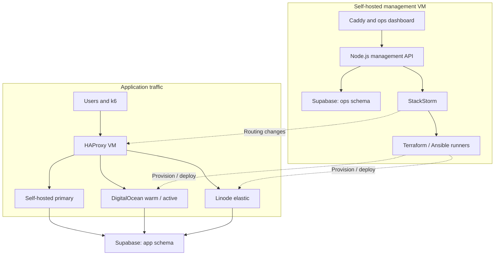

# Architecture

## Topology

| Machine | Hosting | Size | Main containers |
|---|---|---|---|
| Primary app | Self-hosted | Existing fixed size; use comparable 1-vCPU/1-GB demo capacity where applicable | Relief Node.js app serving its frontend |
| Management | Self-hosted | 8 vCPU / 16 GB (62 GB disk) | Caddy, ops frontend/API, StackStorm/dependencies, execution runners, Prometheus, Alertmanager, Grafana |
| Load balancer | Self-hosted | 1 vCPU / 1 GB | HAProxy, ACME client/challenge helper |
| Testing | Self-hosted | 2 vCPU / 2 GB | k6 execution container |
| Warm standby (1) | DigitalOcean by default; Linode as interim if DigitalOcean is unavailable | 1 vCPU / 1 GB | Same relief application image |
| Elastic VMs (up to 5 DigitalOcean + 5 Linode in total, including the warm standby) | DigitalOcean and Linode, alternating | 1 vCPU / 1 GB each | Same relief application image |

All are separate VM roles with public IPs. Physical host diversity is not assumed. Creating additional containers on one physical host does not add physical capacity or provide physical host failure isolation.

## Application traffic

Users access app.cproj.obed.one. DNS points to the HAProxy host. HAProxy terminates public HTTPS and routes to eligible app backends. Baseline traffic goes to the self-hosted primary only.

The warm standby (DigitalOcean by default) is already running, healthy, and ready but initially does not receive normal traffic. On overload it becomes an active peer. If active capacity is still insufficient after the cooldown, StackStorm adds one elastic VM per step, alternating DigitalOcean and Linode and skipping a provider that is at its cap or unavailable, up to 5 per provider; each step is followed by a 60 s cooldown and a CPU re-evaluation. Scale-in removes one elastic VM per step, newest first, never the warm standby and never during a primary outage. On primary failure, the warm standby immediately becomes eligible for all requests and StackStorm ensures exactly one elastic redundancy VM, on the provider that is not the warm provider (or the other one if that provider is at its cap or unavailable). Any further VMs come only from the normal CPU scale-out rules (one per step, cooldown, re-evaluation).

The app and its frontend are packaged together by default. Its API uses the same hostname and /api path. Client sessions/uploads are not kept on an instance; no login sessions or uploaded files are required in the baseline.

### HAProxy health checks and failback

Primary: `inter 10s fall 3 rise 6` on the server line, with `timeout check 4s` in `defaults`/`backend` (detection about 30 s; 60 s healthy before return). Standbys and elastic VMs use rise 2. HAProxy checks only `/health/live` (no DB, cheap, mounted first); `/health/ready` is for the dashboard, Prometheus and StackStorm admission and never removes a backend, so a Supabase outage does not take backends out. Do not use `observe layer7 on-error mark-down` and never `retry-on 503`.

On primary failure `apply_routing` sets the primary to `maint` through the Runtime API so a recovered primary stays out until failback. Server state is persisted with `server-state-file` and `load-server-state-from-file global`, dumping `show servers state` after every runtime change and before reload. Failback: direct probes while in `maint` (60 s continuous), weight 0 set before `state ready`, HAProxy reports UP (rise 6), then 10% -> 50% -> 100% by weights (observe 60 s, 60 s, 120 s), gated on 2 consecutive health successes, fresh samples, 5xx under 1%, p95 under 1.5x baseline and primary CPU under 50%; any gate failure reverses one step. Because `maint` disables HAProxy checks, recovery is first observed by direct probes of the primary (60 s continuous), and `set weight be_app/primary 0` is applied before `state ready`, so the primary admits no traffic until the ramp.

### HAProxy VM single point of failure

The single HAProxy VM is an accepted failure boundary. Manual recovery steps (short DNS TTL on the app record, config/cert backup, Ansible lb role on another host, `curl --resolve` test, repoint the A record, Let's Encrypt rate limits) are in the runbook in docs/15-runbooks.md.

## Management traffic

ops.cproj.obed.one, grafana.cproj.obed.one, stackstorm.cproj.obed.one, and stats.cproj.obed.one resolve to the management VM.

Caddy serves the custom dashboard/API and proxies native UIs. The stats hostname proxies HAProxy's separate statistics endpoint. It does not send management application traffic through the HAProxy application frontend.

Node.js is an application/API layer. It validates and persists requests, invokes authenticated StackStorm APIs, and projects results. It does not run a second autoscaling loop.

## Execution/data boundaries

- Prometheus: measured time series.
- Alertmanager: routing/grouping of operational alerts.
- StackStorm: event rules, workflow execution, task progress and results.
- Terraform: tracked infrastructure ownership/state.
- Ansible: machine configuration and deployment.
- HAProxy: applied traffic topology and backend checks.
- Supabase app schema: protected business data and app idempotency.
- Supabase ops schema: desired state, policy versions, resource slots, incidents, workflow references, backup catalogue.
- Persistent management volumes: StackStorm native databases, metrics, Terraform state, dump files, certificate/configuration material.
- GHCR: versioned application/runner images.

StackStorm requires its own native supporting databases/services; Supabase does not replace them.

## Independence

HAProxy can fail over among configured ready backends while StackStorm is down. It cannot provision missing machines. The custom dashboard and control API remain separate from app traffic, although Supabase is a shared dependency.

When management control state is unavailable, freeze new capacity mutations requiring slot reservations. Keep existing traffic routing and health checks running. Do not treat stale metrics as zero load; freeze CPU scaling only if a serving member is stale or missing (a member HAProxy has confirmed down is removed from membership instead).

The management VM is assumed always available (accepted assumption, see docs/12). Capacity mutations are serialized by a capacity lock with a 120 s lease renewed every 20 s; with up to 10 slots, expect more Terraform/Ansible runs on the 4 GB management VM, but still only one capacity mutation at a time.

## High-level diagram

## Deployment assumptions

Fixed self-hosted machines are pre-created. Bootstrap those hosts with Ansible from a workstation. Terraform owns only the applicable cloud application resources, with one state/workspace per slot (warm slot plus elastic slots per provider) and never deletion by broad tag search; protect the warm slot and fixed resources from automatic cleanup.

Use separate provider state boundaries to permit Linode actions when DigitalOcean's API is unavailable. Provider-specific modules may use different image IDs, instance size IDs, region identifiers, tagging schemes, and startup details behind one action contract.

One HAProxy and one management host are accepted demo failure boundaries. The baseline is application-compute failover plus app-data recovery, not complete multi-region provider-independent recovery.
